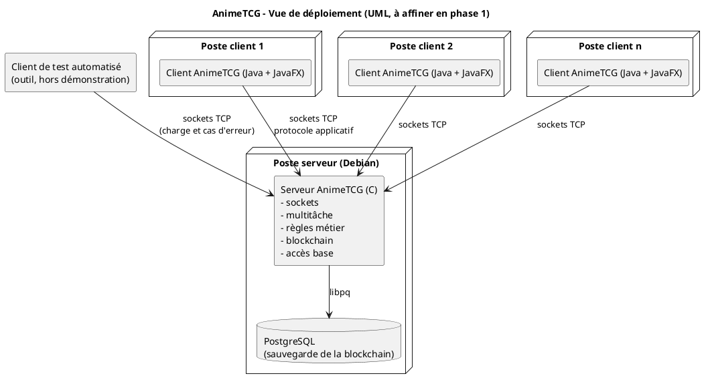

# Cahier des charges — AnimeTCG

**Plateforme de recommandations d'animes par cartes — SAÉ BUT2 S3 — 2026-2027**

| Élément | Valeur |
|---|---|
| Nom de code du projet | **AnimeTCG** — nom **définitif**, retenu par l'équipe le 18/09/2026 (Q8.1). *Le nom provisoire « AniCard » est abandonné.* |
| Nature du document | **Cahier des charges interne** — expression du besoin rédigée par l'équipe pour cadrer son propre projet |
| Version | **0.25** — révision du 14/10/2026 : implémentation autonome du logger C maison (F-LOG-01), catalogue de 70 événements et alignement de la spécification/guide ; la décision historique zlog/rxi est explicitement remplacée par ADR-15. Les appels dans le serveur applicatif restent à intégrer |
| Date | 18 septembre 2026 — **révision du 22/09/2026** (sujet officiel, décisions d'équipe) |
| Équipe | **4 étudiants** — configuration acceptée par l'encadrant ; le sujet officiel prévoit « environ cinq étudiants » (voir §6.1 et §6.2) |
| Encadrant | Johan — ressource **SAÉ 301** (60 % du temps de SAÉ) — **jusqu'au 22/09/2026** (l'équipe décide seule depuis) |
| Dernières validations | **18/09/2026** — 5 points de cadrage, puis 5 points complémentaires. **22/09/2026** — l'équipe n'a plus d'encadrant : les questions qui attendaient une réponse extérieure sont **tranchées en autonomie** (voir `questions-encadrant.md`) |
| Dépôt GitLab | <https://iut-git.unice.fr/sae_but2_grp3_c/sae-301> |
| Livrable aval | Spécification technique, tag `phase1` — échéance : **samedi 10 octobre 2026** |
| Portée | SAÉ projet S3 — 4 phases — évaluation sur 100 points (15 / 40 / 10 / 15 / 20), **une adaptation individuelle de la note est possible** (sujet §13) |

---

## Note de lecture et conventions

Ce document exprime **le besoin** (`le quoi`). Il ne décrit **pas** la conception logicielle : celle-ci relève de la spécification technique (phase 1) et des livrables `phase2` / `phase3`. La pile technologique est donc reléguée en **annexe A, non normative**, et les choix d'architecture n'y figurent qu'à titre d'orientation.

**Décision structurante de l'équipe : le projet est intégralement bâti sur des sockets, de A à Z.** Un seul canal applicatif existe : le socket TCP. Aucun second chemin de communication client ↔ serveur n'est prévu, ni en périmètre ferme, ni en option. Tous les échanges passent par la connexion socket décrite en §5.3, et tout le protocole est conçu, implémenté, testé et documenté sur ce canal unique.

**Documentation et diagrammes : UML** (et non Mermaid), en **PlantUML** — outil validé par l'encadrant, qui « permet une version en fonction de l'avancée de votre code ». La modélisation est **itérative** : sa granularité augmente à mesure que le code est implémenté. Le projet produit **tous les diagrammes UML jugés pertinents, dans la limite de 5 types** — correction apportée par l'encadrant, qui reconnaît que la mention du sujet limitée aux diagrammes de séquence était une erreur. Détail en §5.7.

### Statuts utilisés dans tout le document

| Marqueur | Signification |
|---|---|
| ✅ **Ferme** | Exigence imposée par le sujet de la SAÉ. Non négociable. |
| 🔧 **Proposition** | Choix proposé par le groupe pour combler une ouverture volontaire du sujet. À valider, puis à justifier dans la spécification technique. |
| ⚠️ **À valider** | Point encore ouvert : décision non tranchée. Voir §12 et le `questionnaire-decisions.md`. |
| 🎁 **Bonus** | Hors périmètre minimal. Réalisé uniquement si le temps le permet, sans mettre en risque le périmètre ferme. |

### Conventions d'identifiants

`EF-xx` exigence fonctionnelle · `ENF-xx` exigence non fonctionnelle · `REC-xx` critère de recette · `RQ-xx` risque · `DEC-xx` décision ouverte · `CU-xx` cas d'utilisation du sujet.

### Décisions validées par l'encadrant (18/09/2026)

Cinq points de cadrage ont été soumis à l'encadrant (voir `questions-encadrant.md`). Réponses reçues :

| Point | Réponse | Conséquence dans ce document |
|---|---|---|
| **Domaine métier** (DEC-01) | « Ce choix est libre et me convient parfaitement » — les **œuvres animées japonaises** sont validées | §4.2 confirmé, réserve levée |
| **Difficulté de la preuve de travail** (DEC-20) | La tolérance **3 ou 4** existe pour **s'adapter aux machines** et obtenir la preuve dans un temps acceptable. Aller au-delà (parallélisation, ressources supplémentaires) n'est pas demandé : « vous mettre un défi supplémentaire avant même d'avoir conçu une première version me semble incohérent avec une démarche de production professionnelle ». Une exploration reste possible **en fin de projet**, si tous les objectifs sont satisfaits | **ENF-15 recadrée sur 3 ou 4**, calibrée par mesure ; l'exploration (difficulté supérieure) devient un **bonus conditionnel** — annexe D.1 |
| **Tests et couverture** (O6, O7) | Les notions de couverture seront vues **au S4 en R402, avec SonarQube**. « Partez du principe que vous allez mettre en place vos tests et vérifier la couverture ». Les cibles annoncées sont « cohérentes pour un produit abouti », mais **se voient en phase 3, après un premier prototype**. **Choix des outils libre** | Objectifs O6/O7 **repositionnés en phase 3** ; mise en place des tests dès la phase 2 ; outillage libre — annexe D.4 |
| **Diagrammes UML** (O9) | **PlantUML validé**. Modélisation **itérative** à granularité croissante. Au premier rendu : exprimer le cahier des charges **+ les fonctionnalités singulières du projet**. Correction : **tous les diagrammes jugés pertinents, dans la limite de 5 types** | §5.7 restructurée : **5 types maximum**, PlantUML, contenu de phase 1 précisé |
| **Ressources** (H8, DEC-17) | Groupe de **4 étudiants accepté** (4 à 5 requis). Le temps total de SAÉ se répartit entre les trois ressources SAÉ ; **la ressource SAÉ 301 compte pour 60 %** de ce temps | DEC-17 validé ; H8 précisée ; §6.2 recadrée |
| **Dates des phases** (R4) | ⚠️ **Recadrées par le sujet officiel 2026-2027** : phase 1 jusqu'au **10/10/2026**, phase 2 du **12/10 au 18/12/2026**, phase 3 du **4 au 15/01/2027**, phase 4 du **18 au 21/01/2027** (le sujet imprimé indique « 10/10/25 », année manifestement erronée) | §7.1 recalculé ; le lot L2 se décale d'une semaine |
| **Client automatique / bot** (R10, DEC-14) | Le bot sert **uniquement aux tests** — il est écarté de la démonstration et du reste | **DEC-14 tranchée : option du sujet écartée.** Le bot devient un **outil de test hors périmètre fonctionnel** ; suppression de la pondération 0,5, des étapes de démonstration et du bonus associé |
| **Podman** (R12) | **Accepté**, sans contrainte particulière | Annexe A.4 : conteneurisation autorisée ; exécution native également valable |
| **Intégration continue** (R16) | **Oui**, des runners CI sont disponibles sur l'instance GitLab | Nouvelle exigence **ENF-49** : pipeline de compilation et de tests à chaque push |
| **Architecture** (R17) | « Il faut suivre le **MVC** » | **ENF-50** : l'application cliente est structurée en **MVC** — le patron passe d'orientation à exigence ; arborescence du dépôt alignée |
| **Périmètre fonctionnel** (CU-20) | ⚠️ **Réintégré** : le sujet officiel 2026-2027 liste explicitement le service et le cas d'usage « **authentifier une carte** » (§3, §5.5, CU-20) et l'**exige en démonstration** (§12.1). La consigne orale du 18/09/2026 (« on s'en fiche ») est **supplantée par le sujet écrit** ; l'écart est signalé à l'encadrant (**R19**) | **CU-20, EF-20 et DEC-24 réintégrés** (§3.2, §4.7.3) : cas d'usage, action de protocole `card.authenticate`, règle métier, inscription en chaîne, IHM, test et démonstration |
| **Barème détaillé** (R1) | ✅ **Tranché le 22/09/2026 (décision d'équipe)** : le **barème du sujet s'applique au mot** (15 / 40 / 10 / 15 / 20) ; la grille interne du « dépôt exploitable » est écrite en **I9/I13** | Plus aucun point d'attente (§13) |

> ✅ **Fait le 22/09/2026** : le cahier des charges officiel (sujet 2026-2027) a été **relu ligne à ligne** et nos documents resynchronisés — **20 écarts** relevés et traités, détail dans `docs/diff-sujet-2026.md` (**I12 clos**).

> **Ajout de l'équipe (18/09/2026)** — **Calibrage automatique de la difficulté de preuve de travail** (§5.2.1, ENF-51 à ENF-53). L'encadrant a indiqué que « la tolérance 3 ou 4 est justement pour permettre de s'adapter aux machines » : l'équipe en fait un **mécanisme mesuré**, et non un paramètre écrit en dur. Le serveur mesure son propre débit SHA-256 au démarrage, choisit la difficulté dans les bornes {3, 4}, et réévalue si la charge change. Aucune parallélisation, aucune montée au-delà de 4 : ce mécanisme **mesure** la machine pour **choisir** une difficulté démontrable.

---

## Sommaire

1. [Étape 1 — Description de l'état actuel](#1-étape-1--description-de-létat-actuel)
2. [Étape 2 — Objectif du projet](#2-étape-2--objectif-du-projet)
3. [Étape 3 — Périmètre du projet](#3-étape-3--périmètre-du-projet)
4. [Étape 4 — Spécifications fonctionnelles](#4-étape-4--spécifications-fonctionnelles)
5. [Étape 5 — Spécifications techniques (exigences non fonctionnelles)](#5-étape-5--spécifications-techniques-exigences-non-fonctionnelles)
6. [Étape 6 — Ressources](#6-étape-6--ressources)
7. [Étape 7 — Délais](#7-étape-7--délais)
8. [Étape 8 — Besoins financiers et budget](#8-étape-8--besoins-financiers-et-budget)
9. [Critères de recette et de démonstration](#9-critères-de-recette-et-de-démonstration)
10. [Risques et parades](#10-risques-et-parades)
11. [Traçabilité](#11-traçabilité)
12. [Grille de décision — ouvertures volontaires du sujet](#12-grille-de-décision--ouvertures-volontaires-du-sujet)
13. [Informations et décisions encore attendues](#13-informations-et-décisions-encore-attendues)
14. [Annexe A — Pile technologique (non normative)](#annexe-a--pile-technologique-non-normative)
15. [Annexe B — Glossaire](#annexe-b--glossaire)
16. [Annexe C — Références](#annexe-c--références)
17. [Annexe D — Paramètres chiffrés : valeurs retenues et méthode de calibrage](#annexe-d--paramètres-chiffrés--valeurs-retenues-et-méthode-de-calibrage)
18. [Annexe E — Passage à l'échelle : servir beaucoup plus d'utilisateurs](#annexe-e--passage-à-léchelle--servir-beaucoup-plus-dutilisateurs)

---

## 1. Étape 1 — Description de l'état actuel

### 1.1. Pourquoi ce projet existe

Dans le cadre de la SAÉ du semestre 3, l'équipe doit concevoir et développer **AnimeTCG**, une plateforme de recommandations **d'animes** structurée autour de cartes, en architecture client-serveur. Le sujet impose une difficulté technique réelle (sockets, multitâche, cryptographie appliquée, base de données relationnelle, interface graphique) et une exigence de qualité logicielle (tests, documentation, versioning, démonstration).

Il n'existe pas de système préexistant à remplacer : l'« existant » est constitué des compétences acquises aux semestres précédents, du parc de l'IUT et du dépôt GitLab de l'équipe. Le sujet fixe les concepts fonctionnels (carte, recommandation, battle, légitimation, revendication) et laisse volontairement ouverts de nombreux paramètres métier, que le groupe tranche en §12.

### 1.2. Le domaine métier retenu : l'anime

Une **carte** d'AnimeTCG représente une **œuvre animée japonaise** : série TV, film, OVA, ONA ou spécial. Une carte décrit l'œuvre par ses métadonnées (titres, studio, année, saison, format, genres, thèmes, source, synopsis).

Ce domaine a été retenu parce qu'il offre :

- une **description métier riche mais bornée** — les métadonnées d'anime sont standardisées et stables (titre romanisé / anglais / natif, format, épisodes, studio, genres, thèmes, saison, source) ;
- des **relations de proximité naturelles et crédibles** : franchise commune, remake, film dérivé, même studio, mêmes genres et thèmes, proximité d'époque. Une battle entre deux cartes est donc justifiable devant un jury ;
- une **communauté** qui pratique spontanément le classement, la comparaison et la recommandation — le besoin métier est intuitif ;
- **aucune donnée sensible** : pas d'identité réelle, pas de donnée personnelle, pas de contenu protégé reproduit (les cartes ne contiennent que des métadonnées factuelles et un synopsis court saisi par l'utilisateur).

### 1.3. Contexte technique actuel

| Élément | État |
|---|---|
| Environnement d'exécution | Linux **Debian** (postes de l'IUT et salle de projet) |
| Conteneurisation | **Podman** (Docker indisponible sur le parc) |
| SGBD | **PostgreSQL** installé localement |
| Versioning | **Git**, dépôt GitLab de l'établissement — <https://iut-git.unice.fr/sae_but2_grp3_c/sae-301>, tags `phase1` → `phase4` |
| Langages imposés | **C** (serveur + tests serveur), **Java** (clients + GUI + tests clients) |
| Bibliothèques pressenties | **OpenSSL** (hachage), **libpq** (accès PostgreSQL), **JavaFX**, **JUnit** ; hors liste du sujet : **jansson** (JSON C), **SLF4J + Logback** (journal Java), **gcovr/JaCoCo** (couverture) — **déclarées** avec repli documenté. Le serveur utilise un **logger C maison**, sans moteur tiers ; **la boucle d'événements est écrite à la main (`epoll`)** |
| Outils de build | Makefile (C), Maven (Java) |
| Diagrammes | **UML** (PlantUML versionné + outil graphique au choix) |
| Outils de documentation | Markdown, GitLab, chaîne documentaire |

### 1.4. Contexte humain

Équipe de **4 étudiants** — configuration **acceptée par l'encadrant** (les groupes doivent compter 4 à 5 étudiants). Le volume horaire dédié à cette ressource SAÉ 301 est **irrégulier et partagé** : **≈ 72 h par étudiant** selon le sujet officiel 2026-2027 (120 h × 60 %, H8), mais l'encadrant a prévenu qu'il est **variable et non garanti** et que les trois projets avancent en parallèle sur les mêmes créneaux. Le sujet prévoit une **note de groupe** adaptée individuellement selon l'implication et la maîtrise du projet : la répartition des rôles et la traçabilité des contributions sont donc des enjeux de premier ordre, au même titre que la technique.

**Conséquence directe de cette contrainte de temps :** le périmètre ferme est prioritaire en toutes circonstances, et les éléments bonus (§3.3) ne sont ouverts qu'après validation du périmètre ferme.

### 1.5. Contexte réglementaire et éthique

- Aucune donnée personnelle réelle : les identités des utilisateurs sont **fictives et internes au projet**. La légitimation est **simulée** ✅.
- La « blockchain » du projet est **privée, locale et pédagogique** : aucune cryptomonnaie, aucune valeur financière.
- Les cartes ne reproduisent **aucun contenu protégé** : uniquement des métadonnées factuelles et un synopsis court.
- Les composants logiciels utilisés sont libres ou fournis par l'établissement.
- Les commentaires de code livrés sont **en anglais** ✅ (contrainte de qualité de la phase 3).

### 1.6. Situation cible en une phrase

À l'issue du projet, un serveur unique écrit en C accepte plusieurs clients JavaFX simultanés **par sockets**, exécute leurs actions métier en parallèle sans jamais se bloquer, inscrit chaque action validée dans une blockchain privée avec preuve de travail, sauvegarde cette blockchain dans PostgreSQL, et sait restaurer l'intégralité de son contexte de travail après redémarrage — le tout démontré en direct devant le jury.

---

## 2. Étape 2 — Objectif du projet

### 2.1. Objectifs du projet

**Objectifs fonctionnels**

1. Offrir une plateforme où des utilisateurs créent des cartes d'animes, se recommandent mutuellement, confrontent leurs cartes en battles et font reconnaître la légitimité de leur point de vue sur une œuvre.
2. Garantir la **traçabilité et l'intégrité** de toutes les actions validées par une blockchain privée simplifiée.

**Objectifs pédagogiques et techniques**

1. Maîtriser une **architecture client-serveur réelle** : sockets, protocole applicatif, concurrence, cycle de vie des connexions.
2. Comprendre par la pratique une **blockchain** : hachage, chaînage, preuve de travail, immuabilité, détection de fraude.
3. Produire un logiciel **de qualité professionnelle** : tests, documentation UML, conventions, revue, versioning.
4. Travailler en **équipe de 4** : répartition, planning, intégration continue des contributions, démonstration orale.
5. Livrer une **base technique réutilisable** : socle serveur C multitâche, couche d'accès PostgreSQL, client JavaFX.

### 2.2. Objectifs mesurables

🔧 Cibles proposées par l'équipe, servant de critères d'auto-évaluation (§9). Les lignes marquées 🧑🏫 ont été **recadrées ou validées par l'encadrant le 18/09/2026**.

| # | Objectif mesurable | Cible | Vérification |
|---|---|---|---|
| O1 | Toutes les fonctionnalités obligatoires du sujet sont démontrables | **10 actions du §6 du sujet sur 10**, **authentification comprise** (rétablie le 22/09/2026, §4.7.3) | Scénario de démonstration §9.2 |
| O2 | Clients simultanés supportés sans blocage | **100** clients connectés simultanés (limite serveur, DEC-13) ; au-delà, **mise en file d'attente** et admission automatique dès qu'une place se libère ; ≥ 4 clients humains en démonstration | REC-03, REC-05, annexe D.2 |
| O3 🧑🏫 | Temps de minage d'un bloc, à la difficulté **auto-calibrée** sur la machine d'exécution | Difficulté choisie dans **{3, 4}**, temps de minage dans la fourchette **0,3 s – 2 s**, hachages/nonce/durée **journalisés et affichés** | REC-06, REC-15, annexe D.1 |
| O4 | Restauration du contexte après arrêt puis redémarrage à chaud | Fidélité **100 %** sur le jeu de démo, ≤ **10 s** pour ≤ 1 000 blocs | REC-04 |
| O5 | Détection d'une altération frauduleuse en base | **100 %** des scénarios d'altération testés | REC-07 |
| O6 🧑🏫 | Couverture de tests — **objectif de phase 3**, mesuré sur un premier prototype fonctionnel | **≥ 60 %** global, **≥ 80 %** sur les modules critiques (blockchain, validation, protocole) ; outils retenus par l'équipe : **`gcov`+`gcovr`** (C), **JaCoCo** (Java) ; sujet de fond étudié en R402/S4 avec SonarQube | Rapport de couverture produit en phase 3 |
| O7 🧑🏫 | Taille de la suite de tests — **mise en place dès la phase 2**, consolidée en phase 3 | ≥ **30 tests** côté serveur C, ≥ **15 tests** côté client Java | Exécution + rapport |
| O8 | Qualité de code | 0 fonction > 200 lignes, 100 % des commentaires en anglais, en-têtes présents | Contrôle automatique + revue croisée |
| O9 🧑🏫 | Documentation | Spécification technique complète ; **tous les diagrammes UML jugés pertinents, dans la limite de 5 types**, conformes au code livré et à granularité croissante ; Gantt à jour | Revue de livrable |
| O10 | Aucune perte de données | Aucun bloc validé perdu après arrêt propre ou brutal | REC-04, REC-08 |
| O11 | Note de groupe visée | ≥ **70 / 100** | Barème de la SAÉ, §12 du sujet |
| O12 🆕 | **Adaptabilité démontrable** : le serveur s'ajuste à la puissance de la machine au lieu d'être paramétré | Deux environnements de puissance différente → **deux difficultés différentes choisies automatiquement**, chacune restant dans la cible de temps | REC-15 : conteneur Podman bridé (`--cpus=0.5`) vs exécution native |

### 2.3. Indicateurs de performance du projet

| Indicateur | Valeur cible 🔧 |
|---|---|
| Nombre de blocs nécessaires au scénario de démonstration | ≤ 60 blocs |
| Latence perçue d'une action simple (recommandation, vote) | ≤ 500 ms **hors minage** |
| Clients connectés simultanés | **100** (limite serveur) — au-delà, file d'attente FIFO bornée (ENF-54) |
| Taille maximale d'un message applicatif | 64 Kio (ENF-23) |
| Durée de la présentation | 15 à 20 min, parole équilibrée entre les 4 membres |
| Durée de la démonstration | 10 à 15 min |
| Coût du projet | **0 €** (§8) |

---

## 3. Étape 3 — Périmètre du projet

### 3.1. Dans le périmètre (livrables obligatoires) ✅

| Domaine | Contenu |
|---|---|
| **Serveur** | Processus unique en C, communication **par sockets**, multitâche (processus **ou** threads), validation des demandes, inscription dans la blockchain, sauvegarde PostgreSQL, restauration du contexte, vérification de cohérence, arrêt propre. |
| **Blockchain** | Chaîne privée simplifiée codée par l'équipe : bloc genesis, identifiant, timestamp, données d'action, hash précédent, nonce, hash courant, SHA-256, preuve de travail par zéros en tête, vérification d'intégrité. |
| **Base de données** | Schéma PostgreSQL relationnel défini par le groupe ; écriture et lecture par le serveur uniquement. **Livré** : `sql/schema.sql` + `docs/uml/12-modele-relationnel.puml`. |
| **Clients** | Clients Java communiquant **par sockets**, GUI **JavaFX** : création de carte, actions principales, affichages obligatoires (§4.10). |
| **Protocole** | Un protocole applicatif **propre au projet**, défini sur les sockets, documenté en phase 1 — **`docs/protocole-applicatif.md`** (**v1.1**, 22/09/2026). C'est **le document de référence** : actions, événements, codes d'erreur et cas limites y sont définis, le reste du dossier ne fait que s'y référer. |
| **Tests** | **Un test pour chaque nouvelle fonctionnalité ou fonction créée** (règle de définition de fini, Q7.3), plus des tests unitaires et d'intégration côté C et côté Java, exécutés automatiquement par le **pipeline CI** (ENF-49) : **≥ 30 tests C**, **≥ 15 tests Java**, **≥ 5 scénarios bout en bout**, dont **un test d'altération d'un bloc** et **un test d'altération de la difficulté** démontrant la détection d'anomalie d'intégrité. Un **rapport de couverture** est produit avec le livrable de phase 3. |
| **Documentation** | Ce cahier des charges, la spécification technique phase 1 et sa mise à jour phase 3, les **diagrammes UML** (cas d'utilisation, classes, séquence, états) conformes au code, un **diagramme de Gantt**, le support de présentation phase 4. |
| **Processus** | Dépôt GitLab organisé, tags `phase1` → `phase4`, code commenté en anglais, aucune fonction > 200 lignes. |

### 3.2. Hors périmètre (explicitement exclu) ✅

| Exclusion | Motif |
|---|---|
| **Tout canal de communication autre que le socket** : serveur web embarqué, interface d'administration web, interface d'observation réseau | **Décision de l'équipe : la plateforme est intégralement bâtie sur sockets, de A à Z.** Un seul canal applicatif, donc un seul protocole à concevoir, implémenter, tester et documenter. Y compris en bonus. |
| **Client automatique (bot) comme participant *aux actions métier*** — ⚠️ **nuancé le 22/09/2026** | **Option laissée libre par le sujet** ; l'équipe retient un **bot de test** et un **bot de maintenance** (réponse Q5.1). Il n'est **pas** un acteur métier : **ses votes ne comptent pas dans le quorum** en production, il ne contribue pas à la valeur d'une carte. **En revanche il est affiché** dans la liste des utilisateurs connectés **avec un marqueur distinct** — c'est la condition posée par le sujet (CU-24 : un client automatique doit être distinguable des humains). Détail : **DEC-14**. Le sujet précise que s'il existe, ses actions doivent être **distinguables de celles d'un humain** — c'est le cas du **client de test** de `tests/client_de_test/`, qui n'est **pas** un utilisateur de la plateforme. Un **client de test automatisé**, hors démonstration, reste possible pour la charge et les tests (voir §3.3). |
| Application web, application mobile, client navigateur | Le périmètre minimal est : clients Java + GUI JavaFX. |
| Vérification d'identité réelle des utilisateurs, comptes authentifiés, données personnelles réelles | Le sujet impose une légitimation **simulée / interne** : aucune vérification d'identité réelle n'est demandée. |
| ~~Authentification des cartes~~ | **Réintégrée au périmètre** (sujet officiel 2026-2027, CU-20 + §12.1 de la démonstration) — règles complètes en **§4.7.3** (DEC-24). Voir la note d'écart en tête de ce tableau. |
| Monétisation, cryptomonnaie, jetons échangeables, smart contracts | La blockchain du projet est pédagogique et privée. |
| Manga, light novel, roman, jeux vidéo comme objet de carte | L'objet retenu est l'**œuvre animée** (DEC-01). Extensible plus tard, mais hors périmètre. |
| Modération de contenu, détection d'abus, signalement | Non demandé par le sujet. |
| Moteur de recommandation algorithmique (machine learning, filtrage collaboratif) | La valeur d'une carte est définie par des règles simples explicites (§4.6). |
| Déploiement en production, haute disponibilité, réplication, orchestration Kubernetes | Hors cadre de la SAÉ (Podman sert seulement à uniformiser l'environnement). Les leviers de montée en charge sont étudiés et documentés, mais **non implémentés** : voir **annexe E**. |
| Chiffrement des communications (TLS) et gestion de certificats | Non demandé ; usage local. |
| Persistance locale côté client | Le client est un client léger ; la vérité est toujours côté serveur. |
| Catalogue d'animes connecté à une API externe (MyAnimeList, AniList, Jikan) | Les cartes sont saisies par les utilisateurs à partir d'un jeu de données de démonstration embarqué. Aucune dépendance réseau externe. |

### 3.3. Extensions optionnelles (bonus) 🎁

Réalisables **uniquement** après que le périmètre ferme est intégré, testé et démontrable :

1. **Client de test automatisé** — programme de test (et non un utilisateur) capable de se connecter, de créer des cartes de test et d'envoyer des actions en rafale pour **vérifier la tenue du serveur multitâche**. Il n'apparaît **pas** dans la démonstration, ses actions ne comptent **pas** dans la valeur des cartes et ne participent à aucun vote ni quorum. C'est un outil de test, pas une fonctionnalité (DEC-14).
2. ~~**Partage ciblé**~~ ✅ **PASSÉ DANS LE PÉRIMÈTRE** le 22/09/2026 (réponse Q5.2 : *« oui »*) — règles complètes en **§4.8**, onglet `Amis`, action de protocole dédiée. Ce n'est plus un bonus.
3. **Conteneurisation Podman** — image reproductible du serveur + scripts de lancement pour la démonstration.
4. **Journalisation structurée + affichage d'un journal live** — fluidifie la démonstration et le diagnostic.

> Aucun bonus n'ouvre de second canal de communication : tous les bonus s'appuient sur le même socket et le même protocole (§3.2).

### 3.4. Hypothèses

| # | Hypothèse |
|---|---|
| H1 | Un poste **Debian** et l'instance **PostgreSQL de `linserv-info-01`** (LAN de l'IUT, cf. sujet §10) sont accessibles pour le développement et la démonstration ; à défaut, PostgreSQL local via Podman |
| H2 | Les 4 membres disposent d'un accès au dépôt GitLab et peuvent travailler de façon régulière, malgré un volume horaire faible. |
| H3 | Les bibliothèques de la **liste officielle** (**OpenSSL**, **libpq**, interfaces POSIX de R305, **JavaFX**, **JUnit**) sont disponibles sur le parc. Les bibliothèques **hors liste** retenues (jansson, SLF4J/Logback, gcovr/JaCoCo) sont **déclarées et justifiées** par l'équipe, avec les replis pertinents documentés (ENF-59, §5.9.1) ; aucune autorisation extérieure n'est à demander selon la décision de l'équipe du 22/09. Le logger C maison n'ajoute pas de bibliothèque externe |
| H4 | Le réseau local autorise les connexions socket entre le poste serveur et les postes clients (y compris depuis Podman). |
| H5 | Un jeu de données de démonstration (animes réels, métadonnées factuelles) et un **jeu d'images dont la licence autorise l'usage** (avec crédits) peuvent être préparés à l'avance (ENF-60, sujet §10 « Les clients ») |
| H6 | Aucun pare-feu ni proxy ne bloque le port applicatif choisi. |
| H7 | Les choix métier de **§12** sont validés **par l'équipe** avant la fin de la phase 1 (l'encadrant n'est plus disponible depuis le 22/09/2026 : la validation devient interne et **tracée** dans ce cahier des charges) |
| H8 | **Volume horaire** : le sujet officiel 2026-2027 annonce **120 h de travail par étudiant** (≈ 600 h pour un groupe de cinq), à répartir entre les trois projets, la **SAÉ projet comptant pour 60 %** → **≈ 72 h par étudiant** pour notre projet, soit **≈ 288 h pour un groupe de 4**. L'équipe conserve la réserve du 18/09 (**volume variable et non garanti**, Q8.3) : c'est une **hypothèse de planification**, pas une promesse — décision d'équipe du **22/09/2026** (R3/I14, faute de pouvoir la confirmer : plus d'encadrant) |
| H9 | La limite `ulimit -n` et le backlog du poste de démonstration sont suffisants (vérifié en phase 2, voir annexe D). |

### 3.5. Contraintes

| # | Contrainte | Nature |
|---|---|---|
| C1 | Langage **C** imposé pour le serveur, **Java** imposé pour les clients | Technique, ferme |
| C2 | Communication par **sockets obligatoire** — et, par décision de l'équipe, **exclusivement** par sockets | Technique, ferme |
| C3 | **SHA-256** et **preuve de travail** obligatoires | Technique, ferme |
| C4 | **PostgreSQL** obligatoire pour la sauvegarde | Technique, ferme |
| C5 | **JavaFX** obligatoire pour la GUI | Technique, ferme |
| C6 | Aucune fonction > 200 lignes ; commentaires **et en-têtes de documentation en anglais**, y compris dans les tests ; découpage par responsabilités (sujet §11) | Qualité, ferme |
| C7 | Dépôt GitLab avec tags `phase1` … `phase4` | Processus, ferme |
| C8 | Échéances (sujet officiel) : **10/10/2026**, **18/12/2026**, **15/01/2027**, **18–21/01/2027** | Calendaire, ferme |
| C9 | Parc IUT sans Docker → **Podman** uniquement | Environnement, ferme |
| C10 | Équipe de **4 personnes** (configuration acceptée par l'encadrant ; le sujet prévoit « environ cinq étudiants »), enveloppe **≈ 72 h/étudiant** pour la SAÉ projet, charge réelle irrégulière (H8) | Ressources, ferme |
| C11 | Le serveur ne doit **jamais** être bloqué par le traitement d'une demande ni par un calcul cryptographique | Technique, ferme |
| C12 | Les clients n'accèdent **jamais** directement à la base de données | Architecture, ferme |

---

## 4. Étape 4 — Spécifications fonctionnelles

Cette étape définit les **concepts métier, les règles et les résultats attendus**. Les structures de données précises, les diagrammes de séquence et le protocole applicatif détaillé sont produits en phase 1 dans la spécification technique.

### 4.1. Acteurs et rôles

| Acteur | Description |
|---|---|
| **Utilisateur** | Client humain connecté, identifié par un identifiant unique. Crée des cartes, recommande, vote, se légitime, revendique. |
| **Créateur** | Utilisateur ayant créé une carte — attribut **immuable** de la carte. |
| **Propriétaire courant** | Utilisateur à qui appartient la carte à un instant donné. Par défaut, le créateur. |
| **Porteur légitime** | Utilisateur reconnu comme légitime vis-à-vis de l'œuvre décrite par la carte (processus simulé). |
| **Client de test (outil, hors périmètre fonctionnel)** | Programme de test qui se connecte au serveur pour éprouver le multitâche et les cas d'erreur. Il n'est **pas** un acteur métier : il n'apparaît pas dans la démonstration, ne vote pas et n'entre dans aucun calcul de valeur. |
| **Serveur** | Autorité unique : valide ou refuse, inscrit les actions validées dans la blockchain, persiste en base, arbitre les battles. |

### 4.2. Concept : la carte ✅

Une carte représente une **œuvre animée japonaise**. Nature de l'objet = ouverture volontaire du sujet, tranchée ici (DEC-01) et **validée par l'encadrant le 18/09/2026** (« ce choix est libre et me convient parfaitement »).

**Composants d'une carte** ✅ *(réponse de l'équipe au questionnaire, Q1.1)* : **titre, personnages, lieux, objets, thèmes et liens personnels** (amour, rivalité, maître/apprenti, famille). Les quatre derniers sont des **listes** rattachées à la carte — ils décrivent l'œuvre et alimentent l'affichage ; ils n'entrent ni dans la proximité (§4.5.1) ni dans la valeur (§4.6)..

**Contenu minimal imposé** ✅ : identifiant unique, propriétaire courant, créateur, statut, données décrivant l'objet recommandé.

#### 4.2.1. Champs d'une carte 🔧 (DEC-02)

> ✅ **Réponse de l'équipe (Q1.2)** : **11 champs obligatoires** — `card_id`, `title_carte` (notre `title_romaji`), `sources_id` (notre `source`), `format`, `year`, `genres`, `themes`, `creator_id`, `owner_id`, `status`, `created_at`. Les autres champs de la table ci-dessous restent **facultatifs**. `genres` porte le **style / l'audience** (shojo, seinen…), `themes` porte **le sujet de l'histoire**.

| Champ | Description | Obligatoire |
|---|---|---|
| `card_id` | Identifiant unique **généré par le serveur** à la création, référencé dans la blockchain | ✅ |
| `title_romaji` | Titre romanisé (ex. *Shingeki no Kyojin*) | ✅ |
| `title_english` | Titre anglais ou français (ex. *L'Attaque des Titans*) | Non |
| `title_native` | Titre original japonais | Non |
| `format` | `TV`, `MOVIE`, `OVA`, `ONA`, `SPECIAL` | ✅ |
| `studio` | Studio d'animation principal (ex. *Kyoto Animation*, *MAPPA*, *ufotable*) | Non *(réponse Q1.2)* |
| `year` | Année de première diffusion | ✅ |
| `season` | `HIVER`, `PRINTEMPS`, `ETE`, `AUTOMNE` | Non |
| `episodes` | Nombre d'épisodes (`-1` si inconnu / en cours) | Non *(réponse Q1.2)* |
| `duration_min` | Durée moyenne d'un épisode, en minutes | Non |
| `genres` | Liste de genres, **au moins 1**, issus d'une liste fermée (action, aventure, comédie, drame, fantasy, horreur, mystère, romance, science-fiction, slice of life, sport, thriller…) | ✅ |
| `themes` | Liste de thèmes, **au moins 1**, liste fermée (isekai, mecha, school, sports, supernatural, military, music, historical, psychological…) — *« l'histoire »* | ✅ *(réponse Q1.2)* |
| `source` | Matériau d'origine (*`sources_id`* dans la réponse de l'équipe) : `MANGA`, `LIGHT_NOVEL`, `ORIGINAL`, `JEU`, `AUTRE` | ✅ *(réponse Q1.2)* |
| `franchise` | Nom de la franchise ou de la saga (ex. *Fate*, *Gundam*, *Monogatari*) — **clé du critère de proximité n° 1** | Non |
| `synopsis` | Description libre, **500 caractères maximum** | Non |
| `rating` | Note déclarative sur 10, saisie par le créateur | Non |
| `creator_id` | Utilisateur créateur — **immuable** | ✅ |
| `owner_id` | Propriétaire courant — **mutable** par revendication | ✅ |
| `status` | `ACTIVE`, `EN_BATTLE`, `INACTIVE`, `ARCHIVEE` (voir §4.4) | ✅ |
| `created_at` | Horodatage de création | ✅ |

#### 4.2.2. Règles de création 🔧

- `card_id` est généré **côté serveur** au moment de la création — jamais par le client ✅.
- Une création est acceptée si les champs obligatoires sont présents, non vides, bien typés, si `genres` contient au moins un élément de la liste fermée, si `year` est compris entre **1950** et **année courante + 1**, et si `episodes ≥ -1`.
- **Nombre maximum de cartes actives par utilisateur : 100** ✅ *(réponse Q1.4 — la limite de 10 de la version précédente est remplacée)*. Une carte est **active** si elle est **mise au public**, **en deck** et **stockée côté serveur**. Le dépassement entraîne un **refus explicite** (`1001 CARD_LIMIT_REACHED`) — jamais une suppression — **et le client propose immédiatement de désactiver une des 100 cartes actives** ✅ *(réponse Q1.4, question liée)*. Une carte se désactive **par l'utilisateur** ou **par une défaite en combat** (elle est alors **archivée**, §4.4). Le dépassement entraîne un **refus explicite**, jamais une suppression de données.
- **Les doublons sont autorisés** ✅ *(réponse Q1.3 : « on garde les doublons »)* : deux cartes peuvent porter le même titre, la même année et le même studio. Motifs donnés : les **battles** ont besoin de plusieurs cartes de la même œuvre, et les **collections** des nouveaux joueurs en dépendent. **Aucune contrainte d'unicité** n'est posée sur (titre, année, studio).
- Une carte créée est `ACTIVE` et appartient à son créateur.
- Toute création validée est **inscrite dans la blockchain**.

### 4.3. Concept : la recommandation ✅

Une recommandation est une **action de soutien à une carte** (équivalent d'un *like*) donnée par un utilisateur connecté sur une carte **active et visible**.

- Elle contribue à la **valeur active** de la carte (§4.6).
- Elle fait apparaître la carte dans l'espace personnel « Mes recommandations » de l'utilisateur.
- Un utilisateur **répudie** une recommandation qu'il avait donnée : elle cesse de compter dans la valeur active, mais son **historique reste dans la blockchain** ✅.
- 🔧 Un utilisateur ne peut recommander **qu'une seule fois** une carte donnée. Répudier puis recommander à nouveau est autorisé et journalisé comme deux transactions distinctes.
- 🔧 Recommander **sa propre carte** est autorisé mais **pèse 0,5** au lieu de 1 dans la valeur active (anti-auto-promotion).
- Le **partage ciblé** est un mécanisme **distinct** de la recommandation : il transmet l'existence d'une carte, il n'en augmente pas la valeur ✅.

### 4.4. Machine à états d'une carte 🔧

Diagramme d'états **UML** — produit : source `docs/uml/03-etats-carte.puml`, exports SVG/PNG dans `docs/uml/exports/`. Contenu :

| État | Recommandable | Peut lancer/rejoindre une battle | Visible dans les listes |
|---|---|---|---|
| `ACTIVE` | Oui | Oui | Oui |
| `EN_BATTLE` | Oui (les nouvelles recommandations sont comptées) | Non (déjà engagée) | Oui, signalée |
| `INACTIVE` | Non | Non | Oui, grisée |
| **`ARCHIVEE`** ✅ | Non | Non | **Non — la carte n'est plus affichée** (elle apparaît seulement dans l'historique, avec un visuel distinct) |

**Transitions attendues** :

| De | Vers | Déclencheur |
|---|---|---|
| — | `ACTIVE` | Création validée (EF-11) |
| `ACTIVE` | `EN_BATTLE` | Battle acceptée (EF-15) |
| `EN_BATTLE` | `ACTIVE` | Battle **annulée** : quorum non atteint **ou aucun vote** (les cartes sont rendues) |
| `EN_BATTLE` | `ACTIVE` | La carte gagne la battle (EF-17) |
| `EN_BATTLE` | **`ARCHIVEE`** | La carte perd la battle (EF-17) — archivage **définitif** ✅ *(réponse Q2.6)* |
| `ACTIVE` | `INACTIVE` | Répudiation massive, critère défini par le groupe, ou demande d'un utilisateur légitimé (EF-21) |
| `INACTIVE` | `ACTIVE` | Réactivation selon une **règle explicite** 🔧 |
| `ACTIVE` | **`ARCHIVEE`** | **Défaite en battle** (EF-17) ; une carte **archivée ne revient pas** ✅ *(réponse Q2.6)* |

**Deux sorties distinctes de la circulation** ✅ *(réponses Q1.4 et Q2.6, **confirmées le 22/09/2026**)* : **`INACTIVE`** = choisi par l'utilisateur (retour possible) ; **`ARCHIVEE`** = conséquence d'une défaite (définitif, la carte n'est plus affichée).

Aucune transition ne supprime l'historique : les blocs antérieurs restent dans la blockchain ✅.

### 4.5. Concept : la battle ✅

Une battle est une **confrontation entre deux cartes actives** portant sur le même anime ou sur des animes suffisamment proches.

**Chaîne fonctionnelle** :
1. Un utilisateur déclenche la battle.
2. Le serveur vérifie les **critères de proximité** (§4.5.1) et l'acceptabilité de la demande.
3. La battle acceptée est **inscrite dans la blockchain**.
4. Les utilisateurs **connectés** votent pendant une durée définie 🔧.
5. Le serveur détermine la **carte gagnante** selon une règle explicite.
6. La gagnante **récupère les recommandations actives** de la perdante et **compte une victoire** ; la perdante est **archivée** (`ARCHIVEE`) et **n'est plus affichée**.
7. Le résultat validé est **inscrit dans la blockchain**.

#### 4.5.1. Critères de proximité 🔧 (DEC-03)

✅ **Réponse de l'équipe (Q2.1)** : **deux critères** — ils **remplacent P1 à P5** :

| # | Critère | Règle | Exemple |
|---|---|---|---|
| **P1** | **Titre de la carte** | Égalité **sans tenir compte de la casse** (normalisation : minuscules, espaces et ponctuation réduits) | *Hunter x Hunter* vs *HUNTER X HUNTER* |
| **P2** | **Format** | Formats **identiques** (`TV` avec `TV`, `MOVIE` avec `MOVIE`…) | Une série contre une série |

**Combinaison** : **l'un ou l'autre suffit** (union) — ✅ **confirmé le 22/09/2026** (arbitrage d'équipe ; la variante « les deux » est écartée : elle interdirait *Hunter x Hunter* (TV) face à une OVA du même titre).

*Historique — critères précédents, abandonnés :*

Objectif : éviter les confrontations absurdes (« *Ghibli* contre *isekai* de 2023 ») qui discréditeraient la démonstration, tout en restant simple à implémenter et à expliquer au jury.

#### 4.5.2. Conditions d'acceptation d'une battle 🔧 (DEC-05)

| Condition | Règle proposée |
|---|---|
| Statut des cartes | Les deux cartes sont `ACTIVE` |
| Proximité | Vérifiée selon §4.5.1 (titre **ou** format) |
| **Format identique** | ✅ *réponse Q2.2* : un film ne s'affronte qu'avec un film |
| **Rang de rareté voisin** | ✅ *réponse Q2.2* : *« fer peut affronter bronze, bronze peut affronter fer et argent… »* — seuls des **rangs voisins** s'affrontent (fer ↔ bronze ↔ argent ↔ or ↔ platine) |
| Demandeur | **Propriétaire courant** d'au moins une des deux cartes |
| Concurrence | Aucune des deux cartes n'est déjà `EN_BATTLE` |
| Anti-abus | ≤ **3 battles** lancées par un même utilisateur par tranche de 10 minutes |
| Quorum de vote | ≥ **3 votants distincts**, hors propriétaires courants des cartes engagées |

#### 4.5.3. Règles de vote 🔧 (DEC-04)

| Paramètre | Valeur proposée | Justification |
|---|---|---|
| Durée du vote | ✅ **5 minutes** (300 s) à compter de l'ouverture — *réponse Q2.3* (la valeur de 90 s est remplacée) | Temps de réflexion réel ; à raccourcir en démo si le quorum est atteint avant |
| Droit de vote | ✅ Tout utilisateur **connecté pendant la durée du vote** — *réponse Q2.4* (et non seulement à l'ouverture) | Simplicité, cohérence avec le modèle socket |
| Exclusion | ✅ **Créateur et propriétaires** des deux cartes ne votent pas — *réponse Q2.4* | Évite l'auto-décision |
| Poids du vote | **1 vote = 1 point**. Les bots (test et maintenance) votent **comme un utilisateur** en test, mais leurs votes **ne comptent pas dans le quorum en production** ✅ *(réponses Q2.4 et Q5.1)* | Pondération inutile : la valeur ne peut pas être gonflée artificiellement ✅ |
| Modification du vote | ✅ **NON — le vote est définitif** dès qu'il est déposé : *« pas de retour en arrière »* (réponse Q2.4). Un second vote est **refusé** (`1020 VOTE_ALREADY_CAST`) | Traçabilité simple en blockchain |
| Déconnexion d'un votant | ✅ **Le vote est conservé** — *réponse Q2.5* | Un vote déposé est un fait, pas une présence |
| Absence de réponse | À l'expiration du délai, la battle est close avec les votes reçus | Aucun blocage du serveur |
| Quorum non atteint (ou **0 vote**) | ✅ **Battle annulée** : aucune fusion, **les cartes sont rendues** (`ACTIVE`), événement inscrit en blockchain — *réponses Q2.5-B et Q6.3 cas 15* | Honnêteté du résultat et traçabilité |
| Égalité | ✅ **La carte la plus ancienne** (`created_at`) l'emporte — *réponse Q2.5-A* (le départage par la valeur disparaît) | Règle déterministe, explicable au jury |

#### 4.5.4. Application du résultat ✅ (DEC-06)

- La gagnante **récupère les recommandations actives** de la perdante. Les recommandations **répudiées** restent répudiées et ne sont **pas** réactivées.
- La perdante est **archivée** ✅ *(réponse Q2.6 — l'état `ARCHIVEE` remplace `FUSIONNEE`)* : non recommandable, non engageable dans une nouvelle battle, et **elle n'est plus affichée** dans les listes (visuel distinct si un historique la montre).
- La **victoire est enregistrée dans un compteur** propre à la carte gagnante : c'est ce compteur qui détermine son **rang de rareté** (§4.6), donc son multiplicateur de valeur et son **adversaire possible** (§4.5.2).
- ✅ **Traitement des droits associés (réponse de l'équipe, Q2.6)** : *« les caractéristiques de la carte perdante restent inchangées car perte de toute valeur après défaite »* → **légitimations, revendications et authentifications restent sur la perdante, inchangées**, et restent affichées dans son historique. La battle lui retire **sa valeur et sa visibilité**, pas ses droits.
  > ✅ **Arbitrage du 22/09/2026** : entre les deux réponses de la même séance, c'est **Q2.6 qui s'applique** — *les caractéristiques de la carte perdante restent inchangées*. **Une victoire en battle ne retire donc pas la légitimation** : seule une **prise de titre par dépassement de likes** la fait changer de porteur.
- **Aucun bloc antérieur n'est supprimé ni modifié** ✅.
- Une carte **`INACTIVE`** peut **revenir en jeu** (§4.4) à la demande de son propriétaire. En revanche, une carte **`ARCHIVEE` ne revient pas** : l'archivage qui suit une défaite est **définitif** ✅ *(réponse Q2.6, option « archivage »)*.

### 4.6. Valeur d'une carte et valeur d'un utilisateur 🔧 (DEC-07, DEC-08)

**Valeur active d'une carte** ✅ *(formule remplacée — réponse de l'équipe, Q3.1)* :

```
V(carte) = points de recommandation × multiplicateur de rareté(rang)

rang                  multiplicateur     victoires
fer                        0×            0 à 10
bronze                     1,2×          11 à 30
argent                     1,5×          31 à 60
or                         1,7×          61 à 100
platine                    2×            plus de 100
```

- Le **multiplicateur** est celui du **rang atteint par les victoires validées** de la carte (compteur tenu par la blockchain).
- **Deux compteurs sont affichés** dans l'interface (points de recommandation d'une part, rang et victoires d'autre part) ✅.
- Une recommandation **répudiée cesse de compter** et **n'est pas récupérée** ✅ *(réponse Q3.1)*.
- La **pondération 1,0 / 0,5** de la version précédente disparaît : le créateur et le propriétaire courant **ne votent pas** (§4.5.3), il n'y a donc plus d'auto-promotion à neutraliser.

**Valeur d'un utilisateur** ✅ *(réponse Q3.2)* :

```
V(utilisateur) = total des votes (points de recommandation)
                 des cartes qu'il possède
```

Propriétés recherchées : mesurable, non nulle pour un nouvel arrivant, non manipulable par un simple aller-retour de votes, et explicable en une phrase au jury. Toute évolution de ces formules doit être justifiée dans la spécification technique.

### 4.7. Concept : légitimation et revendication ✅

| Action | Définition métier | Effet attendu |
|---|---|---|
| **Légitimation** | Un utilisateur demande à être reconnu comme **porteur légitime** de l'œuvre décrite par une carte. Processus **simulé / interne** ✅. | Statut de porteur légitime inscrit en blockchain si accepté 🔧 |
| **Revendication** | Un utilisateur **légitimé** revendique la carte via une **transaction** dont les modalités sont définies par le groupe. | Si acceptée, le revendiquant devient **propriétaire courant** |

#### 4.7.1. Processus de légitimation 🔧 (DEC-09)

✅ **Réponse de l'équipe (Q4.1)** : la légitimation se joue **au nombre de likes** — *« le nombre de likes détermine le plus légitime à recevoir le titre de porteur légitime »*. Le **scrutin de 60 s de la version précédente est remplacé** par un mécanisme **continu et compétitif** :

1. Un utilisateur **candidat** publie une demande avec un **justificatif** (200 caractères maximum).
2. Les autres utilisateurs connectés **approuvent** (like) cette demande — c'est l'action `legitimation.respond` du protocole, dont le sens devient « liker ».
3. **Le candidat qui totalise le plus de likes est le porteur légitime** de la carte ; il le reste **tant qu'aucun autre ne le dépasse**.
4. Le titre peut donc être **retiré** — **par dépassement de likes** uniquement. ✅ **Arbitrage du 22/09/2026** : la mention « ou victoire en battle » de la réponse Q4.1 **n'est pas retenue** (Q2.6 prime : les droits de la carte perdante restent inchangés).
5. Une carte a **au plus un porteur légitime actif** ; le justificatif, le **nombre de likes**, la **rareté** et le **propriétaire** sont **visibles par tous** ✅.

*Historique — mécanisme précédent, remplacé :*

1. La demande est publiée aux utilisateurs connectés pendant **60 secondes**, avec un **justificatif textuel obligatoire** (200 caractères maximum) et une **clé de légitimation simulée** générée par le serveur.
2. La demande est acceptée si **≥ 2 utilisateurs distincts** (hors demandeur) l'approuvent, **ou** si **aucun refus** n'est exprimé à l'expiration du délai (acceptation par défaut, pour ne pas bloquer la démonstration).
3. Un refus majoritaire entraîne le rejet ; le rejet **n'est pas inscrit comme action validée** en blockchain ✅, mais reste journalisé côté serveur.
4. Une carte a **au plus un porteur légitime actif** à un instant donné ; une nouvelle légitimation révoque la précédente, avec traçabilité.

#### 4.7.2. Transaction de revendication 🔧 (DEC-10, DEC-11)

| Élément | Proposition |
|---|---|
| Conditions préalables | Demandeur **légitimé**, carte `ACTIVE`, demandeur non déjà propriétaire |
| Proposition | Le revendiquant adresse au propriétaire courant une offre : *justification + engagement symbolique* (conservation des recommandations acquises et du statut des cartes issues de battles) |
| Acceptation | **Accord explicite du propriétaire courant**. Pendant la démonstration, la réponse doit tomber en **120 secondes** — c'est la **fenêtre de décision affichée**. Sans réponse, la demande **ne bascule pas en refus** : elle reste **en attente** (voir la règle d'absence ci-dessous) 🔧 |
| Refus | **Statu quo** : la carte reste au propriétaire, définitivement. Le refus est journalisé, **non inscrit comme action validée** ✅, et **clôt la demande** — il n'existe **aucun recours** |
| **Règle d'absence** 🔧 ✅ *(précisée le 22/09/2026 : le délai court **depuis la demande**, pas depuis la possession — cohérent avec Q4.3 et DEC-11)* | **Le silence vaut accord au bout d'un mois** : une demande de revendication **non refusée pendant 30 jours** (1 mois) rend **automatiquement** le demandeur **propriétaire courant** de la carte. C'est une règle de **droit commun** (silence prolongé = acceptation), pensée pour un propriétaire **absent ou injoignable** : elle évite qu'une carte reste bloquée indéfiniment. Seuils non démontrables en direct (120 s + 30 jours) : la règle est **documentée, testée par un test automatisé** (horloge simulée) et **racontée en soutenance**, pas jouée en direct |
| Effet en cas d'acceptation | Transfert de propriété inscrit en blockchain ; l'ancien propriétaire reste dans l'historique |
| Litige | **Aucune notion de litige** 🔧 : la revendication est un **accord entre les deux parties**. Un refus ne change rien et n'ouvre **aucun recours** ; il n'y a ni juge, ni vote, ni arbitrage. Le refus est simplement journalisé |

#### 4.7.3. Authentification d'une carte 🔧 (DEC-24) — *rétablie par le sujet officiel 2026-2027*

> **Pourquoi cette section existe.** Le 18/09/2026, l'encadrant avait indiqué que l'authentification des cartes n'était pas attendue (« on s'en fiche ») : le cas d'usage CU-20, l'exigence EF-20 et la décision DEC-12 avaient donc été retirés. **Le sujet officiel 2026-2027 la mentionne explicitement** — au §3 (services), au §5.5 (concept), au §6 (CU-20, « Authentifier une carte ») et au **§12.1 (liste des fonctionnalités à démontrer)**. Le sujet écrit **prévaut** sur une consigne orale antérieure : la fonctionnalité est **réintégrée**. L'écart est signalé à l'encadrant (**R19**) pour confirmation, et le travail correspondant est planifié (ligne L7).

| Élément | Définition retenue |
|---|---|
| **Qui peut authentifier ?** | Un utilisateur **légitimé** sur la carte (porteur légitime actif, §4.7.1). Un utilisateur non légitimé reçoit `1014 CLAIM_NOT_LEGITIMATE` — le même code que pour la revendication : la condition préalable est identique |
| **Ce que l'authentification affirme** | Que **les métadonnées de la carte** (titre original, studio, année, format, nombre d'épisodes) **décrivent fidèlement l'œuvre** — et non que l'utilisateur possède un droit quelconque |
| **Ce qu'elle ne fait pas** | Aucune vérification d'identité réelle, aucun document, aucune donnée personnelle : le processus reste **interne et simulé**, comme la légitimation (sujet §5.5) |
| **Effet** | La carte reçoit le marqueur **`AUTHENTIFIEE`** (avec l'identifiant du porteur légitime et le bloc d'inscription). Le marqueur est **affiché** dans l'interface (badge + ligne dans « Cartes authentifiées et revendiquées », affichage obligatoire CU-23) |
| **Unicité** | **Une seule authentification active par carte** : une nouvelle authentification **remplace** la précédente, qui reste dans l'historique (aucune écriture n'est effacée) |
| **Révocation** | Le porteur légitime peut **révoquer** son authentification (nouvelle action, nouveau bloc). Le retrait d'une légitimation révoque **automatiquement** l'authentification associée, avec la même traçabilité |
| **Effet sur la valeur** | **Aucun** : la valeur d'une carte reste `Σ recommandations pondérées + 3 × victoires` (§4.6). L'authentification est un **label de confiance**, pas un bonus — cela évite qu'un utilisateur légitimé fabrique de la valeur sans recommandation |
| **Le marqueur est-il un état de la carte ?** | **Non.** Les états de la carte restent `ACTIVE`, `EN_BATTLE`, `INACTIVE`, `ARCHONNEE` (§4.4) ; `AUTHENTIFIEE` est un **attribut** indépendant, sinon le nombre d'états exploserait (chaque état devrait être décliné en version authentifiée) |
| **Inscription en chaîne** | **Oui** : action validée → nouveau bloc (CU-8). Une authentification **refusée** n'est pas inscrite (c'est une erreur, elle ne fait pas de bloc) ; une **révocation**, en revanche, est une **action validée à part entière** — nouveau bloc, historique conservé, aucun effacement ✅ |
| **Après une battle perdue** ✅ *(corrigé le 22/09/2026 — réponse de l'équipe Q2.6)* | **Le marqueur reste sur la carte perdante, inchangé**, comme la légitimation et les revendications : *« les caractéristiques de la carte perdante restent inchangées car perte de toute valeur après défaite »*. La carte est **archivée** et **n'est plus affichée** (§4.4), mais elle **conserve ses droits** et son historique. *(Réponse au CU-17 du sujet, qui laissait ce point à préciser.)* ✅ **Arbitré le 22/09/2026** : la mention « par victoire de battle » de la réponse Q4.1 **n'est pas retenue** — les droits de la perdante restent inchangés |
| **Cas d'erreur associés** | `1018 CARD_ALREADY_AUTHENTICATED` (authentification déjà active et non révoquée), `1019 AUTHENTICATION_NOT_FOUND` (révocation d'une authentification inexistante), `1014` (demandeur non légitimé) |
| **Démonstration** | Étape explicite du scénario (§9.2) : le porteur légitime authentifie la carte, le badge apparaît chez **tous** les clients connectés (événement diffusé), puis l'altération en base est détectée par la vérification de chaîne |

### 4.8. Partage ciblé 🎁 (DEC-15)

✅ **Retenu par l'équipe (réponse Q5.2 — DEC-15)** : le mécanisme passe du statut « option non retenue » à **fonctionnalité du périmètre**, avec les règles suivantes.

| Règle | Réponse de l'équipe |
|---|---|
| Destinataires | **Liste d'amis** (nouvelle notion : chaque utilisateur gère ses amis) |
| Acceptation | **Le demandeur se déplace** (le partage accepté transfère la carte au destinataire) |
| Refus | **Personne ne bouge** — statu quo |
| Notification | **Oui**, poussée sur la socket du destinataire |
| Inscription en blockchain | ✅ **Oui** *(révisé le 22/09/2026 — option A)* : envoi et acceptation sont des actions métier, chacune produit un bloc |
| Anti-spam | **Oui, personnalisable par l'utilisateur** : **3 messages**, puis **1 par minute** |

> ✅ **Arbitrage du 22/09/2026 — le partage est inscrit en blockchain (option A)** : `share.send` et `share.respond` produisent **chacune un bloc**, comme toute action métier qui fait bouger une carte. La **chaîne reste la source de vérité, sans exception**. La **liste d'amis**, elle, est un **réglage d'utilisateur** (aucune carte ne bouge) et reste **hors chaîne**.

### 4.9. Cycle de vie d'une session utilisateur ✅

1. Le client se connecte à l'**adresse IP et au port** du serveur ✅ (CU-5).
2. Le serveur accepte la connexion dans la limite du **nombre maximum d'utilisateurs connectés** ✅ 🔧 (**100** simultanés — DEC-13, annexe D.2). **Au-delà, la connexion est mise en file d'attente** (ENF-54) : le client reçoit un message « **en attente, position N** », reste connecté sans accès aux actions métier, et est **admis automatiquement** dès qu'une place se libère — **dans l'ordre d'arrivée**. Le serveur reste **non bloquant** pendant l'attente (ENF-18) : la file est une simple liste de sockets en lecture différée, elle ne consomme aucun fil.
3. Le serveur **reconstitue le contexte** du client en parcourant la blockchain : cartes créées et possédées, recommandations données et reçues, battles en cours ou terminées, légitimations, revendications. Si aucune donnée ne concerne le client, son contexte est **vide** ✅ (CU-7).
4. Le client demande des actions ; le serveur les exécute si elles sont valides et réalisables, puis **inscrit chaque action validée dans un nouveau bloc** ✅ (CU-8).
5. À la déconnexion, la **socket est libérée** ✅. Les actions acceptées avant la déconnexion sont **déjà enregistrées** en blockchain et, si la base est disponible, en base ✅ (CU-25).
6. Après déconnexion, une action nécessitant l'intervention de l'utilisateur absent suit la **règle d'absence** définie en §4.7.2 🔧 ou est refusée.

### 4.10. Fonctionnalités obligatoires et affichages imposés

| Réf. | Fonctionnalité | CU source |
|---|---|---|
| EF-01 | Démarrage d'un serveur unique caractérisé par IP + port | CU-1 |
| EF-02 | Vérification au démarrage de l'existence d'une sauvegarde ; chargement ou création d'une blockchain avec bloc genesis | CU-2 |
| EF-03 | Communication serveur ↔ clients **par sockets** | CU-3 |
| EF-04 | Limitation du nombre d'utilisateurs connectés simultanément | CU-4 |
| EF-05 | Connexion d'un client via IP + port | CU-5 |
| EF-06 | ~~Support d'un client automatique~~ — **option écartée** (DEC-14) : le client de test est un outil, hors périmètre fonctionnel | CU-6 |
| EF-07 | Reconstitution du contexte à la connexion d'un client | CU-7 |
| EF-08 | Traitement des demandes, validation, inscription des actions validées en blockchain | CU-8 |
| EF-09 | Traitement parallèle des demandes (serveur multitâche, non bloquant) | CU-9 |
| EF-10 | Support de la liste d'actions minimales du sujet | CU-10 |
| EF-11 | Créer une carte | CU-11 |
| EF-12 | Recommander une carte | CU-12 |
| EF-13 | Consulter ses recommandations données et reçues | CU-13 |
| EF-14 | Répudier une recommandation | CU-14 |
| EF-15 | Lancer une battle | CU-15 |
| EF-16 | Voter dans une battle | CU-16 |
| EF-17 | Appliquer le résultat d'une battle (transfert des recommandations, **victoire comptée**, **archivage de la perdante** — droits inchangés, Q2.6) | CU-17 |
| EF-18 | Demander une légitimation | CU-18 |
| EF-19 | Revendiquer une carte | CU-19 |
| EF-20 | **Authentifier une carte** (rétabli) — un utilisateur **légitimé** certifie qu'une carte décrit fidèlement l'œuvre ; authenticité inscrite en chaîne et affichée (DEC-24, §4.7.3) | CU-20 |
| EF-21 | Rendre une carte inactive (et règle de retour en jeu) | CU-21 |
| EF-22 | Restaurer le contexte complet au démarrage et après redémarrage à chaud | CU-22 |
| EF-23 | Interface graphique client (création, actions, affichages utiles) | CU-23 |
| EF-24 | ~~Bot distinguable des humains~~ — **sans objet** : aucun client non humain ne participe aux actions métier | CU-24 |
| EF-25 | Déconnexion : libération de socket, conservation des actions, règle d'absence | CU-25 |
| EF-26 | Vérification de cohérence de la blockchain, détection d'altération | CU-26 |
| EF-27 | Arrêt propre du serveur et libération des ressources | CU-27 |

**Affichages obligatoires dans la GUI** ✅ : cartes créées, cartes possédées, cartes recommandées par l'utilisateur, recommandations reçues par ses cartes, utilisateurs connectés, battles en cours et terminées, cartes revendiquées, valeur des cartes, valeur des utilisateurs (+ affichage des partages si le mécanisme est retenu).

---

## 5. Étape 5 — Spécifications techniques (exigences non fonctionnelles)

> Cette section décrit **les contraintes et qualités attendues** du système, pas la conception. Les choix d'implémentation (structures, découpage des modules, protocole détaillé) appartiennent à la spécification technique de phase 1.

### 5.1. Architecture attendue (vue besoin)

**Principe ferme** : un **serveur unique**, des **clients multiples**, et **un seul moyen de communication : la socket**.



> Le diagramme UML correspondant est fourni en source dans `docs/uml/` (voir §5.7) et repris, affiné, dans la spécification technique.

| Réf. | Exigence | Statut |
|---|---|---|
| ENF-01 | Le serveur est un **processus unique**, écrit en **C**, compilé sous Debian | ✅ |
| ENF-02 | Les clients sont écrits en **Java**, avec interface **JavaFX** | ✅ |
| ENF-03 | Le serveur traite les demandes **en parallèle** (processus ou threads) et n'est **jamais bloqué** par une demande ni par un calcul cryptographique | ✅ |
| ENF-04 | **Toute** communication client ↔ serveur passe par une **connexion socket TCP**. Aucun autre canal applicatif n'est autorisé : ni accès direct à la base, ni fichier partagé, ni IPC, ni aucun autre service réseau | ✅ |
| ENF-05 | Le serveur est l'**unique** composant qui lit et écrit dans PostgreSQL | ✅ |
| ENF-06 | Si la base est indisponible ou en erreur, le serveur considère qu'aucun contexte de sauvegarde n'existe et **continue de fonctionner** | ✅ |
| ENF-07 | Aucune attente passive d'un client ne doit bloquer le serveur (timeouts obligatoires) | ✅ |
| ENF-08 | Le serveur libère proprement toutes ses ressources à l'arrêt (sockets, mémoire, connexions base, threads/processus) | ✅ |

### 5.2. Blockchain et cryptographie

| Réf. | Exigence | Statut |
|---|---|---|
| ENF-09 | Blockchain privée **codée dans le cadre de la SAÉ** (pas de bibliothèque blockchain tierce) | ✅ |
| ENF-10 | Hashage **SHA-256** | ✅ |
| ENF-11 | Chaque bloc contient au minimum : identifiant unique, timestamp, données d'une action validée, hash du bloc précédent, nonce, hash courant, **et la difficulté appliquée à ce bloc** (voir ENF-52) | ✅ |
| ENF-12 | Le bloc `genesis` possède un hash précédent **nul** | ✅ |
| ENF-13 | Le hash courant est calculé à partir des données du bloc, du hash précédent et du nonce — **la difficulté inscrite dans le bloc faisant partie des données hachées** | ✅ |
| ENF-14 | Preuve de travail : le hash doit présenter un nombre de **zéros hexadécimaux en tête** égal à la **difficulté**. Le hash est manipulé sous sa forme canonique de **64 caractères hexadécimaux** et la vérification se fait par comparaison de préfixe. Chaque zéro hexadécimal vaut **4 bits** : la contrainte est donc 16 fois plus fine qu'un décompte binaire | ✅ |
| ENF-15 | Difficulté **configurable** et, par défaut, **auto-calibrée** sur la machine d'exécution : le serveur mesure son débit SHA-256 au démarrage et choisit la difficulté dans l'ensemble **{3, 4}** (zéro hexadécimal), conformément à l'indication du sujet et au recadrage de l'encadrant (18/09/2026). Le minage **journalise** le nombre de hachages, le nonce et la durée, et ces valeurs sont **affichées côté client** : c'est le travail qui est montré, pas l'attente. Mécanisme détaillé en **§5.2.1**. Toute difficulté supérieure relève d'une **exploration de fin de projet**, conditionnée à l'atteinte de tous les objectifs (annexe D.1) | ✅ |
| ENF-16 | Vérification de cohérence couvrant au minimum : validité du hash de chaque bloc, cohérence du hash précédent, respect de la preuve de travail **selon la difficulté inscrite dans chaque bloc**, détection d'une donnée modifiée frauduleusement (y compris une **difficulté falsifiée**) | ✅ |
| ENF-17 | Un test automatisé doit altérer une donnée d'un bloc et démontrer la détection de l'anomalie | ✅ |
| ENF-18 | Le minage s'exécute **hors du chemin bloquant** du serveur : aucune demande d'un autre client ne doit attendre la fin d'une preuve de travail | ✅ |
| ENF-51 🆕 | **Calibrage automatique** : au démarrage, le serveur mesure son débit de hachage SHA-256 (banc d'essai interne, ≤ 250 ms) et en déduit la difficulté, choisie dans **{3, 4}** selon la règle du §5.2.1. Le mode `auto` est le mode par défaut ; un mode `fixe:k` reste disponible pour les tests et la reproductibilité. Aucune difficulté n'est écrite en dur dans le code | 🔧 |
| ENF-52 🆕 | ✅ **Rédigée en §6.5 de `docs/specification-technique.md`** (en-tête canonique de **96 octets**, charge utile canonique `payload_canon`, vecteurs de test dorés, algorithme de vérification). **Intégrité de la difficulté variable** : la difficulté appliquée est un **champ du bloc**, incluse dans les données hachées. La vérification de cohérence contrôle chaque bloc contre **sa propre difficulté**. Un changement de difficulté ne doit jamais rendre la chaîne invérifiable, et une difficulté falsifiée doit être détectée comme une altération | ✅ |
| ENF-53 🆕 | ✅ **Rédigée en §8.8 de `docs/specification-technique.md`** (moyenne sur 20 blocs, bande morte [0,2 s ; 1 s], deux mesures consécutives, 5 min minimum entre deux changements, bornes {3, 4}). **Réévaluation continue** : une moyenne glissante des temps de minage des **20 derniers blocs** est tenue en mémoire ; si elle sort durablement de la fenêtre **[0,2 s ; 1 s]**, la difficulté est recalculée dans les bornes {3, 4} et le changement est **journalisé** (ancienne valeur, nouvelle valeur, débit mesuré, horodatage) et diffusé aux clients connectés | 🔧 |

### 5.2.1. Calibrage automatique de la difficulté — adaptabilité à la machine 🆕

**Origine** : l'encadrant a recadré la difficulté sur 3 ou 4 zéros en précisant que « la tolérance 3 ou 4 est justement pour permettre de **s'adapter aux machines** que vous avez » (18/09/2026). L'équipe transforme cette intention en mécanisme : **le serveur n'attend pas une difficulté écrite en dur, il mesure la machine sur laquelle il tourne.**

**Principe en quatre temps**

1. **Mesure** — au démarrage, et avant d'accepter des demandes métier, le serveur exécute un **banc d'essai interne** : il hache des blocs factices pendant une durée fixée courte (≤ 250 ms) et en déduit son **débit de hachage** en hachages/seconde. Le banc s'exécute **hors de la boucle d'acceptation** (ENF-18, ENF-53).
2. **Décision** *(fourchette revue le **22/09/2026** : cible **0,3 s – 2 s**, arbitrage d'équipe)* — la difficulté retenue est la plus grande valeur `k` de l'ensemble **{3, 4}** telle que le temps **attendu** `16^k / débit` reste **≤ 2 s** :

   | Débit mesuré | Difficulté retenue | Temps attendu |
   |---|---|---|
   | ≥ 32 768 hachages/s | **4** | 2 s à 32 768 h/s · 0,3 s à ≈ 218 000 h/s · **5,5 s à 12 000 h/s** → non retenu en dessous de 32 768 |
   | 2 048 → 32 767 hachages/s | **3** | 2 s à 2 048 h/s · 0,3 s à ≈ 13 650 h/s |
   | < 2 048 hachages/s | **3** (plancher du sujet) | > 2 s : **dépassement journalisé**, impossible de descendre sous 3 |
   | Banc indisponible ou mesure aberrante | **3** (repli) | — |

   > ⚠️ **Borne basse (0,3 s) non atteignable sur les machines les plus rapides** : le sujet plafonne la difficulté à **4 zéros**, soit 65 536 hachages en moyenne. Une implémentation accélérée par **SHA-NI** (≈ 5 M h/s) termine un bloc en **≈ 13 ms** — sous la borne basse, et aucune difficulté plus élevée n'est autorisée dans le périmètre ferme. La fourchette est donc la **cible** ; quand la machine va plus vite, la démonstration s'appuie sur les **valeurs affichées** (hachages, nonce, durée) — c'est aussi la raison du motif « rendre le travail observable » de l'annexe D.1.

3. **Affichage et journalisation** — le serveur journalise le débit mesuré, la difficulté retenue, le motif attendu (`000` / `0000`) et l'horodatage du calibrage ; le client affiche ces valeurs dans sa barre d'état.
4. **Réévaluation** — si la moyenne glissante des temps de minage des 20 derniers blocs sort durablement de la fenêtre **[0,3 s ; 2 s]** (machine chargée, conteneur bridé, autre processus gourmand), la difficulté est recalculée dans les mêmes bornes et le changement est journalisé.

**Bornes et limites**

| Élément | Valeur |
|---|---|
| Difficultés autorisées en périmètre ferme | **{3, 4}** |
| Temps de minage visé après calibrage | **0,3 s – 2 s** par bloc (cible ; voir la note sur la borne basse) |
| Durée du banc de calibrage au démarrage | ≤ **250 ms** |
| Difficulté de repli | **3** |
| Plafond hors périmètre ferme | **aucun** : au-delà de 4 (5, 6, parallélisation) relève de l'**exploration conditionnelle de fin de projet** (annexe D.1) |

**Ce que ce mécanisme n'est pas** — il ne parallélise pas le minage, n'alloue pas de ressources supplémentaires et ne cherche pas à gagner du débit : il **mesure** la machine pour **choisir** une difficulté démontrable. C'est exactement la ligne fixée par l'encadrant.

**Conséquence d'intégrité : la difficulté entre dans le bloc.** Dès lors que la difficulté peut varier d'un bloc à l'autre (calibrage initial, réévaluation, ou valeur forcée pour un test), elle doit être **inscrite dans le bloc** et **incluse dans les données hachées** :

- le champ `difficulty` fait partie des données du bloc (ENF-11, ENF-13) ;
- le hash du bloc couvre la difficulté : impossible de la modifier après coup sans invalider le hash (**ENF-52**) ;
- la vérification de cohérence contrôle la preuve de travail **selon la difficulté inscrite dans chaque bloc** (ENF-16), et non selon une difficulté globale courante.

Sans cette précaution, une blockchain minée à deux difficultés différentes serait **invérifiable**, et la falsification d'une difficulté passerait inaperçue. C'est le point technique le plus délicat du mécanisme : il doit figurer explicitement dans la spécification technique de phase 1 et dans le test d'altération de la phase 2.

**Modes de fonctionnement**

| Mode | Comportement | Usage |
|---|---|---|
| `auto` *(défaut)* | Calibrage au démarrage + réévaluation continue | Exécution normale ; démonstration sur une machine inconnue |
| `fixe:k` | Difficulté imposée (`k ∈ {3,4}`) | Tests automatisés (reproductibilité), démonstration préparée, comparaison entre machines |

Le mode est choisi par **configuration** (variable d'environnement ou fichier), jamais codé en dur (ENF-51).

**Démonstration de l'adaptabilité — matière directe de soutenance**

Le mécanisme est démontrable avec l'outillage déjà retenu, sans code supplémentaire :

1. lancer le serveur **en natif** : relever le débit mesuré et la difficulté choisie (attendu : **4** sur un poste de l'IUT) ;
2. relancer le serveur dans un conteneur **Podman bridé** (`podman run --cpus=0.5`) : le calibrage **abaisse** la difficulté (attendu : **3**) pour rester dans la cible de temps ;
3. montrer les deux journaux de calibrage et les deux barres d'état.

Deux exécutions, deux machines « de puissance différente », deux décisions justifiées : c'est la preuve que le système est **adaptable**, et non simplement paramétrable. Cette démonstration sert aussi la phase 3 (test de recette REC-15).

### 5.3. Protocole applicatif — 100 % sockets (DEC-16)

| Réf. | Exigence | Statut |
|---|---|---|
| ENF-19 | Le protocole applicatif est **défini par le groupe**, sur sockets uniquement, et documenté en phase 1 (grammaire des messages, types, sémantique, cas d'erreur). ✅ **Satisfaite** : `docs/protocole-applicatif.md` **v1.1** (22/09/2026 ; v1.0 : 19/09/2026) — trame, **grammaire ABNF**, **23 actions**, **22 événements**, **30 codes d'erreur** sur des plages inspirées de JSON-RPC 2.0 *(comptes corrigés en relecture le 22/09/2026 — voir §16 du protocole)*, politique de versionnage, robustesse cas par cas, idempotence, **sources industrielles** | ✅ |
| ENF-20 | Le protocole permet la **corrélation requête/réponse** : chaque demande possède un identifiant repris dans la réponse. ✅ **Satisfaite** : champ `id` en hexadécimal (12 caractères), **corrélateur côté client** (§5.2 du protocole) — la réponse peut arriver dans un ordre quelconque | ✅ |
| ENF-21 | Le protocole permet des **messages serveur non sollicités** (diffusion d'événements : ouverture/clôture de battle, mise à jour des connectés, notifications, progression du minage). ✅ **Satisfaite** : **22 événements** catalogués (§7 du protocole), dont **3 ciblés** (`claim.received` → propriétaire, `client.resync` → client lent) et les autres diffusés | ✅ |
| ENF-22 | Le protocole est **robuste** : message malformé, tronqué ou surdimensionné, type inconnu → erreur explicite, **jamais** de plantage du serveur. ✅ **Satisfaite** : **11 cas limites** traités un par un en **§9 de `docs/protocole-applicatif.md`**, chacun avec sa réaction et sa ligne de journal, plus la garantie qui les résume (« aucun de ces cas ne termine le processus serveur ») | ✅ |
| ENF-23 | Format 🔧 : frames **`[longueur sur 4 octets][charge utile JSON]`**, encodage UTF-8. Taille maximale d'une charge utile : **64 Kio** — au-delà, refus explicite et journalisé. ✅ **Satisfaite** : longueur **big-endian 32 bits**, refus **sans allocation** sur longueur 0, négative ou > 64 Kio (§3 et §9 du protocole) | ✅ |
| ENF-24 | Chaque message porte une **version de protocole** et un **identifiant de demande**. ✅ **Satisfaite** : champs `v` (`MAJEUR.MINEUR`, négocié à la poignée de main, refus `-32005`) et `id` — §5.1 et §6 du protocole | ✅ |
| ENF-25 | Timeout d'inactivité d'un client : **300 s**, après quoi la socket est libérée et l'utilisateur considéré déconnecté. ✅ **Satisfaite** : §12 du protocole — battement de cœur 60 s, expiration à 3 battements manqués, libération de place **immédiate** au départ d'un client de la file | ✅ |
| ENF-26 | La **configuration de connexion** (IP + port) est saisie côté client, mémorisée localement, et peut être proposée par défaut par l'application ; elle est **envoyée avec la demande de connexion**. ✅ **Satisfaite** : l'écran de connexion renseigne automatiquement l'IP et le port dans les paramètres de la demande `session.hello` (§6 du protocole), et la dernière configuration utilisée est re-proposée par défaut | ✅ |
| ENF-27 | Un client ne peut **jamais** obtenir d'effet métier en contournant le protocole (aucun accès base, aucun fichier partagé). ✅ **Satisfaite** : **23 actions** cataloguées (§6), aucune autre écriture possible ; `card.authenticate` et `bot.*` sont **inexistantes** et renvoient `-32601` (§14 du protocole) | ✅ |

### 5.4. Persistance PostgreSQL

| Réf. | Exigence | Statut |
|---|---|---|
| ENF-28 | Les données de la blockchain sont **stockées dans PostgreSQL** ; l'écriture constitue la **sauvegarde du contexte**. ✅ **Satisfaite** : table `blocks`, **append-only** — le serveur en est le seul écrivain (ENF-05) | ✅ |
| ENF-29 | Le **schéma relationnel est défini par le groupe** (une ou plusieurs tables + schémas associés) et documenté en phase 1. ✅ **Satisfaite** : `sql/schema.sql` (**DDL exécutable v1.4**, 14 tables, charge utile canonique `payload_canon`) + diagramme `docs/uml/12-modele-relationnel.puml` (DOC-07) | ✅ |
| ENF-30 | La restauration au démarrage reconstruit : cartes actives, cartes inactives, propriétaires courants, recommandations données et reçues, valeurs, battles, légitimations, revendications. ✅ **Satisfaite** : les **projections** portent chacune l'index du bloc qui les justifie (`last_block_index`) ; requêtes de reconstitution en annexe A de `sql/schema.sql` (objectif ≤ 10 s pour 1 000 blocs, REC-02) | ✅ |
| ENF-31 | L'écriture en base ne doit **pas bloquer** le traitement applicatif ; l'**ordre et l'atomicité** des écritures sont documentés. ✅ **Satisfaite** : deux principes écrits en tête de `sql/schema.sql` — ① **un bloc et sa projection s'écrivent dans la même transaction** (jamais de bloc sans projection, jamais l'inverse) ; ② une base indisponible n'interrompt pas le service : le bloc reste en mémoire et l'écriture est réessayée (journal `WARN`), sans bloquer la boucle d'événements (ENF-18) | ✅ |

**Le schéma retenu** (`sql/schema.sql`, 19/09/2026) repose sur deux principes simples à énoncer :

| Principe | Ce que cela veut dire | Pourquoi |
|---|---|---|
| **`blocks` est la source de vérité** | Table **append-only** : on n'y modifie ni n'y supprime jamais une ligne. Chaque ligne porte son `action_type`, sa charge utile `payload`, le `nonce`, la `difficulté` appliquée et son `hash` en **64 caractères hexadécimaux** | C'est l'exigence du sujet : l'historique des actions est la sauvegarde. Un bloc supprimé, c'est une action perdue |
| **Les autres tables sont des projections** | `users`, `cards`, `recommendations`, `battles`, `battle_votes`, `legitimations`, `claims` (et les listes normalisées `card_genres`, `card_themes`) sont écrites **dans la même transaction** que le bloc correspondant | La **restauration du contexte** (REC-02, ≤ 10 s) lit des tables indexées au lieu de rejouer mille blocs ; et une projection se reconstruit toujours à partir de la chaîne |

Trois détails de mise en œuvre qui évitent des bugs coûteuses :

- **Règles métier exprimées comme index partiels** — « une seule recommandation active par couple (carte, utilisateur) », « une seule revendication en attente par carte », « un seul porteur légitime actif par carte ». La règle est alors garantie par la base et non par du code applicatif qu'on peut oublier.
- **Contraintes `CHECK` alignées sur le §12 du protocole** : année entre 1950 et l'année courante + 1, `difficulty BETWEEN 3 AND 4` (§5.2.1, ENF-52), poids de recommandation ∈ {0,5 ; 1,0}, `hash ~ '^[0-9a-f]{64}$'`. Ce qui était refusé par le protocole ne peut pas non plus entrer en base.
- **Aucune suppression** : une recommandation répudiée, une carte archivée, une revendication refusée sont des **états** (`state`), pas des `DELETE`. Un refus explicite de revendication est définitif et n'a donc **aucun état « contestée »** (DEC-11).

**Adossement aux normes** — comme pour le protocole (§5.3), le schéma suit des références industrielles plutôt que des habitudes d'équipe :

| Référence | Ce qui en est appliqué concrètement |
|---|---|
| **ISO/IEC 9075 (langage SQL)** | Le schéma n'utilise que des **contraintes de table normalisées** — `PRIMARY KEY`, `UNIQUE`, `FOREIGN KEY`, `CHECK` — au lieu de règles cachées dans du code. Une contrainte déclarative est vérifiée par le SGBD **même si un contrôle applicatif est oublié** : c'est une défense en profondeur derrière la validation du §12 du protocole |
| **Normalisation relationnelle (1FN → 3FN)** | Aucune **liste** stockée dans une colonne : genres et thèmes sont éclatés dans `card_genres` et `card_themes` (clé primaire composée). Aucune dépendance transitive : la valeur d'une carte se recalcule, elle ne se recopie pas depuis un autre utilisateur |
| **PostgreSQL — index partiels** | Les règles « une seule » s'expriment en **index unique partiel** (`WHERE state = 'ACTIVE'` / `WHERE state = 'PROPOSEE'`) : une recommandation active par couple, une revendication en attente par carte, un porteur légitime actif par carte. Ces règles coûtent alors **zéro ligne de code applicatif** et tiennent même sous concurrence, le serveur n'ayant qu'un seul écrivain (ENF-05) |
| **Transactions ACID** | Atomicité du couple « bloc + projection » (§5.4, ENF-31) : jamais un bloc inscrit sans sa projection, jamais l'inverse. Le mode d'isolement retenu pour les écritures est le **`READ COMMITTED`** par défaut de PostgreSQL, suffisant puisque les écritures sont **sérialisées par le serveur** et non concurrentes entre elles |

### 5.5. Qualité, tests et documentation

| Réf. | Exigence | Statut |
|---|---|---|
| ENF-33 | Aucune fonction ou méthode ne dépasse **200 lignes** (hors commentaires et sauts de ligne) | ✅ |
| ENF-34 | Tous les commentaires de code sont **en anglais** | ✅ |
| ENF-35 | Une **en-tête** est attendue pour chaque fonction ou méthode principale (rôle, paramètres, valeur de retour, effets de bord) | ✅ |
| ENF-36 | **Chaque nouvelle fonctionnalité livrée arrive avec son test** (règle « pas de fonctionnalité sans test » : c'est la **définition de fini** d'un lot) — décision d'équipe du 18/09/2026 (Q7.3). Les tests unitaires sont fonctionnels et **mis en place dès la phase 2**, exécutés automatiquement par le pipeline **CI** (ENF-49) ; la suite compte **≥ 30 tests côté serveur** et **≥ 15 tests côté client**. La couverture est **mesurée en phase 3** et visée à **≥ 60 % global** et **≥ 80 %** sur les modules critiques ; **aucun seuil de couverture n'est exigé pour le livrable de phase 2** (cadrage de l'encadrant, 18/09/2026). Outillage **non imposé** par l'encadrant : l'équipe retient **`gcov` + `gcovr`** (C) et **JaCoCo** (Java), intégrés au pipeline CI ; le sujet de fond est traité en **R402 (S4) avec SonarQube** | ✅/🔧 |
| ENF-37 | Le dépôt GitLab est organisé et exploitable (arborescence claire, README, tags de phase, `.gitignore`) | ✅ |
| ENF-38 | Les livrables sont déposés dans le dépôt GitLab et labellisés `phase1`, `phase2`, `phase3`, `phase4` | ✅ |
| ENF-39 | 🔧 Convention de commits en anglais, format `type(scope): description`, une revue croisée avant fusion sur la branche principale | 🔧 |
| ENF-40 | 🔧 Journalisation serveur structurée (horodatage, niveau, identifiant client, action, identifiant de demande). **Précisée par ENF-55 à ENF-58 et le §5.8** : bibliothèques retenues, format de ligne unique partagé avec le client, centralisation, non-blocage | 🔧 |
| ENF-41 | 🔧 Scripts de lancement (base, serveur, clients) et, si le temps le permet, image **Podman** pour uniformiser l'environnement | 🔧 |
| ENF-42 | L'interface JavaFX doit rester **réactive** : aucune opération réseau bloquante dans le fil d'affichage ; les réponses lentes sont signalées à l'utilisateur | ✅ |
| ENF-43 | La documentation graphique est produite en **UML** (cas d'utilisation, classes, séquence, états), versionnée avec le code | ✅ |
| ENF-49 | *(ajout du 18/09/2026)* Un **pipeline d'intégration continue GitLab** compile le serveur et le client et exécute les tests à chaque push ; l'état du pipeline est visible dans le dépôt | ✅ |
| ENF-54 🆕 | ✅ **Rédigée en §11 de `docs/specification-technique.md`** (spécification détaillée, 12 sous-sections : machine à états, cas par cas, coût mémoire, réglages noyau, tests A→G). *(revu le 18/09/2026)* Quand la limite de **100 clients connectés simultanés** (DEC-13, annexe D.2) est atteinte, le serveur **met la nouvelle connexion en file d'attente** : il répond « **en attente, position N** », la garde ouverte **sans accès aux actions métier**, et l'**admet automatiquement** dès qu'une place se libère, **dans l'ordre d'arrivée** (FIFO). La file est **bornée à 100 places** et l'attente à **60 s** : au-delà, le client reçoit un **message d'erreur explicite** et la socket est **fermée** — jamais d'attente infinie. La position, l'admission et le refus sont **journalisés** (ENF-40). La mise en attente **ne bloque pas** la boucle d'événements (ENF-18). Cas démontré par le test de charge **REC-03** | 🔧 |
| ENF-59 🆕 | *(alignement sujet 2026-2027, §10 « Bibliothèques autorisées » ; **clarifiée le 22/09/2026**)* Les bibliothèques de la **liste officielle** — **OpenSSL** (hachage), **libpq** (PostgreSQL), les interfaces **POSIX**, **JavaFX**, **JUnit** — sont utilisées sans démarche. Pour les autres, l'encadrant a confirmé le **22/09/2026** que **le choix des bibliothèques est libre** : **aucune demande d'autorisation n'est envoyée**. En contrepartie, **chaque dépendance externe est déclarée** (nom, version, rôle, licence, repli) en **§5.9.1** et chaque licence est vérifiée — la traçabilité attendue par le sujet est produite **par la documentation**, pas par une démarche préalable | ✅ |
| ENF-60 🆕 | *(sujet §10 « Les clients »)* Toute **image** utilisée dans l'interface provient d'une source dont la **licence autorise l'usage** et fait l'objet d'un **crédit visible** ; l'inventaire des crédits est tenu dans **`CREDITS.md`** à la racine du dépôt (voir §5.9.2) | 🔧 |
| ENF-61 🆕 | *(sujet §11, phase 3)* Les réorganisations de code appliquent les **principes SOLID** et, lorsqu'ils répondent à un besoin identifié, des **patrons de conception** ; chaque application est **justifiée dans la spécification technique** (une ligne par patron, avec le problème résolu) | 🔧 |
| ENF-50 | *(ajout du 18/09/2026)* L'application cliente suit le patron **MVC** : le modèle porte l'état et les opérations ; la vue (JavaFX) ne contient **aucune** règle métier ni appel réseau direct ; le contrôleur fait le lien. Structure **exigée**, reflétée dans l'arborescence du dépôt | ✅ |

### 5.6. Sécurité minimale et intégrité

| Réf. | Exigence |
|---|---|
| ENF-44 | Toute entrée client est **validée** côté serveur (types, bornes, longueurs, caractères, appartenance aux listes fermées). ✅ |
| ENF-45 | Le serveur ne fait **jamais confiance** au client pour un identifiant, une valeur ou une propriété : il les recalcule ou les vérifie. ✅ |
| ENF-46 | Les requêtes SQL du serveur sont **paramétrées** (aucune concaténation de chaînes). ✅ |
| ENF-47 | Les données altérées en base sont **détectables** par la vérification de cohérence ✅, et cette détection est **démontrée** en phase 4. Requête de vérification fournie en **annexe B de `sql/schema.sql`** : parcours de `blocks` en ordre croissant, recalcul du hash (avec le champ `difficulty`, ENF-52) et comparaison au `previous_hash` du bloc suivant. |
| ENF-48 | Le serveur refuse toute action impossible : utilisateur déconnecté, carte inactive ou archivée, vote après la clôture d'une battle, action sur une carte inexistante. ✅ *(précisé le 22/09/2026 : un **second vote** pendant la fenêtre **n'est pas un refus** — il **remplace** le premier, le vote est modifiable jusqu'à la clôture, DEC-04 ; c'est le code `1011` qui marque la limite)* |

### 5.7. Livrables documentaires et diagrammes UML attendus

**Cadrage de l'encadrant (18/09/2026)** — trois règles encadrent la modélisation :

1. **5 types de diagrammes UML au maximum.** Le sujet ne mentionnait que les diagrammes de séquence : l'encadrant reconnaît une **erreur** et demande « tous les diagrammes UML qui vous semblent pertinents (5 types de diagrammes max) ».
2. **La modélisation est itérative.** « Sa granularité va augmenter à mesure que votre code est implémenté » : les diagrammes ne sont pas figés en phase 1, ils sont enrichis jusqu'à la phase 3 où ils doivent correspondre au code livré.
3. **Contenu du premier rendu (phase 1)** : exprimer **ce que le cahier des charges définit**, augmenté des fonctionnalités **singulières de notre projet** — c'est-à-dire ce qui vient de nos propres choix : critères de proximité entre animes, formule de valeur, mécanisme de légitimation, règles de revendication, cycle de vie d'une carte.

#### Les 5 types retenus (dans la limite imposée)

| # | Type UML | Nb | Diagrammes produits | Phase |
|---|---|---|---|---|
| 1 | **Cas d'utilisation** | 1 | Acteurs, **27 cas d'utilisation du sujet — tous retenus** (CU-20 authentification **rétabli** par le sujet 2026-2027) + extensions retenues | 1 |
| 2 | **Classes** | 2 | Serveur (Carte, Utilisateur, Bloc, Blockchain, Recommandation, Battle, Légitimation, Revendication) et client **en MVC** (modèle, vue, contrôleur, service réseau) | 1 |
| 3 | **Séquence** | 6 | Connexion + reconstitution du contexte · création de carte · recommandation et répudiation · battle complète · revendication d'une carte · **authentification d'une carte** | 1 puis 3 |
| 4 | **États** | 1 | États et transitions d'une carte (§4.4) | 1 |
| 5 | **Composants / déploiement** | 1 | Serveur, clients, PostgreSQL, canal socket | 1 |

#### Artefacts documentaires hors décompte des 5 types

| Réf. | Artefact | Contenu attendu | Phase |
|---|---|---|---|
| DOC-07 | **Modèle relationnel** PostgreSQL | Tables, clés, contraintes — schéma relationnel exigé par le sujet. **Produit le 19/09/2026, mis à jour le 22/09/2026 (v1.4)** : diagramme `docs/uml/12-modele-relationnel.puml` + **DDL exécutable** `sql/schema.sql` (**14 tables** — dont `authentications`, contraintes `CHECK`, index partiels, principes source-de-vérité / projections) | 1 ✅ |
| DOC-08 | **Diagramme de Gantt** | Planification projet (exigé par le sujet pour la partie projet) | 3 |
| DOC-09 | **Spécification technique** | Document complet exigé par le sujet. ✅ **Version 0.9 du 14/10/2026** : `docs/specification-technique.md` — 17 sections, organisée en points de vue IEEE 1016-2009 et adossée aux normes du projet. Elle contient la spécification actualisée de la journalisation C (§10, ENF-55→58), du logger autonome et de ses preuves/périmètre, de la saturation (§11), de l'architecture en couches (§4.4→§4.6), du hachage canonique (§6.5, §8.6→§8.9) et de la relecture du protocole (§7.4) | 1 🔧 puis 3 |
| DOC-10 | **Support de présentation** | Structure imposée par le sujet §12.2 : introduction, organisation du groupe, répartition des tâches, architecture serveur, architecture clients, structures de données, base de données, blockchain, protocole applicatif, **un diagramme de séquence au choix**, **un problème technique rencontré (analyse + solution)**, conclusion — notre « problème technique » est le **hachage de la difficulté variable** (§5.2.1, ENF-52) | 4 |

> Sources versionnées dans `docs/uml/` au format **PlantUML**, avec exports PNG/SVG joints à la spécification technique. Le format Mermaid n'est pas utilisé.
>
> ✅ **Outillage (18/09/2026, Q9.1)** : **plusieurs outils sont utilisés** — **PlantUML** pour les **sources** `.puml` (versionnées, *diff*-friendly, c'est la **référence**) et, en complément, des **éditeurs graphiques** (draw.io, StarUML…) pour les rendus soignés de soutenance. Dans tous les cas : **la source ET l'export sont commités ensemble**. Les sources vivent dans `docs/uml/`, les exports dans `docs/uml/exports/` (**SVG** pour la spec technique et la projection, **PNG** pour le dépôt). La régénération tient en une commande — `python3 docs/uml/render.py` — sans rien installer. **Source et export sont commités ensemble** : la source est modifiable, l'export est ce qui s'affiche. ✅ **Avancement au 22/09/2026 : 14 diagrammes produits et exportés** (28 fichiers) — les **5 types UML sont complets** (classes serveur **et** client, 5 séquences, états, cas d'utilisation, composants/déploiement), plus le **modèle relationnel** (DOC-07) et le déploiement de montée en charge (annexe E). Restent : le **déploiement de démonstration** (`15-deploiement-demo.puml`, phase 3 — les numéros 13 et 14 étant pris) et le **Gantt** (DOC-08, phase 3).
>
> 📊 **Hors décompte également** : `docs/uml/07-montee-en-charge.puml` — diagramme de **déploiement des trois paliers de montée en charge** (16 / 10 000 / 1 000 000 de clients). Il illustre l'**annexe E** (perspective, non implémentée) ; il réutilise le type « composants / déploiement » déjà compté et **n'ajoute donc pas de 6ᵉ type**.

---

### 5.8. Journalisation : une bibliothèque par langage et centralisation des journaux 🆕

**Le problème.** Au démarrage du projet, la tentation est le `printf` côté C et le `System.out.println` côté Java. Ça dépanne une heure, puis ça coûte cher : pas de niveau, pas d'horodatage, pas de fichier, impossible de filtrer, impossible de corréler le client et le serveur, et des traces de debug oubliées dans la démonstration. **ENF-40** demandait déjà une journalisation structurée côté serveur ; cette section la rend concrète et l'étend aux deux composants.

#### 5.8.1. Un moteur dédié par langage — décision C maison et comparaison

| Côté | Choix actif | Dépendances / statut | Rôle |
|---|---|---|---|
| **Serveur (C)** | Logger **maison** versionné dans `server/util/` (`log.c`, `log.h`, `log_events.c`, `log_events.h`) | C11, POSIX, `pthread`; aucun moteur de journalisation C externe. Test autonome par le harnais et le `Makefile` du module, sans framework C tiers. Intégration aux appels métier du serveur **à faire** | API structurée du projet : catalogue fermé, niveau, contexte TLS, champs typés, file bornée, writer dédié et rotation |
| **Client (Java, cible)** | **SLF4J** (façade) + **Logback** (moteur visé) | Aucun code client ni `pom.xml` n'est présent dans ce checkout ; ces artefacts ne sont donc pas compilés/testés ici | À l'intégration, le client devra respecter le format commun et propager le même `request_id` |

**Comparaison des pratiques C — références officielles, non dépendances.** Ces projets ont été comparés pour reprendre des principes d'ingénierie, pas pour faire un classement de performance. Les sources sont répertoriées au §17 de DOC-09 et dans la fiche `docs/fiche-fonctionnalite-logger-c.md`.

| Projet | Pratiques documentées par ses sources officielles | Décision AnimeTCG |
|---|---|---|
| **zlog** | Catégories/règles configurables, plusieurs destinations, MDC, rotation et synchronisation annoncée entre threads/processus | **Non intégré**. Son étendue est utile comme référence ; elle n'enlève pas le travail d'adaptation au vocabulaire et au format AnimeTCG et ajoute une dépendance C tierce |
| **rxi/log.c** | API C99 compacte, niveaux, `FILE *`/callbacks et crochet de verrouillage | **Non intégré**. Le repli historique est retiré ; l'API maison couvre les besoins d'AnimeTCG sans copier ce code |
| **log4c** | Catégories, appenders, layouts, configuration XML et destinations dont fichier/syslog | **Non intégré**. Architecture de comparaison ; fonctionnalités/configuration plus étendues que le périmètre de la SAÉ |

> **Conflit de décision — résolution explicite.** La version 0.21 du cahier des charges et l'ADR-05 avaient retenu **zlog** avec `rxi/log.c` en repli ; cette décision n'est plus active. Le **14/10/2026**, l'ADR-15 la remplace par le logger maison C et conserve SLF4J/Logback comme choix cible pour Java (client non présent/non intégré dans ce checkout). L'historique reste cité pour traçabilité, pas comme une dépendance à installer ou un code validé. L'API, les limites, les erreurs et la validation actuelles sont décrites dans DOC-09 §10, F-LOG-01 et GUIDE-LOG-01.

Le logger C autonome est déjà compilable et testé dans `server/util/`. La présence des fichiers ne signifie pas que les couches `net`, `protocol`, `business`, `chain` ou `persistence` l'appellent : ce raccordement dépend de l'intégration du serveur applicatif, encore absente de ce dépôt.

> 🎯 **Règle d'usage :** aucun `printf` ni `System.out.println` de diagnostic dans le code livré (ENF-55). Les sorties visibles dans la GUI JavaFX ne sont pas des journaux.

#### 5.8.2. Le format unique — c'est **lui** qui rend la centralisation possible

**Une ligne = un événement. Jamais de message multiligne** (une exception Java devra être aplatie sur une ligne, sa pile écrite à la suite). Le format commun est spécifié pour C et Java. Le formatter C est implémenté dans `server/util/`; le client Java et sa configuration Logback ne sont pas présents dans ce checkout, donc la parité côté client reste à réaliser et à tester :

> 📄 **Ce format a une référence écrite : la note d'ingénierie `docs/note-format-ligne.md` (v1.4, 14/10/2026, catalogue de 70 entrées).** Elle ne décrit pas seulement la ligne : elle **fonde chaque choix sur un standard** et fournit les tables de correspondance qui rendent le format vérifiable. Le tableau ci-dessous est le résumé de ce qu'elle apporte.
>
> | Ce que la note apporte | D'où ça vient (standard) |
> |---|---|
> | **Structure** : en-tête positionnel + données structurées + message | **RFC 5424** (syslog) : `HEADER SP STRUCTURED-DATA SP MSG` |
> | **Queue `clé=valeur`** et ses règles d'échappement (`\"`, `\\`, `\n`, `\t`) | Convention **logfmt** (Heroku) |
> | **`message` = nom d'événement**, jamais une phrase : **vocabulaire fermé de 70 entrées** | RFC 5424 **`MSGID`** ≈ ECS `event.action` ≈ OpenTelemetry `EventName` |
> | **Niveaux numérotés** : syslog `6`, ECS `event.severity=6`, OpenTelemetry `SeverityNumber=9` pour `INFO` | RFC 5424 table 2 + modèle de journal OpenTelemetry |
> | **Diffusion syslog** : facility `local0` (16), `PRIVAL` `<134>`, `MSGID`, SD-ID `[animetcg@32473 …]` | RFC 5424 (facilities 16-23, données structurées, RFC 5612) |
> | **Nommage des clés** : minuscules, `snake_case`, **unité dans le nom** (`ms`, `bytes`, `hashes`), `<sujet>_before` / `<sujet>_after` | Guides de journalisation structurée, schéma ECS |
> | **Contrat de compatibilité** : champs jamais réordonnés, clés ajoutées en fin de ligne, lecteurs tolérants | Champ `VERSION` de la RFC 5424 + lecture tolérante (RFC 1122) |
>
> ⚠️ **Écart assumé au 12-Factor** : le logger C maison écrit dans un fichier local roté et ne propose pas de sortie `stdout`. En conteneur, `podman logs` ne lit pas ce fichier automatiquement ; il faut configurer un agent de collecte ou un adaptateur distinct. La rotation borne le stockage local à 10 MiB × 5. Cette capacité de collecte reste à mettre en place au déploiement.

```
HORODATAGE | NIVEAU | SERVICE | c=CLIENT | r=REQUÊTE | MODULE | message | clés=valeurs
```

| Champ | Contenu | Exemple |
|---|---|---|
| **Horodatage** | **ISO 8601, en UTC, à la milliseconde** — trié chronologiquement par un simple `sort` | `2026-09-18T19:12:03.412Z` |
| **Niveau** | `TRACE` `DEBUG` `INFO` `WARN` `ERROR` `FATAL`, **mêmes 6 niveaux des deux côtés** | `INFO` |
| **Service** | `srv` ou `cli` — quel composant a écrit | `srv` |
| **Identifiant client** | Celui du serveur ; `-` si aucun | `c=7` |
| **Identifiant de demande** | **Le `request_id` du protocole (ENF-24)** — 12 chiffres hexadécimaux minuscules ; clé de corrélation | `r=ab12f3c4d5e6` |
| **Module** | `net`, `protocol`, `chain`, `persistence`, `business`, `view`, `controller`, `net` (client) | `chain` |
| **Message** | Court, **en anglais** (cohérence avec ENF-34) | `block mined` |
| **Clés = valeurs** | Le contexte chiffré, en paires `clé=valeur` séparées par des espaces | `difficulty=4 nonce=31847 ms=812` |

**Ce que ça donne, une action vue des deux côtés** — la même demande suivie de bout en bout :

```
2026-09-18T19:12:03.412Z | INFO | srv | c=7 | r=ab12f3c4d5e6 | chain | block mined | difficulty=4 nonce=31847 hashes=72144 ms=812
2026-09-18T19:12:03.655Z | DEBUG | cli | c=7 | r=ab12f3c4d5e6 | net | response received | status=OK bytes=214
```

> **Contexte de corrélation — contrat d'intégration.** Le logger C livré utilise un contexte local au fil (`animetcg_log_set_context`) et le copie dans les records. Le futur client Java est prévu avec SLF4J MDC, mais n'est pas présent dans ce checkout. À l'intégration, `client_id` et `request_id` devront être posés/effacés à chaque requête. Le TLS C ne se propage pas entre fils : une tâche transférée doit copier ces identifiants et reposer le contexte dans le thread destinataire. Le format partagé ne dépend d'aucun moteur C tiers.

> **Cible de corrélation REC-17** : une fois les appels Java et C raccordés au protocole, le même `request_id` doit permettre de relier une action cliente à son traitement serveur. Cette corrélation de bout en bout n'est pas encore démontrée dans le dépôt.

#### 5.8.3. Centraliser les journaux des deux langages — trois niveaux

**Niveau 0 — cible de développement et de test sur une machine.**
À l'intégration, l'application C pourra passer `directory="logs"`, `filename="server.log"`; le client Java devra choisir son propre fichier rotatif, par exemple `logs/client-<utilisateur>.log`. Le logger C n'est pas automatiquement configuré sur ces chemins et le client Java n'est pas dans ce checkout : il s'agit d'une configuration cible, pas d'une recette e2e déjà effectuée.

```bash
# À utiliser après création des fichiers par les deux applications
sort -t'|' -k1,1 logs/server.log logs/client-*.log

# Suivre les fichiers en direct (l'ordre d'affichage dépend de leur arrivée)
tail -F logs/server.log logs/client-*.log
```

`sort` fusionne chronologiquement les fichiers terminés ; `tail -F` suit les fichiers sans prétendre réordonner les lignes. Un script `scripts/logs.sh` n'est pas encore livré. Le dossier d'exécution `logs/` doit rester non versionné.

**Niveau 1 — les postes sont séparés (cas de la démonstration, 4 postes).**
Le logger C actuel est limité au fichier local. Pour centraliser ses lignes, l'exploitation devra configurer un agent, par exemple rsyslog `imfile`, puis vérifier le transfert vers le collecteur. Le futur client Java pourra être configuré avec le `SyslogAppender` de Logback. **Ni les appels Java, ni l'agent, ni la configuration ne sont fournis ou testés dans le dépôt** ; ne pas annoncer que `journald` reçoit déjà les lignes C.

```bash
# Exemple après configuration effective du transfert de tous les producteurs vers journald
journalctl -f -t animetcg-srv -t animetcg-client
```

La centralisation ne requiert pas de second canal **applicatif**, mais elle exige une configuration d'exploitation. Le format syslog peut porter l'horodatage et l'hôte d'origine ; la recette multi-postes reste à réaliser.

**Niveau 2 — agrégateur central (Graylog/GELF, Fluentd) : 🎁 hors périmètre S3.**
Supervision, tableau de bord, alertes. Utile en exploitation réelle, **surdimensionné pour la SAÉ** — à mentionner en soutenance comme évolution, pas à installer.

> ⚠️ **Aucune contradiction avec la règle « un seul canal applicatif : le socket »** (§3.2). Le socket reste le **seul** canal qui transporte des **données fonctionnelles**. La journalisation passe par des **outils d'exploitation** (fichiers, syslog, journald) et ne transporte **aucune** donnée métier : c'est de l'observabilité, pas un second protocole applicatif.

#### 5.8.4. Trois pièges à éviter — et les exigences qui les préviennent

| Piège | Pourquoi c'est grave | Parade retenue |
|---|---|---|
| **Écrire le journal depuis la boucle d'événements** | Une écriture disque lente bloque **tous** les clients : c'est exactement le défaut que **ENF-18** interdit. Même un moteur rapide ne supprime pas le risque d'E/S bloquante sur le fil appelant | Côté C : le log est placé dans une **file bornée de 4096 records**, drainée par un thread écrivain dédié ; `pthread_mutex_trylock` transforme contention/saturation en perte comptée. Cible Java : **appender asynchrone** (à intégrer). L'appel producteur ne réessaie pas en boucle |
| **Un journal qui grossit sans fin** | Disque plein en pleine démonstration | Côté C : rotation implémentée dans le logger maison à **10 MiB × 5 fichiers au total** (actif + 4 backups). Cible Java : `RollingFileAppender` (10 MiB × 5, à intégrer). Total nominal visé : **50 MiB par programme** |
| **Journaliser trop, ou trop sensible** | Bruit illisible ; et une charge utile complète peut contenir des données personnelles | On journalise des **identifiants, des compteurs et des durées**, jamais la charge utile complète ni un mot de passe. Le niveau est réglable **sans recompiler** (`ANIMETCG_LOG_LEVEL`, configuration Logback cible (non livrée ici)`) |

**Nouvelles exigences** (ajoutées au tableau du §5.5) :

| Réf. | Exigence | Statut |
|---|---|---|
| ENF-55 🆕 | Logger dédié sans `printf` / `System.out.println` de diagnostic : cœur C maison dans `server/util/` livré ; choix cible Java SLF4J/Logback mais aucun code client/build Java dans ce checkout. Appels dans les couches serveur, client Java et e2e restent à faire. Voir DOC-09 §10, F-LOG-01 et GUIDE-LOG-01 | 🔧 cœur C livré/testé ; intégration à faire |
| ENF-56 🆕 | Grammaire ABNF §10.3 et note `docs/note-format-ligne.md` **v1.4** : vocabulaire fermé de **70 événements** (dont `client address` en DEBUG), clés normalisées, mappings RFC 5424/ECS/OpenTelemetry et règles de compatibilité. Une ligne par événement ; les fichiers sont triables chronologiquement | 🔧 format/code C testés ; client Java/e2e à vérifier |
| ENF-57 🆕 | File C bornée à **4096 records** (~2,01 MiB), writer dédié, insertion producteur par `trylock`, pertes comptées et synthèse `WARN`; appender Java asynchrone reste le choix cible, client absent. Cœur et tests de saturation/partial write dans `server/util/`; boucle d'événements serveur à intégrer | 🔧 cœur C livré/testé ; Java/e2e à faire |
| ENF-58 🆕 | Seuil C configurable (`minimum_level`, `ANIMETCG_LOG_LEVEL`, API à chaud), rotation C **10 MiB × 5 fichiers au total**, droits 0750/0640 et règle privacy `ip` uniquement sur `client address` en DEBUG. `scripts/logs-purge.sh` purge les fichiers `*.log*` de plus de 180 j ; son ordonnanceur et la collecte inter-postes restent à configurer | 🔧 cœur C et script livrés/testés ; planification/centralisation/e2e à faire |

**Critère de recette associé — REC-17 (cible, non encore validée)** : après implémentation des appels Java et C, les deux programmes doivent produire des journaux au même format, une **seule commande** doit les fusionner en ordre chronologique, et une action cliente doit être **traçable de bout en bout** grâce à son identifiant de demande.

**Coût logiciel** : **0 € pour le moteur C** (aucune bibliothèque de journalisation externe ; le code est dans le dépôt). Le temps d'intégration applicative, de configuration Java et de recette multi-postes n'est pas encore mesuré. À montrer en soutenance lorsque l'e2e sera raccordé : une action vue des deux côtés, dans un journal unique trié.

---

### 5.9. Bibliothèques déclarées et ressources graphiques 🆕

#### 5.9.1. Bibliothèques : ce que le sujet autorise, ce que nous déclarons (ENF-59)

Le sujet 2026-2027 (§10) fixe une **liste blanche** et prévoit une **demande écrite** pour tout le reste. **Cette demande n'a plus de destinataire** : depuis le **22/09/2026**, l'équipe n'a plus d'encadrant. La décision est donc prise **en autonomie** : les bibliothèques hors liste sont **retenues**, **déclarées** ici et **justifiées**, chacune avec un **repli documenté**. La contrainte du sujet n'est pas appliquée à la lettre, et la décision est **tracée ici** (voir aussi `docs/diff-sujet-2026.md`, écart n° 6). À la place, nous produisons la **déclaration** complète de nos dépendances : nom, version figée, rôle, licence et repli.

| Bibliothèque | Usage chez nous | Statut | Repli si le besoin change |
|---|---|---|---|
| **OpenSSL** (`<openssl/sha.h>`, `-lcrypto`) | Calcul **SHA-256** des blocs | ✅ **Autorisée nommément** | — |
| **libpq** (`<libpq-fe.h>`, `-lpq`) | Accès PostgreSQL | ✅ **Autorisée nommément** | — |
| **POSIX** (`sys/socket.h`, `pthread.h`, `unistd.h`, `time.h`, `-pthread`) | Sockets, fils, horloge | ✅ **Autorisées** (cours de programmation système) | — |
| **JavaFX** | Interface graphique cliente | ✅ **Imposée** | — |
| **JUnit** | Tests Java | ✅ **Autorisée nommément** | — |
| **jansson** | Décodage JSON côté C (§5.3 de la spec technique) | ✅ **Retenue** — décision d'équipe (22/09/2026), **hors liste §10, déclarée** | Repli : analyseur JSON restreint écrit à la main (≈ 300 lignes, notre format de message est simple et borné) |
| **Logger C maison** (SLF4J/Logback = choix cible Java) | Journalisation structurée (§5.8) | Cœur C **implémenté dans le dépôt** ; aucun moteur C tiers. Java et son `pom.xml` sont absents/non intégrés dans ce checkout | Pas de repli de moteur côté C ; le format reste défini par `docs/note-format-ligne.md`. `java.util.logging` est une alternative Java historique non retenue |
| **gcov / gcovr / JaCoCo** | Mesure de couverture (phase 3) | ✅ **Retenue** — décision d'équipe (22/09/2026) ; outil, non lié au binaire ; `gcov` fourni avec **GCC** | Repli : comptage manuel des cas couverts par les tests (le sujet de phase 3 précise qu'**aucun framework de tests C n'est installé**, ce que notre banc de tests maison respecte déjà) |
| **libuv** | *(non retenue)* | ❌ **Écartée par décision d'équipe du 22/09/2026** | La boucle d'événements est **écrite à la main** (`epoll` + sockets BSD), conformément à la contrainte « sockets de A à Z » du sujet : aucune dépendance réseau, et un point d'explication au jury (annexe E) |

**Ce que l'équipe s'impose elle-même** (plus exigeant qu'une autorisation, et vérifiable en soutenance) : ① lorsqu'une dépendance sera intégrée, sa version sera figée dans le manifeste de build ou `third_party/` et listée ci-dessus ; ② les **licences sont vérifiées** avant intégration (§12.5 de la spec technique) et les mentions obligatoires conservées ; ③ chaque dépendance est isolée derrière une façade (ex. `log.c`) afin de pouvoir la remplacer sans toucher au métier ; ④ les **replis** restent documentés. **État du checkout du 14/10/2026** : `server/util/` ne lie aucun moteur C tiers, mais aucun `pom.xml`, code client Java, `third_party/` ou `THIRD-PARTY.md` n'est livré ; les entrées Java/JSON/C supplémentaires de cette section sont donc des choix/intentions à matérialiser, pas des dépendances compilées ici.

> ⚠️ **Écart assumé et tracé** : le sujet écrit demande une autorisation écrite ; n'ayant plus d'encadrant, l'équipe **assume la décision** et produit la traçabilité que le sujet attend, sous forme de **déclaration signée par les 4 membres** (§5.9.1 et `THIRD-PARTY.md`). Chaque dépendance hors liste a un **repli** si le jury ou le build l'exige. En cas de question du jury le jour de la soutenance, la réponse est : *« notre encadrant nous a confirmé la liberté de choix ; voici la liste de nos dépendances, leurs licences et les replis prévus »*.

#### 5.9.2. Images des cartes — licences et crédits (ENF-60)

Le sujet autorise les images « **dont les conditions d'utilisation autorisent cet usage** », avec **mention des crédits**. Pour un domaine comme l'anime, c'est un point sensible : les visuels officiels (affiches, captures) sont **protégés**.

| Règle | Application |
|---|---|
| Source de l'image | **Aucune** affiche ni capture officielle d'œuvre. Sources retenues : images **créées par l'équipe** (schémas, vignettes génériques par genre), banques d'images sous **CC0 / CC BY 4.0 / domaine public** |
| Vérification avant ajout | La licence est **vérifiée et notée** avant l'ajout du fichier (URL de la source, titre, licence, auteur) |
| Traçabilité du crédit | Un fichier **`CREDITS.md`** à la racine du dépôt, une ligne par image : `fichier \| source (URL) \| auteur \| licence \| date d'ajout`. Le crédit est **aussi affiché dans l'interface** (onglet « À propos » ou infobulle de la carte) |
| Poids | Images bornées et mises à l'échelle côté client ; **aucune** image n'est transmise dans une charge utile de protocole (la charge utile reste bornée à 64 Kio, ENF-23) |
| Données factuelles | Les métadonnées d'anime (titre romaji, studio, année, épisodes) sont des **faits** et ne posent pas de problème de droit d'auteur ; elles sont saisies par les utilisateurs ou issues du jeu de démonstration |
| Le cas des visuels générés | Si une image est produite par un outil de génération, la licence de l'outil est vérifiée **et** le fait est mentionné dans `CREDITS.md` |

> **Ce que le jury attend** : pouvoir demander « d'où viennent vos images ? » et obtenir une réponse **écrite** en trois secondes. C'est le même réflexe que pour les licences logicielles (§12.5 de la spec technique) et c'est l'un des rares points où un projet étudiant peut créer un vrai problème juridique.

## 6. Étape 6 — Ressources

### 6.1. Rôles et responsabilités — équipe de 4 🔧 (DEC-17)

Chaque **pôle** est porté par un membre référent, avec un **doublage** assuré par un second membre : c'est la parade au risque RQ-03 (dépendance à une personne unique).

> 🔧 **Attribution nominative (Q8.2, 18/09/2026)** : les **référents restent à définir** — l'équipe affectera les noms dès que possible (I2). **Pas de rotation systématique** : la rotation n'est pas un principe du projet, elle reste une **possibilité ponctuelle « si besoin »** (indisponibilité d'un membre, rééquilibrage de charge). Le **doublage**, lui, est permanent : chaque membre doit pouvoir expliquer et reprendre le lot d'un autre.

| Membre | Pôle principal | Responsabilités détaillées | Doublage assuré par |
|---|---|---|---|
| **M1** | **Chef de projet & socle serveur / sockets** | Planning, arbitrages, animation des points hebdomadaires ; architecture en couches du serveur ; boucle d'acceptation des connexions ; multitâche ; protocole applicatif ; Makefile ; commande d'arrêt propre ; **rédaction du cahier des charges et du Gantt** | M3 |
| **M2** | **Blockchain & cryptographie** | Structures de blocs, calcul SHA-256, preuve de travail, chaînage, vérification de cohérence, test d'altération ; **rédaction de la spécification technique et des diagrammes UML** | M1 |
| **M3** | **Persistance & données** | Schéma PostgreSQL, accès libpq, écriture de la sauvegarde, restauration du contexte au démarrage, jeu de données de démonstration, environnement Podman ; **scénario de démonstration** | M2 |
| **M4** | **Clients & interface** | Client Java, GUI JavaFX, affichages obligatoires, robustesse réseau côté client, tests JUnit, **support de présentation** | M1 |

**Répartition transversale** (chaque membre est responsable de la qualité de son lot, et contributeur sur le reste) :

| Activité transverse | Pilote | Contributeurs |
|---|---|---|
| Tests (C et Java) | M4 | tous |
| Documentation et UML | M2 | tous |
| Revue de code croisée | M1 | tous |
| Jeu de données et démo | M3 | tous |
| Présentation orale | M4 | tous (4 orateurs) |

> **Correspondance avec les rôles nommés par le sujet §9** (« chef de projet, concepteurs, codeurs, testeurs, responsable qualité ») : **chef de projet** = M1 (planning, dépôt, tags) · **concepteurs** = les quatre membres sur leur pôle, M2 pilote la spécification technique · **codeurs** = les quatre (chacun sur son pôle) · **testeurs** = M4 pilote la mise en place, chacun teste le code d'un autre · **responsable qualité** = M4 (revue 200 lignes, en-têtes anglais, SOLID, couverture, pipeline CI).
>
> Avec 4 personnes, chaque membre porte **deux à trois casquettes**. Les pôles critiques (socle serveur, blockchain) sont doublés, et le travail est réparti de façon à ce qu'aucun lot ne dépende d'une seule personne (RQ-03).

### 6.2. Estimation de charge 🧑🏫

**Enveloppe officielle (sujet 2026-2027, §1)** : **120 h de travail par étudiant** pour l'ensemble des trois projets (**≈ 600 h** pour un groupe de cinq), la **SAÉ projet comptant pour 60 %** → **≈ 72 h par étudiant pour notre projet**, soit **≈ 288 h d'équipe** à 4 étudiants. La réserve du 18/09/2026 reste valable : l'encadrant a prévenu que **le volume est variable et non garanti** (Q8.3) — l'enveloppe ci-dessous sert au dimensionnement, pas à l'engagement. L'équipe de **4 étudiants** est acceptée (groupes de 4 à 5).

**Volume horaire : non garanti (Q8.3, équipe, 18/09/2026)** — l'équipe retient l'option **« volume variable et non garanti »** : aucune enveloppe ferme ne peut être promise à date. L'enveloppe de **≈ 72 h/étudiant** (H8, chiffrée par le sujet) sert de **base de travail pour dimensionner**, **pas un engagement** : c'est bien pourquoi la planification reste par lots courts. Conséquence de pilotage, appliquée : **planification par lots courts**, **aucune dépendance à une semaine précise**, et priorité absolue au fil conducteur (§8).

| Phase | Période officielle | Charge estimée (4 étudiants) | Répartition type |
|---|---|---|---|
| Phase 1 — Conception et spécification | début sept. → **10 oct. 2026** | **≈ 80 h** | ≈ 4 h/étudiant/semaine sur 5 semaines |
| Phase 2 — Codage et tests | **12 oct. → 18 déc. 2026** | **≈ 165 h** | ≈ 4 h/étudiant/semaine sur 10 semaines |
| Phase 3 — Qualité | **4 → 15 janv. 2027** | **≈ 28 h** | ≈ 3,5 h/étudiant/semaine sur 2 semaines |
| Phase 4 — Démonstration et présentation | **18 → 21 janv. 2027** | **≈ 15 h** | répétition générale + dossier |
| **Total indicatif** | | **≈ 288 h d'équipe** (≈ 72 h/étudiant) | soit **60 %** des 120 h/étudiant du semestre |

⚠️ **Cette enveloppe est désormais compatible avec un projet de cette ampleur** (≈ 72 h par étudiant et non plus 20 h) — mais elle reste **conditionnée par la présence réelle aux créneaux** de SAÉ, qui ne sont pas différenciés dans l'emploi du temps (sujet §1 : les trois projets avancent en parallèle). Conséquences de pilotage, appliquées sans exception :

1. **Priorité absolue au fil conducteur de démonstration** (§9.2) : tout ce qui n'apparaît pas dans ce scénario n'est pas développé avant que le fil soit complet et stable.
2. **Aucun bonus** (client de test, partage ciblé, Podman, journal live) avant que les **10** actions obligatoires retenues ne soient testées et rejouables (**authentification comprise** — §3.2).
3. **Réutilisation maximale** : une même fonctionnalité doit servir la démonstration, les tests et la documentation (ex. le test d'altération sert aussi de preuve en soutenance).
4. **Documentation en continu**, jamais en fin de phase : la phase 3 est trop courte pour rattraper un retard documentaire.

### 6.3. Ressources techniques

| Ressource | Usage | Disponibilité |
|---|---|---|
| Postes Debian de l'IUT | Développement, tests, démonstration | Parc |
| PostgreSQL local (éventuellement via Podman) | Sauvegarde de la blockchain | ✅ |
| Dépôt GitLab `sae-301` | Versioning, livrables, suivi | ✅ |
| **Runners d'intégration continue GitLab** | Compilation et tests automatiques à chaque push (ENF-49) | ✅ **Disponibles** (encadrant, 18/09/2026) |
| jansson, libpq, JavaFX, JUnit, Maven, SLF4J/Logback | Ressources de développement prévues | Sélection/déclaration documentaire au §5.9.1 ; manifests/code correspondants absents de ce checkout (14/10/2026). Le logger C livré n'a pas de dépendance de moteur |
| `gcov` (fourni avec GCC) + `gcovr`, **JaCoCo** (plugin Maven) | Mesure de couverture en **phase 3**, intégrée au pipeline CI | ✅ `gcov` déjà présent avec GCC ; `gcovr` et JaCoCo à installer (gratuits) |
| **Logger maison C** (`server/util/`) ; SLF4J/Logback pour Java (cible) | Journalisation visée des deux composants — §5.8 | ✅ cœur C dans le dépôt ; pas de code client/pom Java. Intégration applicative/Java/collecte multi-postes à terminer |
| Outil UML (PlantUML versionné + éditeur graphique type draw.io / StarUML) | Diagrammes | ✅ |
| Jeu de données d'animes pour la démonstration | Cartes crédibles et proches entre elles | À produire (M3, phase 2) |

### 6.4. Ressources à mobiliser en fin de projet

- **Créneau de démonstration** : poste serveur + au moins **4 postes clients** (un par membre), idéalement 6.
- **Sauvegarde de secours** : captures d'écran, journal serveur pré-enregistré, dump SQL prêt à restaurer (RQ-01).
- **Répétition chronométrée** et répartition de la parole entre les 4 membres ✅.

---

## 7. Étape 7 — Délais

### 7.1. Jalons fermes ✅

**Fenêtres officielles des phases** (sujet §9 à §12) : phase 1 **de début septembre au 10/10/2026** · phase 2 **du lundi 12 octobre au vendredi 18 décembre 2026** · phase 3 **du lundi 4 au vendredi 15 janvier 2027** · phase 4 **du lundi 18 au mardi 21 janvier 2027**.

| Jalon | Date | Livrable |
|---|---|---|
| J1 — Phase 1 : conception et spécification | **samedi 10 octobre 2026** *(le 10/10/2026 tombe un samedi — vérifié)* | Spécification technique + UML, tag `phase1` (sujet §9 : « de début septembre au 10/10 ») |
| J2 — Phase 2 : codage et tests | **vendredi 18 décembre 2026** | Code serveur, clients, tests, tag `phase2` |
| J3 — Phase 3 : qualité | **vendredi 15 janvier 2027** | Code, tests et spec mis à jour, Gantt, tag `phase3` |
| J4 — Phase 4 : présentation et démonstration | **lundi 18 – jeudi 21 janvier 2027** | Support de présentation, tag `phase4` (sujet §12) |

### 7.2. Planification prévisionnelle 🔧

> Le **diagramme de Gantt** visuel est produit en phase 3 (DOC-08). La trame ci-dessous en donne la substance : lots, fenêtres et jalons. Les fenêtres sont **indicatives**, la charge réelle dépendant des semaines disponibles (H8).

| Lot | Contenu | Fenêtre prévue | Pilote | Jalon lié |
|---|---|---|---|---|
| L0 | Cadrage : cahier des charges, décisions ouvertes, rôles | 8 → 18 sept. 2026 | M1 | — |
| L1 | Modélisation métier : cartes d'animes, règles de proximité, valeur, droits | 14 → 25 sept. 2026 | M2 | — |
| L2 | Spécification technique : UML (cas d'utilisation, classes, séquence, états), modèle relationnel, protocole socket, cas d'erreur | 18 sept. → **9 oct. 2026** | M2 | **J1 — 10/10** |
| L3 | Socle serveur : sockets, acceptation, multitâche, dispatcher, arrêt propre | **12 oct. → 6 nov. 2026** | M1 | — |
| L4 | Blockchain : structures, SHA-256, preuve de travail, **calibrage automatique de la difficulté (§5.2.1)**, vérification d'intégrité, test d'altération (dont altération de la difficulté) | 12 oct. → 6 nov. 2026 | M2 | — |
| L5 | Persistance : schéma PostgreSQL, écriture, restauration du contexte | **26 oct. → 20 nov. 2026** | M3 | — |
| L6 | Client Java/JavaFX : connexion, création de carte, listes, statut | **2 nov. → 4 déc. 2026** | M4 | — |
| L7 | Actions métier : recommandation, répudiation, légitimation, revendication, **authentification**, inactivation | 16 nov. → 11 déc. 2026 | M1/M2 | — |
| L8 | Battles et votes : ouverture, clôture, quorum, départage, **archivage de la perdante** | 16 nov. → 8 déc. 2026 | M1 | — |
| L9 | Intégration, tests de charge, scénario de démonstration scripté, jeu de données | 16 nov. → 18 déc. 2026 | M3/M4 | **J2 — 18/12** |
| L10 | Bonus éventuels (client de test de charge, partage ciblé, Podman, journal live) | 30 nov. → 15 déc. 2026 | M4 | — |
| L11 | Qualité : **mesure de la couverture de tests** (objectif de fin de projet), revue (200 lignes, anglais, en-têtes), mise à jour spec + UML, Gantt | 4 → 14 janv. 2027 | M2/M4 | **J3 — 15/01** |
| L12 | Préparation orale, répétitions, sauvegardes de secours | 14 → 17 janv. 2027 | M4 | — |
| L13 | Démonstration et soutenance | 18 → 19 janv. 2027 | tous | **J4 — 19/01** |

### 7.3. Chemin critique 🔧

`L2 Protocole applicatif (fin phase 1)` → `L3 Socle serveur sockets/multitâche` → `L4 Blockchain + preuve de travail` → `L5 Persistance et restauration` → `L9 Intégration et scénario de démonstration`.

**Tout retard sur L3, L4 ou L5 se reporte intégralement sur la démonstration.** Ces trois lots sont donc prioritaires dès le premier jour de la phase 2, avec un point d'avancement **deux fois par semaine** et un doublage systématique (RQ-03).

### 7.4. Écarts anticipés

| Écart possible | Cause | Parade |
|---|---|---|
| Phase 1 débordant sur la première semaine d'octobre | ~~17 points ouverts à trancher~~ ✅ **Tranchés le 22/09/2026** (valeurs par défaut retenues comme définitives ; seule exception : le minage à 0,3–2 s) | Planification par **lots courts**, fil conducteur de démonstration prioritaire ; points secondaires ajustables en phase 3 |
| Phase 2 trop courte | Charge horaire très faible (H8) | Fil conducteur d'abord ; bonus jamais prioritaires |
| Phase 3 insuffisante pour tout mettre à jour | Dette documentaire | Documentation et UML rédigés **en continu** dès la phase 1 |
| Semaines « blanches » (autres modules, partiels) | Contrainte de formation | Planification par lots de taille réduite, jamais de dépendance à une semaine précise |

---

## 8. Étape 8 — Besoins financiers et budget

### 8.1. Nature du budget

**Le budget du projet est de 0 €** : projet universitaire, réalisé avec des ressources fournies par l'établissement et des logiciels libres 🔧.

| # | Poste | Montant | Commentaire |
|---|---|---|---|
| B1 | Matériel informatique | **0 €** | Parc de l'IUT (postes Debian), postes personnels des membres |
| B2 | Licences logicielles | **0 €** | Logger C maison ; outils prévus/visés : jansson, libpq, OpenSSL, JavaFX, JUnit, SLF4J/Logback, Maven, Podman, PostgreSQL, GitLab (selon manifests futurs) ; aucune licence zlog requise |
| B3 | Hébergement, serveurs, cloud | **0 €** | Exécution locale, aucun service externe |
| B4 | Prestataires, sous-traitance | **0 €** | Travail interne à l'équipe |
| B5 | Base de données | **0 €** | PostgreSQL local |
| B6 | Outils de documentation et UML | **0 €** | PlantUML, éditeur graphique gratuit, Markdown |
| B7 | Impression, supports de soutenance | **0 €** | Présentation numérique |
| B8 | Coût de maintenance futur | **0 €** | Le projet n'a pas de vie après la SAÉ ; seule la phase 3 consomme du temps d'équipe |

### 8.2. Valorisation du temps (indicative, non monétaire)

| Élément | Valeur |
|---|---|
| Temps d'équipe | ≈ 288 h (≈ 72 h × 4 étudiants) — valeur pédagogique, pas une dépense |
| Coût matériel et logiciel | 0 € |
| **Total dépensé** | **0 €** |

### 8.3. Suivi

Le suivi porte donc uniquement sur **la consommation du temps par lot**. Un tableau de suivi (prévu / réalisé / écart, par lot L0 → L13) est tenu **à chaque réunion hebdomadaire** dans le dépôt GitLab. Tout dépassement supérieur à 20 % sur le chemin critique déclenche l'application immédiate de la règle « périmètre ferme d'abord » (§6.2). ✅ *(Pratique de gestion attendue par le volet « gestion de projet » du barème.)*

---

## 9. Critères de recette et de démonstration

### 9.1. Critères de recette (acceptation)

| Réf. | Critère | Vérification | Résultat attendu |
|---|---|---|---|
| REC-01 | Le serveur démarre sur une base vide | Démarrage à froid | Blockchain créée avec bloc `genesis`, port en écoute |
| REC-02 | Le serveur démarre sur une base contenant une sauvegarde | Démarrage à chaud | Contexte restauré, **identique** à l'état d'arrêt |
| REC-03 | Plusieurs clients humains se connectent simultanément, puis montée au-delà de la limite | 4 clients minimum ; test de charge à **100 clients** (client de test automatisé), puis **tentatives au-delà** ; déconnexions pour libérer des places ; cas de **file pleine** | Aucun blocage du serveur, aucune socket perdue ; au-delà de 100, le client reçoit sa **position d'attente** et est **admis dans l'ordre d'arrivée** dès qu'une place se libère ; file pleine ou attente > 60 s → **message d'erreur explicite** (ENF-54) |
| REC-04 | Restauration après arrêt / redémarrage | Scénario complet rejoué | Cartes, recommandations, battles, légitimations, propriétaires et valeurs identiques |
| REC-05 | Multitâche effectif | Actions simultanées + observation du nombre de processus/threads | Demandes traitées en parallèle ; **aucune** attente imposée par un minage en cours |
| REC-06 | Preuve de travail effective et **observable** | Chronométrage d'un minage + relevé du journal | Nonce modifié, hash conforme au motif de zéros, nombre de hachages et durée **affichés au client**, temps de minage ≤ 1 s, difficulté du bloc conforme au calibrage |
| REC-07 | Détection d'altération | Modification directe d'une donnée d'un bloc en base | Vérification renvoie une anomalie **localisée** (quel bloc, quel champ) |
| REC-08 | Arrêt propre | Commande d'arrêt pendant et hors traitement | Ressources libérées, aucun bloc validé perdu |
| REC-09 | Actions refusées non inscrites | Tentative d'action invalide | Refus explicite côté client, **aucun bloc ajouté** |
| REC-17 🆕 | Journaux des deux composants fusionnés | Exécution du scénario de démonstration | Une **seule commande** fusionne le journal du serveur et ceux des clients en ordre chronologique ; une action d'un client y est **traçable de bout en bout** par son identifiant de demande (§5.8) |
| REC-18 🆕 | **Transfert par silence prolongé** (revendication) | Test automatisé à **horloge simulée**, sans attendre un mois : demande non refusée pendant 30 jours, puis refus explicite avant échéance | Transfert automatique inscrit en blockchain dans le premier cas ; **aucun transfert** dans le second (§4.7.2, DEC-11) |
| REC-10 | Règle d'absence | Client déconnecté ou silencieux pendant une battle ou une revendication | Règle définie appliquée, résultat tracé — **refus explicite = statu quo** ; **silence > 30 jours = transfert** (REC-18) |
| REC-11 | Qualité de code | Contrôle automatique + revue croisée | 0 fonction > 200 lignes, commentaires en anglais, en-têtes présents |
| REC-12 🧑🏫 | Tests — **mise en place en phase 2**, couverture **mesurée en phase 3** (cadrage de l'encadrant) | Exécution locale **et** par le pipeline CI (ENF-49) + rapport de couverture | **Phase 2** : suite exécutée et verte, ≥ 30 tests C et ≥ 15 tests Java, ≥ 5 scénarios bout en bout. **Phase 3** : couverture ≥ 60 % global / ≥ 80 % critique, outils au choix |
| REC-13 | Protocole robuste | Envoi de messages malformés, tronqués, surdimensionnés, de type inconnu | Erreur explicite, **serveur toujours vivant** |
| REC-14 | Aucun canal hors socket | Inspection du code et du réseau | Un seul port applicatif ouvert ; aucun accès base côté client |
| REC-15 🆕 | **Adaptabilité au matériel** (calibrage automatique) | Serveur lancé en **natif**, puis dans un conteneur **Podman bridé** (`--cpus=0.5`), puis avec une charge CPU artificielle | À chaque exécution : débit mesuré journalisé, difficulté choisie dans {3,4}, temps de minage ≤ 1 s ; au moins **une exécution choisit une difficulté différente** de l'autre, automatiquement et sans modification de code |
| REC-16 🆕 | **Intégrité d'une difficulté variable** | Altération forcée du champ `difficulty` d'un bloc en base, puis vérification de cohérence | Le bloc est signalé comme invalide (hash incohérent **et/ou** preuve de travail non respectée selon la difficulté inscrite) — la falsification est détectée, pas seulement l'altération des données métier |

### 9.2. Scénario de démonstration (fil conducteur du projet) ✅

1. Suppression du contexte, **démarrage à froid** du serveur.
2. Vérification publique du nombre de **processus ou de threads** (sujet §12.1) — un seul processus serveur, un nombre de fils **constant** pendant toute la démonstration.
3. Connexion de **plusieurs clients humains** (4 postes : un par membre).
4. **Création de cartes** : au moins deux cartes proches (même franchise ou remake).
5. **Émission de recommandations** sur plusieurs cartes, dont une par le créateur de la carte.
6. **Répudiation** d'une recommandation → valeur active recalculée et affichée.
7. **Lancement d'une battle** entre les deux cartes proches.
8. **Votes** dans la battle, par les clients humains connectés.
9. **Application du résultat** : gagnante renforcée (recos + une victoire), perdante **archivée**, historiques conservés.
10. **Demande de légitimation**, puis **revendication** d'une carte.
10 bis. **Authentification d'une carte** par son porteur légitime : le badge « authentifiée » apparaît **chez tous les clients connectés** (événement diffusé) et la ligne correspondante apparaît dans la table des cartes authentifiées.
11. **Affichage du contenu de la base de données** (blocs et tables).
12. **Déconnexion** de clients.
13. **Arrêt du serveur**.
14. **Redémarrage à chaud** et **restauration du contexte** : rien n'a été perdu.
15. **Vérification de cohérence** de la blockchain : résultat conforme.
16. **Modification frauduleuse** d'une donnée en base.
17. **Détection de l'altération** par la vérification de cohérence.

> Ce scénario est le **fil conducteur** des phases 2 et 3 : il doit être scripté, rejouable, chronométré, et doublé d'une sauvegarde de secours (captures, journal, dump SQL).

---

## 10. Risques et parades

| Réf. | Risque | Probabilité | Impact | Parade |
|---|---|---|---|---|
| RQ-01 | Incident technique pendant la démonstration | Moyenne | Élevé | Scénario scripté, jeu de données prêt, captures et journal de secours, répétition générale |
| RQ-02 | Retard sur le socle serveur (sockets/multitâche) | Moyenne | Élevé | Priorisation absolue, binôme, point d'avancement bihebdomadaire |
| RQ-03 | Un membre devient point de blocage unique sur un lot critique | Élevée | Élevé | Doublage systématique (M1↔M3, M2↔M1), code sur branche partagée, documentation continue |
| RQ-04 | ✅ **Recadré le 22/09/2026** : enveloppe **≈ 72 h/étudiant** (sujet officiel : 120 h × 60 %), mais **charge irrégulière et partagée** avec les deux autres SAÉ (R301, R307) | **Élevée** | **Élevé** | Périmètre ferme d'abord, lots courts, aucun bonus avant stabilité, arbitrages hebdomadaires |
| RQ-05 | Corruption ou indisponibilité de la base en pleine démo | Faible | Élevé | Dump SQL de secours, script de restauration testé, tolérance du serveur à l'absence de base (ENF-06) |
| RQ-06 | Dérive du périmètre (scope creep) | Élevée | Moyen | Toute idée nouvelle passe par la grille §12 ; validation explicite avant intégration |
| RQ-07 | Preuve de travail trop lente ou trop rapide sur les machines de démo | Moyenne | Moyen | Difficulté **configurable**, calibrage mesuré en phase 2 (annexe D), valeur figée pour la démo |
| RQ-08 | Manipulation de la valeur (aller-retour de recommandations, auto-likes répétés) | Moyenne | Moyen | Pondération réduite des auto-recommandations (0,5), historique complet en blockchain, affichage des contributions d'origine |
| RQ-09 | Battle bloquée (quorum non atteint, votants absents) | Moyenne | Moyen | Durée bornée à **5 min**, quorum explicite, clôture automatique, égalité départagée par règle déterministe |
| RQ-10 | Désynchronisation entre UML/spec et code livré | Élevée | Moyen | Mise à jour en continu, revue croisée en phase 3 avec vérification des diagrammes de séquence |
| RQ-11 | Tests insuffisants faute de temps | Élevée | Moyen | Tests écrits **en parallèle** du code ; le test d'altération est prioritaire et non négociable |
| RQ-12 | Conflits Git, pertes de travail | Moyenne | Moyen | Branches par fonctionnalité, revue avant fusion, pas de commit direct sur la branche principale |
| RQ-13 | Protocole applicatif figé trop tard → reprise en C **et** en Java | Moyenne | Élevé | Figer le protocole (ENF-19 → ENF-27) **avant** la fin de la phase 1 ; toute évolution passe par une version de protocole |
| RQ-14 | Minage bloquant le serveur (un client fait attendre les autres) | Moyenne | Élevé | ENF-18 : minage hors du chemin bloquant ; test de charge REC-05 dédié |

---

## 11. Traçabilité

### 11.1. Cas d'utilisation du sujet → exigences → recette

| CU | Intitulé (raccourci) | Exigence | Recette | Phase |
|---|---|---|---|---|
| CU-1 | Démarrage du serveur (IP + port) | EF-01 | REC-01 | 2 |
| CU-2 | Sauvegarde existante ou bloc genesis — **+ calibrage automatique de la difficulté au démarrage** | EF-02, ENF-51 | REC-01, REC-02, REC-15 | 2 |
| CU-3 | Communication par sockets | EF-03, ENF-04 | REC-03, REC-14 | 2 |
| CU-4 | Nombre maximal de connectés | EF-04 | REC-03, REC-10 | 2 |
| CU-5 | Connexion client (IP + port) | EF-05, ENF-26 | REC-03 | 2 |
| CU-6 | Client automatique — **option écartée** (outil de test uniquement) | EF-06 | REC-03 | 2 |
| CU-7 | Reconstitution du contexte client | EF-07 | REC-02, REC-04 | 2 |
| CU-8 | Action validée → nouveau bloc | EF-08 | REC-09, REC-06 | 2 |
| CU-9 | Serveur multitâche | EF-09, ENF-03, ENF-18 | REC-05 | 2 |
| CU-10 | Liste des actions minimales | EF-10 | REC-01 → REC-12 | 2 |
| CU-11 | Créer une carte | EF-11 | REC-04, REC-11 | 2 |
| CU-12 | Recommander une carte | EF-12 | REC-04 | 2 |
| CU-13 | Consulter recos et partages | EF-13 | REC-04 | 2 |
| CU-14 | Répudier une recommandation | EF-14 | REC-04 | 2 |
| CU-15 | Lancer une battle | EF-15 | REC-04 | 2 |
| CU-16 | Voter dans une battle | EF-16 | REC-04, REC-10 | 2 |
| CU-17 | Appliquer le résultat | EF-17 | REC-04 | 2 |
| CU-18 | Demander une légitimation | EF-18 | REC-04 | 2 |
| CU-19 | Revendiquer une carte | EF-19 | REC-04, REC-10 | 2 |
| CU-20 | **Authentifier une carte** (rétabli par le sujet officiel 2026-2027) | EF-20 | REC-04, REC-10 | 2 |
| CU-21 | Rendre une carte inactive | EF-21 | REC-04 | 2 |
| CU-22 | Restaurer le contexte | EF-22, ENF-30 | REC-02, REC-04 | 2 |
| CU-23 | Interface graphique client | EF-23, ENF-42 | REC-03 | 2 |
| CU-24 | Bot distinguable des humains — **sans objet** | — | — | — |
| CU-25 | Déconnexion et règle d'absence | EF-25 | REC-10 | 2 |
| CU-26 | Vérification de cohérence (dont **difficulté par bloc**) | EF-26, ENF-16, ENF-52 | REC-07, REC-16 | 2 |
| CU-27 | Arrêt propre du serveur | EF-27, ENF-08 | REC-08 | 2 |

### 11.2. Ouvertures du sujet → décisions du groupe

| Ouverture du sujet | Décision | Où c'est défini ici |
|---|---|---|
| Nature des objets des cartes | DEC-01 — œuvres animées (anime) | §4.2 |
| Informations contenues dans une carte | DEC-02 — 20 champs, dont 11 obligatoires | §4.2.1 |
| Critères de proximité entre deux cartes | DEC-03 — 5 critères P1…P5 | §4.5.1 |
| Règles de vote | DEC-04 — **5 min**, quorum 3, créateur et propriétaires exclus, vote **définitif**, départage par ancienneté | §4.5.3 |
| Conditions de battle | DEC-05 — proximité + propriétaire + pas de concurrence + anti-abus | §4.5.2 |
| Valeur d'une carte | DEC-07 — formule pondérée | §4.6 |
| Valeur d'un utilisateur | DEC-08 — formule agrégée | §4.6 |
| Conditions de légitimation | DEC-09 — **légitimation au nombre de likes** (le scrutin interne de 60 s est remplacé) | §4.7.1 |
| Conditions de revendication | DEC-10 — légitimé + accord du propriétaire | §4.7.2 |
| Conditions d'authentification | **DEC-24** — légitimation obligatoire, une seule authentification active par carte, révocable ; **conservée par la carte perdante d'une battle** (Q2.6 : les droits restent inchangés) | §4.7.3 |
| Modalités de la transaction | DEC-11 — offre + engagement symbolique + règle d'absence | §4.7.2 |
| Présence ou non d'un client automatique | DEC-14 — **non** : écarté en démonstration ; outil de test hors périmètre | §3.3, §3.2 |
| Comportement du client automatique | DEC-14 — **sans objet** (aucune action métier) | §3.3 |
| Partage ciblé | DEC-15 — hors périmètre ferme | §4.8 |
| Protocole applicatif | DEC-16 — frames JSON sur sockets, canal unique | §5.3 |
| Organisation de l'interface graphique | DEC-18 — onglets + barre d'état | §12 |
| Principaux cas d'erreur traités | DEC-19 — **8 cas prioritaires + le cas 17** (« 15 » dans la réponse de l'équipe), chacun rattaché à un code du protocole ; **17 cas** au total | §12.1 ↔ protocole §8.2 |

---

## 12. Grille de décision — ouvertures volontaires du sujet

**Où en est cette grille au 22/09/2026** : **quatorze lignes** (DEC-02 à DEC-09, DEC-14, DEC-15, DEC-16, DEC-18, DEC-19, DEC-21) ont reçu une **réponse de l'équipe** au questionnaire et sont désormais **tranchées** ; les autres lignes étaient déjà **validées** par l'encadrant (DEC-01, DEC-17, DEC-20) ou **tranchées** en réunion (DEC-10, DEC-11, DEC-13, DEC-16, DEC-22, DEC-23). Les questions posées, les réponses et les **points restés ouverts** sont dans **`questionnaire-decisions.md`** (livrable séparé) — section « Réponses de l'équipe ».

| Réf. | Point ouvert | Proposition retenue | Alternative(s) | Impact si modifié | Statut |
|---|---|---|---|---|---|
| DEC-01 | Nature des objets des cartes | **Animes** (œuvres animées : TV, film, OVA, ONA, spécial) | Manga / light novel, jeux, lieux, entreprises | **Élevé** (touche toute l'IHM et les critères de proximité) | ✅ **Validé** (encadrant, 18/09/2026) |
| DEC-02 | Champs d'une carte | ✅ **Réponse de l'équipe** : **11 champs obligatoires** ; `card_id` **numérique croissant** ; **doublons conservés** (battles, collections) | Jeu de champs réduit (5-6 champs) | Moyen | ✅ **Tranchée par l'équipe** — relevé du 22/09/2026 |
| DEC-03 | Critères de proximité | ✅ **Réponse de l'équipe** : **titre (sans casse)** et **format**, l'un ou l'autre suffit — P1…P5 abandonnés | Vérification manuelle par le demandeur | Moyen | ✅ **Tranchée par l'équipe** — relevé du 22/09/2026 |
| DEC-04 | Règles de vote | ✅ **Réponse de l'équipe** : **5 min**, tout connecté **pendant** le vote, créateur/propriétaires exclus, **vote définitif**, égalité → **la plus ancienne**, quorum non atteint → **battle annulée** | Vote majoritaire simple sans quorum | Faible | ✅ **Tranchée par l'équipe** — relevé du 22/09/2026 |
| DEC-05 | Conditions de battle | ✅ **Réponse de l'équipe** : **2 cartes** + **même format** + **rangs voisins** (fer ↔ bronze ↔ argent…) + demandeur propriétaire + anti-abus 3/10 min | Battles à 3 cartes ou plus | Moyen | ✅ **Tranchée par l'équipe** — relevé du 22/09/2026 |
| DEC-06 | Post-battle | ✅ **Réponse de l'équipe** : recos transférées, perdante **`ARCHIVEE`** (plus affichée, définitif), **victoire comptée** pour la rareté, **droits inchangés** | Archivage définitif, désactivation | Faible | ✅ **Tranchée par l'équipe** — relevé du 22/09/2026 |
| DEC-07 | Valeur d'une carte | ✅ **Réponse de l'équipe** : **points de reco × multiplicateur de rareté** (fer 0× / bronze 1,2× / argent 1,5× / or 1,7× / platine 2×) ; **deux compteurs** affichés | Nombre brut de recommandations | Moyen | ✅ **Tranchée par l'équipe** — relevé du 22/09/2026 |
| DEC-08 | Valeur d'un utilisateur | ✅ **Réponse de l'équipe** : **total des votes (points) des cartes possédées** | Simple compte de recommandations reçues | Faible | ✅ **Tranchée par l'équipe** — relevé du 22/09/2026 |
| DEC-09 | Conditions de légitimation | ✅ **Réponse de l'équipe** : **au nombre de likes** ; 1 seul titulaire ; retirable (dépassement de likes, ou victoire en battle ⚠️) ; justificatif **public** | Code de légitimation simulé à saisir | Moyen | ✅ **Tranchée par l'équipe** — relevé du 22/09/2026 |
| DEC-10 | Conditions de revendication | Légitimé + carte active + demandeur non déjà propriétaire + **accord du propriétaire** (fenêtre de décision 120 s) | Transfert automatique sans accord | Élevé (blockchain) | ✅ **Tranché** (équipe, 18/09/2026 — Q4.2) |
| DEC-11 | Modalités de la transaction | Offre + justification + engagement symbolique ; **silence du propriétaire pendant 30 jours (1 mois) = accord, le demandeur devient propriétaire** ; **refus explicite = statu quo, sans recours** | Transaction symbolique en points | Moyen | ✅ **Tranché** (équipe, 18/09/2026 — Q4.3) |
| ~~DEC-12~~ | ~~Conditions d'authentification~~ | **Décision retirée le 18/09/2026, puis remplacée** par DEC-24 (le sujet officiel 2026-2027 exige la fonctionnalité) | — | — | ❌ Retirée → ✅ **DEC-24** |
| DEC-13 | Nombre maximal de connectés | **100** simultanés (limite serveur) ; au-delà **file d'attente FIFO bornée** (100 places, attente 60 s), puis refus explicite | 16 (proposition initiale de l'équipe) | Faible | ✅ **Tranché** (équipe, 18/09/2026) |
| DEC-14 | Client automatique | ✅ **Réponse de l'équipe (précise la décision de l'encadrant)** : **bot de test + bot de maintenance** ; 1 max en démonstration ; votes **hors quorum** en production ; **affiché** dans la liste des connectés avec un **marqueur distinct** | Bot pleinement participant (rejeté) | Faible | ✅ **Tranchée par l'équipe** — relevé du 22/09/2026 |
| DEC-15 | Partage ciblé | ✅ **RETENU** (réponse Q5.2) : **liste d'amis**, acceptation → le demandeur se déplace, refus → rien, notification socket, **inscrit en blockchain** *(arbitrage du 22/09/2026, option A)*, anti-spam **3 puis 1/min** | Oui, avec les règles du §4.8 | Moyen (IHM + blocs) | ✅ **Tranchée par l'équipe** — relevé du 22/09/2026 |
| DEC-16 | Protocole applicatif | Frames `[longueur 4 octets][JSON UTF-8]` sur **sockets uniquement** ; corrélation par identifiant de demande ; événements diffusés ; version de protocole ; max 64 Kio. **canal unique : le socket.** | Format binaire TLV, protocole ligne à ligne (plus simple à déboguer mais moins riche) | **Élevé** (contrat C ↔ Java, à figer fin phase 1) | ✅ **Tranchée par l'équipe** — relevé du 22/09/2026 (Q6.1 : protocole figé) |
| DEC-17 | Rôles de l'équipe | 4 pôles : socle serveur, blockchain, persistance, clients — chacun doublé | Répartition différente | Faible | ✅ **Cadre validé** : 4 étudiants acceptés (encadrant, 18/09/2026). Attribution nominative à faire (I2) |
| DEC-18 | Organisation de l'interface graphique | ✅ **Réponse de l'équipe** : onglets `Mes cartes / Explorer / Mes recommandations / Battles / **Amis** / Profil` + barre d'état ; visuel distinct des cartes inactives/**archivées** ; **image de couverture par l'utilisateur** ; **écran de connexion** ; **journal d'activité** dans l'IHM | Tableau de bord unique | Faible | ✅ **Tranchée par l'équipe** — relevé du 22/09/2026 |
| DEC-19 | Cas d'erreur traités | ✅ **Réponse de l'équipe** : **8 cas prioritaires** (1, 2, 4, 6, 9, 10, 13, 14) **+ cas 15** (cartes rendues faute de votes) ; les autres restent couverts par les **30 codes** | Liste étendue | Faible | ✅ **Tranchée par l'équipe** — relevé du 22/09/2026 |
| DEC-20 | Difficulté de preuve de travail | **3 ou 4** zéros ; observabilité assurée par la **journalisation et l'affichage** des hachages/nonce/durée ; au-delà : exploration de fin de projet uniquement | Forcer 3 en permanence | Faible | ✅ **Recadré par l'encadrant** (18/09/2026) |
| **DEC-22** 🆕 | **Mode de détermination de la difficulté** | ✅ **Réponse de l'équipe** (Q7.1) : auto-calibrage au démarrage, bornes {3, 4}, banc ≤ 250 ms ; **cible revue le 22/09/2026 : fourchette 0,3 s – 2 s** (arbitrage d'équipe) | Calibrage manuel unique avant la démonstration (plus simple, non adaptable) ; calibration seule sans réévaluation (compromis intermédiaire) | **Élevé** (touche la structure du bloc, la vérification d'intégrité **et** le test d'altération) | ✅ **Tranchée par l'équipe** — relevé du 22/09/2026 |
| DEC-21 | Nombre maximal de cartes actives par utilisateur | ✅ **Réponse de l'équipe** : **100** — carte active = mise au public + en deck + stockée côté serveur ; **archivage après défaite** ; à la limite, l'IHM **propose de désactiver** une carte | Illimité, ou 5 (plus stricte) | Faible | ✅ **Tranchée par l'équipe** — relevé du 22/09/2026 |

### 12.1. Cas d'erreur pris en compte 🔧 (DEC-19)

> ✅ **Réponse de l'équipe (Q6.3)** : **8 cas prioritaires** — **1, 2, 4, 6, 9, 10, 13, 14** — **plus un cas nouveau** ajouté par l'équipe — le **n° 17** ici, numéroté « 15 » dans leur réponse : *« dire que les cartes sont rendues à cause d'un 0 vote »*. Les autres cas de ce tableau restent **couverts par le protocole** (30 codes) et **testés comme cas de robustesse** : ce n'est pas une limitation, c'est une **priorité de traitement**.

> **La référence est le fichier de protocole.** Les cas ci-dessous sont la **vue « recette »** du catalogue d'erreurs défini dans **`docs/protocole-applicatif.md` §8.2** : chaque ligne renvoie à un code **existant** du protocole, avec son **nom machine exact**. Rien n'est défini ici qui ne soit défini là-bas — c'est cette correspondance qui sera vérifiée en soutenance (ENF-19 exige que les cas d'erreur soient documentés avec le protocole).
>
> **Mis à jour le 22/09/2026** : avec le rétablissement de l'**authentification** (DEC-24), la liste est passée de **14 à 16 cas** — **n° 15** (authentification déjà active, `1018`) et **n° 16** (révocation d'une authentification inexistante, `1019`) — puis à **17 cas** avec le **n° 17** ajouté par la réponse de l'équipe (Q6.3 : *cartes rendues faute de vote*). Les **8 cas prioritaires** sont ceux désignés par l'équipe (**1, 2, 4, 6, 9, 10, 13, 14**). Le code `1014` couvre par ailleurs **deux situations symétriques** (revendication *ou* authentification par un utilisateur non légitimé) : la condition préalable est identique, et l'erreur est la même.

| # | Cas d'erreur pris en compte | Code(s) du protocole (§8.2) |
|---|---|---|
| **1** ✅ prioritaire | Connexion refusée : nombre maximal de connectés atteint (**100**) — le client est d'abord mis en file d'attente | `-32002 QUEUE_FULL` · `-32003 QUEUE_TIMEOUT` |
| **2** ✅ prioritaire | Identifiant d'utilisateur invalide (pseudo hors du format 3–32 caractères `[A-Za-z0-9_-]`) ou inconnu | `-32602 INVALID_PARAMS` |
| **3** | Message malformé ou tronqué, type d'enveloppe inconnu, JSON invalide (non UTF-8, `NaN`, `Infinity`, clés dupliquées) | `-32700 PARSE_ERROR` · `-32600 INVALID_REQUEST` |
| **4** ✅ prioritaire | Message dépassant la taille maximale autorisée (ENF-23 : 64 Kio) | `-32600 INVALID_REQUEST` — refus **sans allocation** ni lecture du corps |
| **5** | Action demandée sur une carte inexistante | `1002 CARD_NOT_FOUND` |
| **6** ✅ prioritaire | Action demandée sur une carte inactive ou archivée (recommandation, battle, authentification) | `1003 CARD_NOT_ACTIVE` |
| **7** | Recommandation en double du même utilisateur sur la même carte | `1004 RECOMMENDATION_DUPLICATE` |
| **8** | Répudiation d'une recommandation jamais donnée ou déjà répudiée | `1005 RECOMMENDATION_NOT_FOUND` |
| **9** ✅ prioritaire | Battle refusée : cartes **non proches** (titre et format différents), **rangs non voisins**, battle d'une carte avec elle-même, carte déjà en battle, rythme d'ouverture dépassé | `1006 BATTLE_NOT_PROXIMITY` · `1007 BATTLE_SELF` · `1009 CARD_BUSY` · `1008 BATTLE_RATE_LIMITED` |
| **10** ✅ prioritaire | Vote **après la clôture** (fenêtre de **5 min** dépassée), vote d'un **propriétaire courant** ou du créateur, **vote déjà déposé** (le vote est définitif) | `1010 VOTE_OWNER_EXCLUDED` · `1011 BATTLE_CLOSED` · **`1020 VOTE_ALREADY_CAST`** |
| **11** | Quorum non atteint à la clôture d'une battle | **aucun code** : c'est un **résultat**, pas un refus — événement `battle.closed` (`outcome`) |
| **12** | Légitimation : la carte a déjà un porteur légitime actif *(le scrutin de 60 s a disparu — la légitimation se joue au nombre de likes, Q4.1)* | `1012 CARD_ALREADY_LEGITIMATED` · `1013 LEGITIMATION_CLOSED` |
| **13** ✅ prioritaire | Revendication : demandeur non légitimé, revendication déjà en attente, demandeur déjà propriétaire, dossier déjà clos | `1014 CLAIM_NOT_LEGITIMATE` · `1015 CLAIM_ALREADY_PENDING` · `1016 CLAIM_SELF_OWNED` · `1017 CLAIM_CLOSED` |
| **14** ✅ prioritaire | Exploitation : base indisponible en cours d'exécution, altération détectée, déconnexion brutale en pleine action, arrêt du serveur pendant un minage | `-32603 INTERNAL_ERROR` · `-32001 SERVER_BUSY` (et événement `server.notice` — information d'exploitation, pas un code métier) |
| **15** | **Authentification demandée alors qu'une authentification active existe déjà** (DEC-24) 🆕 | `1018 CARD_ALREADY_AUTHENTICATED` |
| **16** | **Révocation d'une authentification inexistante ou déjà révoquée** (DEC-24) 🆕 | `1019 AUTHENTICATION_NOT_FOUND` |
| **17** 🆕 ✅ prioritaire | **Battle close sans aucun vote** : les cartes engagées sont **rendues** (`ACTIVE`), la battle est **annulée** — le client doit l'**annoncer explicitement** | **aucun code** : c'est un **résultat** — événement `battle.closed` avec `outcome = "annulee_0_vote"` |

**Deux cas du tableau sont des *résultats* et non des *refus*** : le **quorum non atteint** (n° 11) et la **battle à 0 vote** (n° 15) sont transmis par `battle.closed` — le client les affiche comme un dénouement, pas comme une erreur ✅ *(réponses Q2.5-B et Q6.3)*.

**Tout refus est explicite** côté client (message compréhensible), **journalisé** côté serveur, et **ne produit jamais** un bloc « action validée » ✅. Le client **branche son traitement sur le code**, jamais sur le texte du message.

> ℹ️ **Deux cas du tableau ne sont pas des refus, et c'est volontaire** : le **quorum non atteint** (n° 11) est un *résultat* transmis par `battle.closed`, et un **second vote dans la fenêtre** (n° 10) est un *remplacement* de vote — le vote est **modifiable jusqu'à la clôture** (DEC-04, §4.5.3). Les confondre avec des erreurs serait une faute de conception : le client afficherait un échec là où la règle métier a bien été appliquée.

**Les cinq codes hors liste** — le catalogue en compte **30** ; cinq d'entre eux sont implémentés et testés **sans figurer dans les 17 cas de recette** ci-dessus — plus `1020 VOTE_ALREADY_CAST`, créé le **22/09/2026** avec le vote définitif (**il est bien branché à un cas : le n° 10**) : `-32601 METHOD_NOT_FOUND` · `-32004 SESSION_EXPIRED` · `-32005 PROTOCOL_VERSION_UNSUPPORTED` · `1001 CARD_LIMIT_REACHED`. Ils relèvent de cas limites que la démonstration ne cherche pas à provoquer (limite de 10 cartes actives, action inconnue d'un client mal écrit, session expirée, version de protocole non supportée).

> ✅ **Arbitrage du 22/09/2026 — cas 2** : un pseudo **déjà connecté** ne provoque **aucun refus** : une nouvelle session **reprend la session existante** (même compte, mêmes cartes, contexte rejoué). Aucun code d'erreur n'est ajouté. *(Historique : le cas « identifiant déjà connecté », qui figurait dans la version précédente de cette liste, **ne correspond à aucun refus** dans le protocole. Une nouvelle session avec le même pseudo **reprend le même compte** (le pseudo est unique en base, `uq_users_pseudo`) : le seul refus possible sur l'identité est le **format invalide** du pseudo (`-32602`, cas n° 2).

---

## 13. Informations et décisions encore attendues

> 📄 **Décisions finales et questions résiduelles** : **`questions-a-repondre.md`** — toutes les valeurs par défaut ont été **retenues comme valeurs finales** le 22/09/2026 (seule exception : le temps de minage, porté à la fourchette 0,3–2 s). ⚠️ **Depuis le 22/09/2026, il n'y a plus d'encadrant** : les questions qui lui étaient destinées ont été **tranchées en équipe** (`questions-encadrant.md` v5) — seule autorité : le **sujet écrit**.

> Les **questions précises posées à l'encadrant** — formulations exactes, objectifs mesurables concernés, valeurs par défaut et **e-mail envoyé le 22/09/2026** — sont regroupées dans **`questions-encadrant.md`**. Le tableau ci-dessous en est la synthèse.

| # | Élément attendu | Qui | Statut |
|---|---|---|---|
| I1 | **Nom définitif** de la plateforme | Équipe | ✅ **Tranché le 18/09/2026** : **AnimeTCG** (Q8.1) |
| I2 | **Composition nominative** de l'équipe et affectation des 4 pôles (DEC-17) | Équipe | ⚠️ **Seul point encore ouvert** : référents « à définir » (Q8.2). **Pas de rotation systématique** — une rotation ponctuelle reste possible « si besoin » |
| I3 | Validation du domaine métier (anime) — DEC-01 | Encadrant | ✅ **Validé le 18/09/2026** : « ce choix est libre et me convient parfaitement » |
| I4 | Validation des propositions DEC-01 → DEC-21 | Encadrant + équipe | ✅ **Tranchée le 22/09/2026 par les réponses de l'équipe au questionnaire** (13 lignes : DEC-02 à DEC-09, DEC-14, DEC-15, DEC-18, DEC-19, DEC-21) ; les autres étaient déjà validées ou tranchées. **Restent ouverts** : 2 contradictions internes (Q4.1 ↔ Q2.6 ; Q1.4 ↔ Q2.6), 3 précisions de libellé, 1 point de conception (partage hors blockchain) et les paramètres de la spec §15.2 → réunion d'arbitrage (`questionnaire-decisions.md`, §B) |
| I5 | Volume horaire | Encadrant + Équipe | ✅ **Chiffré par le sujet 2026-2027** : 120 h/étudiant pour les trois projets, **60 % pour la SAÉ projet** → ≈ **72 h/étudiant** ; ⚠️ **volume réel non garanti** (Q8.3, 18/09/2026) |
| I6 | Politique de branches et de commits imposée | Équipe | ✅ **Tranché le 22/09/2026** : **tronc stable + branche par fonctionnalité + merge request relue**, convention `type(scope): description` en anglais (ENF-39) |
| I7 | Format du document de présentation (phase 4) | Équipe | ✅ **Tranché le 22/09/2026** : support **Markdown + export PDF** (slides), déposé sous le tag `phase4`, avec Gantt et scénario de démonstration |
| I8 | Disponibilité des bibliothèques sur le parc | Équipe | ✅ **Clos le 22/09/2026** : choix **libre** (réponse de l'encadrant). Les dépendances hors liste (**jansson**, **SLF4J/Logback**, **gcovr/JaCoCo**) sont **déclarées** en §5.9.1 — **aucune demande à envoyer**. Le logger C actif est maison et n'ajoute aucun moteur tiers |
| I9 | Critères du « dépôt GitLab organisé et exploitable » | Équipe | ✅ **Tranché le 22/09/2026** : **grille interne** — tags `phase1`→`phase4`, README à jour, arborescence validée, **CI verte**, MR relues, aucun secret en clair (§5.10, annexe D) |
| I10 | Arborescence du dépôt `sae-301` | Encadrant + Équipe | ✅ **Validée le 18/09/2026** : « **ça convient** » (Q9.2) ; cadre MVC confirmé par l'encadrant (ENF-50). Arborescence détaillée en **Q9.2** du questionnaire |
| I11 | Outil UML et rendu attendu | Encadrant + Équipe | ✅ **Validé le 18/09/2026** : PlantUML pour les **sources** versionnées + **autres outils graphiques utilisés en complément** (Q9.1) ; exports commités ; granularité croissante ; **5 types de diagrammes maximum** (§5.7) |
| I12 | ✅ **CLOS le 22/09/2026** — **Sujet officiel 2026-2027 intégré** : 20 écarts relevés et traités (voir `docs/diff-sujet-2026.md`) | Équipe | ✅ **Fait** |
| I13 | **Barème détaillé** | Équipe | ✅ **Tranché le 22/09/2026** : le **barème du sujet s'applique au mot** (15 / 40 / 10 / 15 / 20) ; la répartition interne de chaque tranche et la grille « dépôt » sont écrites en §2.2 et annexe D |
| I14 | **Volume horaire total** de la ressource SAÉ 301 | Équipe | ✅ **Tranché le 22/09/2026** : **≈ 72 h/étudiant (120 h × 60 %)** retenu comme **hypothèse de planification non garantie** (H8) — re-chiffrage à chaque lot |
| I15 | **libuv ou sockets BSD** pour le serveur | Équipe | ✅ **Tranché le 22/09/2026** : **sockets BSD + `epoll` écrits à la main**, **libuv écarté** (annexe A.1) |
| I16 | Forme du rendu de phase 1 | Équipe | ✅ **Tranché le 22/09/2026** : **document unique = la spécification technique** (Markdown, export PDF), taggé **`phase1`**, UML **intégrés** (exports) **et** sources PlantUML dans le dépôt |

---

## Annexe A — Pile technologique (non normative)

> ⚠️ **Annexe non normative.** Conformément à la doctrine « le cahier des charges décrit le quoi, pas le comment », ces choix d'outils ne constituent pas des exigences du besoin. Ils sont consignés comme **orientations techniques de l'équipe**, à valider et détailler dans la spécification technique de phase 1.

### A.1. Serveur (C)

| Domaine | Outil pressenti | Rôle |
|---|---|---|
| E/S réseau et boucle d'événements | **Sockets BSD écrits à la main + `epoll`** ✅ *(décision d'équipe du 22/09/2026 — libuv écarté)* | Le sujet impose une communication **par sockets de A à Z** et ne liste que les interfaces **POSIX** : pas de dépendance réseau, et la boucle d'événements devient un point d'explication au jury (annexe E) |
| Multitâche | **Boucle `epoll` + pool de threads (`pthread`)** | La boucle ne bloque jamais ; minage et accès base partent dans les threads de travail (ENF-03, RQ-14) |
| Accès PostgreSQL | **libpq** | Connexion, requêtes paramétrées, sauvegarde et restauration |
| Minage | worker dédié (thread) | Preuve de travail hors du chemin bloquant (ENF-18) |
| Build | **Makefile** | Compilation, tests, cibles d'exécution et de nettoyage |
| Journalisation | Logger **maison C** (`server/util/`, C11/POSIX/pthreads) (ENF-55, §5.8.1) | Catalogue fermé, champs typés, contexte TLS, file bornée 4096, writer dédié, niveau configurable, rotation 10 MiB × 5 fichiers ; aucune dépendance moteur C tierce |
| Couverture de tests (phase 3) | **`gcov` + `gcovr`** | `gcov` est fourni avec GCC : compilation avec `--coverage`, le binaire s'instrumente tout seul. `gcovr` agrège les compteurs en un rapport **HTML** lisible et un **XML** consommable par le pipeline CI. Cible `make coverage` |

> **Le serveur n'expose qu'un canal applicatif : le socket TCP.** Aucune bibliothèque de serveur web n'est utilisée. La gestion réseau repose entièrement sur les sockets et, côté C, sur une **boucle d'événements `epoll` écrite à la main** (libuv écartée le 22/09/2026).

### A.2. Clients (Java)

| Domaine | Outil pressenti | Rôle |
|---|---|---|
| Interface graphique | **JavaFX** | GUI obligatoire ✅ |
| Réseau | `java.net.Socket` | Connexion socket au serveur (ENF-04) |
| Tests | **JUnit** | Tests unitaires et d'intégration |
| Couverture de tests (phase 3) | **JaCoCo** | Agent d'instrumentation du bytecode + plugin `jacoco-maven-plugin` : rapport **HTML** et **XML** consommable par le pipeline CI. Seuils vérifiables en phase 3 (`jacoco:check`) |
| Journalisation (cible, non livrée) | **SLF4J** (façade) + **Logback** (moteur visé) | Le client Java et `pom.xml` ne sont pas présents dans ce checkout : dépendances non compilées ni testées. Le futur client devra configurer ses niveaux, son contexte `MDC` et, si nécessaire, un appender rotatif/asynchrone/syslog (ENF-55, §5.8.1) |
| Build et dépendances | **Maven** | Gestion de projet, exécution des tests |

### A.3. Architecture logicielle retenue

| Côté | Organisation | Principe | Statut |
|---|---|---|---|
| **Client** | **MVC** : **M**odèle (état + opérations) ← **C**ontrôleur ← **V**ue JavaFX, avec un service réseau appelé par le contrôleur | La vue ne contient **aucune** règle métier et **aucun** appel réseau direct : tout passe par le modèle et le service réseau | ✅ **Exigence** — encadrant, 18/09/2026 : « il faut suivre le MVC » (ENF-50) |
| **Serveur** | Architecture **en couches** : couche réseau (sockets) → couche protocole/dispatch (contrôleurs d'actions) → couche métier (règles du §4) → couche blockchain → couche persistance | Une demande arrivée sur une socket est décodée, routée vers un contrôleur, validée selon les règles métier, puis inscrite en blockchain et en base | 🔧 Orientation — cohérente avec le MVC côté client, précisée par les diagrammes UML de phase 1 |

> **Conséquence sur l'arborescence du dépôt** : cette séparation doit être **visible dans les dossiers** (côté Java : `model/`, `view/`, `controller/`, `net/` ; côté C : `net/`, `protocol/`, `business/`, `chain/`, `persistence/`). Une revue de code qui trouve de la logique métier dans une vue ou un accès base hors du serveur est un défaut bloquant.

### A.4. Données, environnement, processus

| Domaine | Outil pressenti | Rôle |
|---|---|---|
| Base de données | **PostgreSQL** | Sauvegarde de la blockchain ✅ |
| Environnement uniformisé | **Podman** (Docker indisponible sur le parc) — ✅ **accepté par l'encadrant le 18/09/2026**, sans contrainte particulière | Reproductibilité du backend ; l'exécution native reste valable, et l'exécution **native est préférée pour la démonstration** (moins de risque) |
| Intégration continue | **GitLab CI** — ✅ **runners disponibles** (encadrant, 18/09/2026) | Compilation + exécution des tests à chaque push (ENF-49) |
| Versioning | **Git** + **GitLab** (`sae-301`) | Dépôt, tags de phase, revues |
| Diagrammes | **UML** : PlantUML (sources versionnées) + éditeur graphique | Cas d'utilisation, classes, séquence, états |
| Journaux | **Fichiers `logs/`** (développement). Centralisation multi-postes envisageable via configuration rsyslog `imfile` (C) et `SyslogAppender` (Java) ; configuration et recette restent à faire | Le logger C maison ne fournit pas d'appender syslog ; voir §5.8.3 |
| Documentation | Markdown + chaîne documentaire | Cahier des charges, spec technique, présentation |

### A.5. Points de vigilance liés à la pile

- **Boucle d'événements + travail bloquant** : le minage et les accès base ne doivent **jamais** s'exécuter dans la boucle `epoll` (RQ-14).
- **Maven + JavaFX** : vérifier la version de Java imposée par les postes et la configuration du plugin.
- **Podman rootless** : accepté, mais vérifier les droits et le mapping de ports si un conteneur est utilisé en démonstration (H4) ; l'exécution native reste le plan A le jour J.
- **libpq** : prévoir une stratégie de reconnexion si la base disparaît en cours d'exécution (ENF-06).
- **PlantUML** : si le rendu n'est pas disponible dans GitLab, exporter les diagrammes en PNG/SVG et les versionner à côté des sources.

---

## Annexe B — Glossaire

| Terme | Définition |
|---|---|
| **Anime** | Œuvre animée japonaise (série TV, film, OVA, ONA, spécial) — objet recommandable de la plateforme. |
| **Battle** | Confrontation entre deux cartes proches, tranchée par un vote d'utilisateurs connectés. |
| **Bloc** | Unité de la blockchain : identifiant, timestamp, données d'une action validée, hash précédent, nonce, hash courant. |
| **Blockchain privée simplifiée** | Liste chaînée sécurisée utilisée par un serveur unique, avec preuve de travail, à finalité pédagogique. |
| **Carte** | Objet recommandable manipulé par la plateforme : identifiant, propriétaire courant, créateur, statut et métadonnées décrivant l'anime. |
| **Difficulté** | Nombre de **zéros hexadécimaux** en tête exigés sur le hash d'un bloc pour valider la preuve de travail. Chaque zéro hexadécimal représente 4 bits ; une difficulté `k` impose en moyenne `16^k` hachages. Dans AnimeTCG, la difficulté est **inscrite dans chaque bloc** et **auto-calibrée** selon la machine. |
| **Calibrage automatique** | Mécanisme par lequel le serveur mesure son propre débit de hachage au démarrage et en déduit la difficulté à appliquer, pour rester dans une cible de temps de minage (§5.2.1). |
| **Banc d'essai (benchmark)** | Mesure courte (≤ 250 ms) du débit de hachage, exécutée par le serveur au démarrage pour alimenter le calibrage automatique. |
| **Franchise** | Ensemble d'œuvres partageant un univers : critère de proximité n° 1 entre deux cartes. |
| **Genesis** | Premier bloc de la blockchain, dont le hash précédent est nul. |
| **Hash (empreinte)** | Résultat de SHA-256 sur les données d'un bloc : **256 bits**, soit 32 octets, représentés canoniquement par **64 caractères hexadécimaux**. |
| **Légitimation** | Reconnaissance, simulée dans ce projet, d'un utilisateur comme porteur légitime de l'œuvre décrite par une carte. |
| **File d'attente de connexion** | Liste FIFO des clients acceptés mais non encore admis, la limite de **100 connectés simultanés** étant atteinte. Le client y reçoit sa position et est admis dès qu'une place se libère (ENF-54). |
| **Minage** | Recherche d'un nonce produisant un hash conforme au motif attendu. |
| **Nonce** | Valeur variable modifiée pendant le minage. |
| **Preuve de travail (PoW)** | Mécanisme exigeant un effort de calcul vérifiable pour inscrire un bloc. |
| **Recommandation** | Vote d'intérêt (like) d'un utilisateur sur une carte ; contribue à la valeur active de la carte. |
| **Répudiation** | Retrait d'une recommandation : elle ne contribue plus à la valeur active, mais reste dans l'historique. |
| **Revendication** | Transaction par laquelle un utilisateur légitimé devient propriétaire courant d'une carte. |
| **Partage ciblé** | Signalement d'une carte à un destinataire identifié ; mécanisme distinct de la recommandation. |
| **Scope creep** | Dérive non contrôlée du périmètre, sans ajustement des délais, coûts ou ressources. |
| **Socket** | Point de terminaison de communication réseau ; **unique** moyen d'échange de la plateforme. |
| **UML** | Unified Modeling Language : langage de modélisation utilisé pour tous les diagrammes du projet. |
| **SAÉ** | Situation d'apprentissage et d'évaluation. |

---

## Annexe C — Références

**Documents du projet**

- Sujet officiel : *SAÉ BUT2 S3 2026-2027 — Cahier des charges*, plateforme client-serveur de recommandations par cartes.
- Dépôt GitLab de l'équipe : <https://iut-git.unice.fr/sae_but2_grp3_c/sae-301>
- **Sujet officiel 2026-2027** : *SAÉ — BUT 2, semestre 3 — plateforme de recommandations fondée sur une blockchain privée* (organisation, 27 cas d'utilisation, phases 1 à 4, listes de bibliothèques, calendrier). Le fichier d'exemple **`bc_example.py`** fourni avec le sujet sert de prise en main de la preuve de travail (liste chaînée de blocs, nonce, motif de zéros hexadécimaux).
- Supports cités par le sujet sur la blockchain : <https://www.geeksforgeeks.org/how-does-theblockchain-work/> et <https://www.geeksforgeeks.org/create-simple-blockchain-using-python/>.
- **OpenSSL** — documentation de `SHA256()` et de la bibliothèque `libcrypto` : <https://docs.openssl.org/master/man3/SHA256_Init/>
- **PostgreSQL du LAN de l'IUT** : instance `linserv-info-01` (sujet §10 et §8) — identifiants et base attribués en cours.
- Spécification technique : `docs/specification-technique.md` (**DOC-09 v0.9**, 14/10/2026, 17 sections) — vivante jusqu'au tag `phase3`.
- Note de format de ligne : `docs/note-format-ligne.md` (**v1.4**, 14/10/2026, catalogue de 70 entrées) — référence normative du format et des clés (§5.8.2, ENF-56).
- Audit de cohérence du corpus : `docs/audit-coherence-22-09.md` — vérification croisée des 11 documents, du DDL et des 28 exports (22/09/2026).
- Diagrammes **UML** : sources `docs/uml/` + exports `docs/uml/exports/` (**14 diagrammes au 22/09/2026**, dont la séquence d'authentification), régénérables par `python3 docs/uml/render.py`.
- Protocole applicatif : `docs/protocole-applicatif.md` (**v1.2**, 22/09/2026, 17 sections ; **3 comptes corrigés en relecture**, **authentification rétablie**, puis **réponses du questionnaire intégrées** : **23 actions, 22 événements, 30 codes**, partage ciblé et vote définitif).
- Schéma de base de données : `sql/schema.sql` (**v1.5**, **14 tables** — la chaîne + 13 projections, dont `authentications`, `legitimation_likes`, `friendships` et `shares`) + `docs/uml/12-modele-relationnel.puml`.

**Méthode et gestion de projet**

- *Cahier des charges : comment le rédiger + modèle gratuit (8 étapes)* — trame méthodologique suivie par ce document.
- Makefile en C : <https://blog.stephane-robert.info/docs/developper/autres-outils/build/makefile/>
- Documentation technique : <https://blog.stephane-robert.info/docs/documenter/>

**Technologies**

- `epoll` (E/S non bloquantes, Linux) : `man 7 epoll` — `accept4` : `man 2 accept4`
- libpq (PostgreSQL C) : <https://www.postgresql.org/docs/current/libpq.html>
- JavaFX : <https://openjfx.io/> — JUnit : <https://junit.org/> — Maven : <https://maven.apache.org/>
- Podman : <https://podman.io/> — Git : <https://git-scm.com/docs/git/fr> — GitLab : <https://docs.gitlab.com/>

**Références de calibrage (annexe D)**

- Débit du hachage SHA-256 et dépendance à l'implémentation : <https://asecuritysite.com/encryption/htest> et <https://shattered.io/sha-256-vs-sha3-256/>
- Couverture de tests cible (60 % acceptable, 90 % exemplaire chez Google ; consensus 70–80 % ; moyenne observée 74–76 %) : <https://blog.jetbrains.com/qodana/2026/07/code-coverage-tests/>
- Limites de descripteurs de fichiers et de backlog pour les connexions concurrentes : <https://websocket.org/guides/connection-limits/> et <https://oneuptime.com/blog/post/2026-01-24-websocket-max-connections-limits/view>
- Champs de métadonnées standard d'un anime : <https://pkg.go.dev/github.com/nstratos/go-myanimelist/mal> et <https://apify.com/benthepythondev/anime-scraper>

**Normes et algorithmes**

- SHA-256 — FIPS 180-4, *Secure Hash Standard*.
- UML 2.5 — OMG Unified Modeling Language.
- **Comparaison des loggers C — références, non dépendances** : zlog, documentation officielle du projet (catégories, sorties/configuration, MDC, rotation) : <https://github.com/HardySimpson/zlog> · rxi/log.c, README officiel (API C99, six niveaux, `FILE *`, callbacks et verrouillage) : <https://github.com/rxi/log.c> · log4c, site et documentation officiels (appenders, layouts, configuration XML, destinations fichier/syslog) : <https://log4c.sourceforge.net/>. La décision active est ADR-15 : logger C maison ; aucune de ces bibliothèques n'est intégrée.
- Journalisation en Java — façade **SLF4J** : <https://www.slf4j.org/> · implémentation **Logback**, `MDC`, appenders rotatif et asynchrone, `SyslogAppender` : <https://logback.qos.ch/>
- Bonnes pratiques de journalisation (niveaux, `MDC`, rotation, journalisation asynchrone, ne jamais journaliser de données sensibles) : <https://foojay.io/today/effective-java-logging/>
- Syslog **RFC 5424** (horodatage ISO 8601, hôte d'origine) et configuration de `rsyslog` pour la centralisation : <https://unix.stackexchange.com/questions/621024/how-to-configure-rsyslogd-to-emit-rfc5424-messages>
- `systemd-journald` — journal centralisé, interrogation par unité avec `journalctl` : <https://www.freedesktop.org/software/systemd/man/latest/systemd-journald.service.html>
- Représentation canonique d'un hash SHA-256 : 256 bits = 32 octets = **64 caractères hexadécimaux** — <https://www.qcecuring.com/blog/sha-256> et <https://www.dcode.fr/sha256-hash>
- 1 caractère hexadécimal = 4 bits ; en preuve de travail, la difficulté se lit en **zéros hexadécimaux de tête** — <https://www.spark.money/tools/hex-converter>
- Probabilité de 1/16 par caractère hexadécimal dans un hash SHA-256 — <https://crypto.stackexchange.com/questions/55835/probability-last-character-sha256-hash>
- Implémentations pédagogiques de preuve de travail : difficulté `"0000"` ⟹ ≈ 65 536 tentatives — <https://deepwiki.com/openblockchains/awesome-blockchains/2.3-proof-of-work>
- Le décompte des zéros **binaires** n'est pas retenu dans les blockchains réelles : granularité trop grossière (variation par puissances de deux) — <https://www.reddit.com/r/Bitcoin/comments/runyzu/why_nonce_adjustment_can_guarantee_leading_zeros/>

---

## Annexe D — Paramètres chiffrés : valeurs retenues et méthode de calibrage

Cette annexe justifie les valeurs retenues pour les paramètres chiffrés du projet (point 4 du cadrage). Elle sert aussi de **procédure de calibrage** à exécuter en phase 2 sur la machine de démonstration.

### D.1. Difficulté de la preuve de travail — DEC-20

**Principe.** La difficulté `k` désigne un nombre de **zéros hexadécimaux en tête** du hash SHA-256. La probabilité qu'un hash aléatoire satisfasse la contrainte est `(1/16)^k`, donc le **nombre moyen de hachages** nécessaires vaut `16^k` :

| Difficulté k | Zéros exigés | Hachages attendus (16^k) |
|---|---|---|
| **3** | `000` | **4 096** |
| **4** | `0000` | **65 536** |
| 5 | `00000` | 1 048 576 |
| 6 | `000000` | 16 777 216 |
| 7 | `0000000` | 268 435 456 |

**Cadrage de l'encadrant (18/09/2026)** — c'est lui qui fixe la règle :

> « Il s'agit de montrer une preuve de travail, le minage demande de la ressource en calcul et la tolérance **3 ou 4** est justement pour permettre de **s'adapter aux machines** que vous avez pour obtenir cette preuve de travail en un temps acceptable. […] il n'est pas demandé d'aller dans ce cadre-ci dans la SAÉ et vous mettre un défi supplémentaire avant même d'avoir conçu une première version me semble incohérent avec une démarche de production professionnelle. Enfin, si vers la fin du temps imparti vous avez satisfait à tous les objectifs du cahier des charges et que vous voulez améliorer votre système par une exploration de votre choix, je n'y vois pas d'inconvénient. »

**Valeur retenue : difficulté 3 ou 4, choisie par mesure sur la machine de démonstration, configurable.** Aucune valeur supérieure en périmètre ferme.

#### Pourquoi le motif se compte en zéros **hexadécimaux** (et non binaires)

Cette convention n'est pas un détail d'affichage : elle change l'échelle de la difficulté d'un facteur 16 par zéro.

| Fait établi | Conséquence pour le projet |
|---|---|
| SHA-256 produit **256 bits**, soit 32 octets, affichés sous forme de **64 caractères hexadécimaux** | Le hash manipulé par le serveur est une chaîne de 64 caractères, pas une suite de 256 `0`/`1` |
| **1 caractère hexadécimal = exactement 4 bits** (deux caractères = 1 octet) | Un zéro hexadécimal vaut 4 zéros binaires : la granularité d'ajustement est **16 fois plus fine** qu'un décompte binaire |
| Chaque caractère hexadécimal a une probabilité **1/16** d'être un `0` | Difficulté `k` → probabilité `(1/16)^k` → **`16^k` hachages en moyenne** |
| C'est la convention des blockchains et des implémentations pédagogiques de preuve de travail | La comparaison se fait sur le **préfixe de la chaîne hexadécimale** (ex. `0000` → ≈ 65 536 tentatives) |

**Ce que cela implique si l'on comptait en binaire :** une difficulté de « 4 zéros binaires » ne représenterait que `2^4 = 16` hachages en moyenne — un minage instantané, sans effort mesurable. Il faudrait viser environ **16 zéros binaires** pour retrouver l'équivalent d'une difficulté hexadécimale de 4. Le décompte binaire est également **trop grossier** pour ajuster finement : on ne peut le faire varier que par puissances de deux.

**Conséquence d'implémentation** : la vérification compare le **préfixe de la chaîne hexadécimale** au motif attendu (`strncmp` de `k` caractères contre `0`), ou — si l'implémentation travaille sur les octets — compare les octets nuls en tenant compte du fait qu'une difficulté **impaire (3)** s'arrête au **nibble de poids fort** du deuxième octet. C'est l'une des raisons pratiques de retenir l'hexadécimal : la comparaison de chaînes est directe, lisible et sans piège d'alignement.

**Pourquoi la difficulté ne doit pas être augmentée pour « faire visible » :** le débit de hachage de notre implémentation varie de plusieurs ordres de grandeur, et le sha-256 est par nature imprédictible — seul un surcroît de ressources ou une parallélisation le rendrait plus rapide, ce qui sort du cadre de la SAÉ.

| Débit observé | Nature de l'implémentation | Temps pour k = 3 | Temps pour k = 4 |
|---|---|---|---|
| ≈ 130 000 h/s | implémentation peu optimisée | ≈ 0,03 s *(hors fourchette : trop rapide)* | **≈ 0,5 s** ✅ dans la fourchette |
| ≈ 1 000 000 h/s | implémentation C raisonnable | ≈ 0,004 s | ≈ 0,07 s *(sous la borne basse → **mesure affichée**)* |
| ≈ 5 000 000 h/s | implémentation C optimisée (SHA-NI) | ≈ 0,001 s | ≈ 0,013 s *(sous la borne basse ; difficulté 4 = plafond du sujet, on n'augmente pas)* |

À difficulté 4 sur une implémentation optimisée, le minage n'est plus perceptible par un jury. **La réponse retenue n'est pas d'augmenter la difficulté, mais de rendre le travail observable autrement :**

1. **Journaliser et afficher.** Le serveur enregistre, pour chaque bloc, le **nombre de hachages essayés**, le **nonce** trouvé et la **durée du minage** ; ces valeurs sont affichées dans la barre d'état du client. Le travail devient une **valeur mesurée**, pas un temps d'attente.
2. **Calibrer par mesure.** La difficulté est choisie après mesure du débit réel de notre implémentation sur la machine de démonstration, jamais supposée.
3. **Explorer en fin de projet (bonus conditionnel).** Uniquement si **tous** les objectifs du cahier des charges sont satisfaits : difficulté supérieure (5, voire 6) et/ou piste de **parallélisation du minage**. Dans ce cas, l'exploration est documentée comme telle — une amélioration, pas une exigence.

#### Calibrage automatique (mécanisme retenu — §5.2.1)

La procédure manuelle ci-dessous est remplacée par un **mécanisme embarqué** (ENF-51 à ENF-53) : le serveur mesure la machine sur laquelle il tourne et choisit sa difficulté lui-même. La mesure manuelle reste utile **une seule fois**, en phase 2, pour vérifier que l'ordre de grandeur des valeurs utilisées dans ce document correspond bien à la réalité du poste.

```
# Algorithme du calibrage automatique (pseudo-code, à porter dans le lot L4)
calibrer():
    debut  <- horloge_monotone()
    essais <- 0
    tant que (horloge_monotone() - debut) < 250 ms:
        sha256(bloc_factice + essais)          # aucun effet sur la chaine
        essais <- essais + 1
    duree  <- horloge_monotone() - debut
    debit  <- essais / duree                   # hachages par seconde

    si debit >= 32768:            # temps attendu a k=4 <= 2 s (cible haute)
        k <- 4
    sinon:
        k <- 3                    # temps attendu a k=3 <= 2 s des 2048 h/s

    journaliser(debit, k, motif = "0" * k, horodatage)
    retourner k
```

**Réévaluation continue** : moyenne glissante des 20 derniers temps de minage ; si elle sort de [0,2 s ; 1 s], `calibrer()` est relancée et le changement est journalisé puis diffusé aux clients.

**Conséquence d'intégrité** : la difficulté retenue est **écrite dans chaque bloc** et **incluse dans le hash** du bloc (ENF-11, ENF-13, ENF-52). Sinon, une chaîne minée à deux difficultés différentes serait invérifiable — et une difficulté falsifiée passerait inaperçue. Le test d'altération de la phase 2 couvre désormais **deux cas** : altération d'une donnée métier, et altération du champ `difficulty` (REC-16).

### D.2. Nombre maximum de clients connectés — DEC-13

**Valeur retenue : 100 clients connectés simultanés (limite serveur, paramétrable). Au-delà, le serveur met la connexion en file d'attente (ENF-54) — il ne la refuse pas.**

**Comportement à la saturation** (décision d'équipe, 18/09/2026) :

| Situation | Comportement du serveur | Comportement du client |
|---|---|---|
| Moins de 100 connectés | Admission immédiate | Accès normal aux actions |
| Limite atteinte | Connexion acceptée, **placée en file d'attente** (FIFO) | Message « **en attente, position N** » ; interface en attente, sans actions métier |
| Une place se libère | **Admission automatique** du premier de la file | Bascule en session normale, sans reconnexion |
| File pleine (100 en attente) ou attente > 60 s | **Refus explicite** + socket fermée + journalisation | Message d'erreur clair, avec la raison |

**Justification** : sur Linux, chaque connexion consomme un descripteur de fichier et la limite par processus est souvent de 1 024 par défaut ; le nombre de connexions simultanées utiles est donc très supérieur à nos besoins. La contrainte réelle n'est pas le noyau mais **notre capacité à tester et démontrer**. 16 couvre largement le scénario (4 à 8 clients humains, plus un client de test automatisé pour la charge) tout en restant atteignable pour un test de charge. Le vrai point de vigilance est le **backlog** (`net.core.somaxconn`) et la limite `ulimit -n` du poste de démonstration : les deux sont vérifiés en phase 2 (H9). Pour la montée en charge au-delà de quelques centaines de clients, voir l'**annexe E** (leviers système, modèles de concurrence, solutions de communication comparées).

### D.3. Seuils métier retenus

| Paramètre | Valeur | Raison |
|---|---|---|
| Durée d'un vote de battle | **5 min** | Temps de réflexion réel (Q2.3) ; la démonstration peut clore le vote dès le quorum atteint |
| Quorum de vote | 3 votants distincts hors propriétaires | Atteignable avec 4 à 6 clients connectés |
| Cartes actives max par utilisateur | 10 | Lisibilité, anti-spam |
| Légitimation : mécanisme | **le plus de likes** (plus de scrutin) | Le titre se prend et se reprend : la démonstration peut le montrer deux fois |
| Légitimation : approbations requises | 2 (ou acceptation par défaut) | Atteignable à 4 utilisateurs |
| Revendication : fenêtre de décision | 120 s | Laisse le temps de démontrer un refus puis une acceptation, en direct |
| Revendication : silence valant accord | **30 jours (1 mois)** | Un propriétaire absent depuis un mois ne bloque plus une carte : le demandeur légitimé devient propriétaire. Non démontrable en direct : **documenté + testé par horloge simulée** |
| Anti-abus battles | 3 par 10 min | Freine les enchaînements automatiques |

### D.4. Volumes de test et couverture — recadrés en phase 3

**Cadrage de l'encadrant (18/09/2026)** :

> « Nous aborderons ces notions de couverture de test au second semestre en **R402 avec SonarQube**. Idem que sur la question précédente, partez du principe que vous allez **mettre en place vos tests et vérifier la couverture**. Vos objectifs sont cohérents pour un produit abouti mais vous verrez ces points **en phase 3 après avoir fait un premier prototype**. Ceci peut très bien être mis en place tout au long de votre développement et **le choix des outils utilisés vous appartient**. »

**Conséquence** : les seuils ci-dessous sont des **objectifs de fin de projet (phase 3)**, pas des conditions d'entrée de la phase 2. En phase 2, l'exigence porte sur la **mise en place effective des tests et la vérification continue de la couverture**, avec les outils de notre choix.

**Décision d'équipe (18/09/2026, Q7.3)** : **chaque nouvelle fonctionnalité ou fonction livrée arrive avec son test** — c'est la **définition de fini** d'un lot, et cela vaut **dès la phase 2**. Le volume (≥ 30 tests C, ≥ 15 tests Java) reste un **plancher**, pas une cible : il monte mécaniquement avec le code. La question d'un seuil **plus ambitieux (80 % global)** est **reportée au 4 janvier 2027**, au démarrage de la phase 3, quand l'état réel du code sera connu.

| Élément | Cible | Quand | Justification |
|---|---|---|---|
| Tests côté serveur (C) | ≥ 30 | mis en place dès la phase 2, consolidés en phase 3 | Couvre blockchain, validation des entrées, protocole, persistance, cycles de vie |
| Tests côté client (Java) | ≥ 15 | idem | Couvre le modèle client, le décodage du protocole, les contrôleurs |
| Couverture globale | ≥ 60 % | **mesurée en phase 3** | Objectif de produit abouti ; 60 % est la valeur « acceptable » et le consensus professionnel se situe à 70–80 %. **Passage éventuel à 80 % : décidé le 4 janvier 2027**, en début de phase 3 |
| Couverture des modules critiques (blockchain, validation, protocole) | ≥ 80 % | **mesurée en phase 3** | Modules à risque d'intégrité et de sécurité |
| Tests d'intégration bout en bout | ≥ 5 scénarios | phase 2 | Connexion + contexte, création + recommandation, battle complète, restauration, altération détectée |
| Test d'altération | 1, obligatoire | phase 2 | Exigé par le sujet ; sert aussi de preuve en soutenance |

**Ce qui est attendu à chaque phase**

| Phase | Attendu |
|---|---|
| **Phase 2** (livrable `phase2`) | **Un test par nouvelle fonctionnalité livrée** (définition de fini), plus : suite exécutée par le pipeline CI à chaque push, ≥ 30 tests C, ≥ 15 tests Java, ≥ 5 scénarios bout en bout, le test d'altération d'un bloc et celui de la difficulté. La couverture est **suivie** mais **aucun seuil n'est exigé** |
| **Phase 3** (livrable `phase3`) | Les seuils ci-dessus sont **mesurés et tenus**, et le **rapport de couverture** est joint au livrable (outil au choix) |

**Outillage : aucun outil n'est exigé** ✅

Le cadrage de l'encadrant est explicite : le sujet de la **couverture** sera traité **en R402, au second semestre, avec SonarQube**, et « le choix des outils utilisés vous appartient ». Il n'y a donc **rien à installer ni à choisir maintenant**, et le CDC n'impose aucun outil.

| Étape | Ce qui est demandé | Outil |
|---|---|---|
| **Phase 2** | Écrire les tests et les faire tourner (pipeline CI) | Aucun outil de couverture requis — l'exécution de la suite suffit |
| **Phase 3** | Mesurer la couverture et joindre un rapport | **Au choix de l'équipe**, ou SonarQube s'il est disponible |
| **S4 — R402** | Étude formelle de la couverture de tests | **SonarQube** (cadre du module) |

**Outils retenus par l'équipe (choix libre, non imposé)**

L'encadrant n'impose aucun outil ; l'équipe **retient deux outils complémentaires**, un par langage, tous deux intégrés au pipeline CI (ENF-49) :

| Langage | Outil retenu | Comment il fonctionne | Sortie |
|---|---|---|---|
| **C** (serveur) | **`gcov` + `gcovr`** | `gcov` est fourni avec **GCC** : en compilant avec `--coverage`, le binaire s'instrumente et écrit des compteurs d'exécution ; `gcovr` les agrège en rapport | HTML + **XML** (lisible par GitLab CI), cible `make coverage` |
| **Java** (clients) | **JaCoCo** | Agent qui instrumente le bytecode au lancement, plus le plugin `jacoco-maven-plugin` pour générer le rapport et éventuellement faire échouer le build sous un seuil | HTML + **XML**, via Maven |

**SonarQube** reste le sujet du module **R402 (S4)** : il agrège, historise et affiche ces mêmes rapports. Il n'est donc **pas** à installer en S3.

> ⚠️ **Rien de tout cela n'est une exigence imposée** — c'est le choix de l'équipe, conformément au « le choix des outils utilisés vous appartient ». Si le temps manque en phase 3, la priorité reste : tests solides et exécutés automatiquement (ENF-36, ENF-49), puis rapport de couverture si l'outillage est disponible.

⚠️ La neutralité des seuils reste un choix explicite : mieux vaut **30 tests solides et 60 % de couverture tenus** que 120 tests fragiles et une couverture annoncée sans rapport.

### D.5. Critères de recette chiffrés (synthèse)

> Ces seuils sont des **engagements internes de l'équipe** — le niveau d'exigence qu'elle se fixe pour s'auto-évaluer — sauf la limite de 200 lignes, imposée par le sujet. Chacun est relié à un critère de recette du §9.1.

> **Confirmés par l'équipe le 18/09/2026 (Q7.4)** — ces engagements restent ceux du tableau ci-dessous. Le **temps de minage** suit le **calibrage automatique** du §5.2.1 (**≤ 1 s** à la difficulté choisie dans {3, 4}) et non la fourchette 0,3–2 s de la proposition initiale, qui datait d'avant le calibrage.

| Critère | Seuil | Défini dans |
|---|---|---|
| Temps de minage d'un bloc (démo) | **0,3 s – 2 s**, à la difficulté calibrée (3 ou 4), avec hachages, nonce et durée **affichés** *(si la machine est plus rapide que 0,3 s, c'est le **temps mesuré** qui est affiché et commenté)* | REC-06 |
| Restauration du contexte (≤ 1 000 blocs) | ≤ 10 s | REC-02, REC-04 |
| Fidélité de la restauration | 100 % | REC-04 |
| Détection des altérations testées | 100 %, sur **2 cas** : donnée métier altérée **et** difficulté falsifiée | REC-07, REC-16 |
| Clients simultanés en démo | ≥ 4 clients humains (un par membre) | REC-03 |
| Clients simultanés en charge | **100** actifs (limite serveur), puis file d'attente FIFO bornée | REC-03, D.2 |
| Latence d'une action simple hors minage | ≤ 500 ms | §2.3 |
| Blocs du scénario de démonstration | ≤ 60 | §2.3, §9.2 |
| Fonctions > 200 lignes | 0 | REC-11, ENF-33 |
| Transfert de propriété par silence (> 30 jours) | 100 % en **test à horloge simulée** ; un refus explicite avant échéance **bloque** le transfert | REC-18, DEC-11 |

---

## Annexe E — Passage à l'échelle : servir beaucoup plus d'utilisateurs

> ⚠️ **Annexe de perspective, hors périmètre ferme.** Elle répond à la question **Q7.2** — « et si la plateforme devait servir 10 000, 100 000, 1 000 000 d'utilisateurs ? » — et sert deux buts : **justifier le dimensionnement retenu** (**100 clients**) et **être capable de répondre en soutenance** sur les leviers de montée en charge. Aucune de ces solutions n'est à implémenter en S3 (voir E.5).
>
> Perspective utile : **Phoenix a démontré 2 millions de connexions WebSocket sur une seule machine** et **WhatsApp jusqu'à 2,8 millions de connexions par serveur** — la limite n'est donc presque jamais la carte réseau, mais l'architecture logicielle et les réglages du système. C'est exactement ce que décrit la suite.

### E.1. Où se situe réellement la limite aujourd'hui

La limite n'est pas « la puissance de la machine » : c'est une **chaîne de goulots** qui se brisent les uns après les autres. Dans AnimeTCG, à **100 clients**, **aucun n'est atteint** — et la **file d'attente** du serveur absorbe le surplus sans blocage (ENF-54).

| # | Couche | Valeur par défaut / fait notable | Seuil où cela casse | État dans AnimeTCG |
|---|---|---|---|---|
| 1 | Descripteurs de fichiers du processus | `RLIMIT_NOFILE` souple à **1 024** par défaut ; plafond système `fs.nr_open` à 1 048 576 | ~1 000 connexions (erreur `EMFILE`) | Très loin (100) — mais **c'est le premier plafond** : à 1 000 le serveur échouerait |
| 2 | File d'attente d'écoute (`listen`) | `net.core.somaxconn` = **4 096** depuis le noyau 5.4 (128 auparavant) | Dépend du débit d'`accept()` | Non atteint |
| 3 | Modèle de concurrence | Un **thread par connexion** coûte ~1 à 8 Mo de pile ; une boucle d'événements coûte quelques Ko par connexion | ~10 000 connexions en thread-par-connexion (≈ 10 000 × 2 Mo = **20 Go** de pile) | Event loop (`epoll`) — bon choix |
| 4 | Appel système d'attente d'E/S | `select()` : coût **O(n)** + plafond matériel `FD_SETSIZE` (1 024) ; `poll()` : **O(n)** sans plafond ; `epoll` : **O(1)** sur la liste des descripteurs prêts | `select` casse à 1 024 ; `poll` s'écroule en CPU dès quelques milliers | `epoll` écrit à la main |
| 5 | Mémoire par connexion | Quelques Ko (event loop) à quelques Mo (pile de thread) | Des dizaines de Go à 100 000 | Très loin |
| 6 | CPU | Le **minage** est la seule charge réellement CPU-bornée du projet | Concurrence des minages | Traitée par ENF-18 (minage hors boucle) |
| 7 | Base de données | PostgreSQL : `max_connections` = **100 par défaut** | ~100 connexions simultanées | Le serveur est le seul client (ENF-05) |
| 8 | Protocole et bande passante | JSON textuel : entêtes HTTP ~800 o par cycle d'interrogation ; trame WebSocket **2 à 14 o** | Volume d'échanges | 64 Kio max par message (ENF-23) |
| 9 | **Croissance de l'état** | La blockchain **ne se compacte jamais** : chaque action ajoute un bloc définitif | Ralentissement de la reconstitution du contexte au démarrage | Non atteint (≤ 1 000 blocs visés) |

**Le constat clé** : les quatre premiers goulots sont **invisibles** à notre échelle, et le premier à apparaître est **le réglage système** (1 024 descripteurs), pas le code. La vraie difficulté, à grande échelle, arrive **en 7 et 9** : la base de données et la croissance de l'état — pas les sockets.

### E.2. Les six familles de leviers

| Famille | Leviers | Ce que ça règle | Effort | Pertinent pour AnimeTCG ? |
|---|---|---|---|---|
| **1. Réglages système** | `LimitNOFILE`, `fs.file-max`, `somaxconn`, `tcp_tw_reuse`, `tcp_fin_timeout`, `ip_local_port_range` | Le premier plafond, sans toucher au code | Heures | Non nécessaire, mais **à connaître** (voir D.2) |
| **2. Modèle de concurrence** | Boucle d'événements non bloquante → pool de threads → **threads légers** (virtual threads Java 21, ~200-300 o au lieu de ~1 Mo) | La mémoire et les changements de contexte | Jours | **Déjà en place** (`epoll` + pool de threads, ENF-03) |
| **3. Protocole et format** | Binaire plutôt que textuel (**protobuf : 3 à 10× plus compact, 2 à 5× plus rapide** à traiter que JSON) ; compression ; batching ; **backpressure** | Bande passante et CPU de sérialisation | Jours à semaines | Non — JSON reste justifié (lisibilité en démonstration, ENF-23) |
| **4. Base de données et état** | Pool de connexions (**PgBouncer**), répliques de lecture, partitionnement, **snapshots + compaction de la chaîne** | Le mur des 100 connexions puis celui du volume | Semaines | Non — mais la **compaction** est la question de fond du projet |
| **5. Architecture applicative** | Cache mémoire, séparation lecture/écriture (CQRS), pagination et diffusion sélective, limitation de débit | Charge par requête, taille des transferts | Semaines | **Partiellement** : pagination et diffusion ciblée dès maintenant |
| **6. Passage à l'échelle horizontale** | **SO_REUSEPORT** (un socket d'écoute par worker, répartition par le noyau), chargeur de répartition, **sharding**, backplane pub/sub | Dépasser un processus, puis une machine | Mois | Non |

**Deux avertissements techniques issus des sources** :

- **`SO_REUSEPORT`** répartit la charge dans le noyau (depuis Linux 3.9), mais le noyau **ne répartit pas parfaitement** et la même adresse client peut tomber sur des workers différents : la « stickiness » de session doit être gérée par l'application. Cloudflare documente aussi que l'approche naïve *epoll-and-accept* souffre d'un comportement LIFO qui charge le worker le plus occupé.
- **`io_uring`** (noyau 5.1+) est souvent présenté comme le successeur d'`epoll` : il apporte surtout des gains sur les **entrées/sorties disque** et en mode requête-réponse (**+25 % de débit**, 3 à 5× sur le stockage), mais il est **plus lent qu'`epoll` en transfert massif continu** — un prototype mesuré à 506 K requêtes/s contre 1 565 K pour `epoll`. Migrer « naïvement » donne ~1,06× à 1,10×, soit du bruit. **`epoll` reste le choix par défaut pour un serveur réseau en 2026.**

### E.3. Les solutions de communication comparées (dont l'API REST)

C'est le cœur de la question posée. **Aucune de ces solutions n'est « plus scalable » dans l'absolu** : chacune déplace le coût. Le tableau dit *où*.

| Solution | Modèle | Ce qu'elle apporte | Ce qu'elle coûte | Pertinence pour AnimeTCG |
|---|---|---|---|---|
| **Sockets TCP bruts** (+ protocole maison) | Connexion persistante, bidirectionnelle | Contrôle total, latence minimale, **aucun surcoût de framing** | Protocole, reconnexion, sérialisation et sécurité **à écrire soi-même** | ✅ **Choix retenu** (imposé par le sujet) |
| **API REST (HTTP/1.1)** | Requête/réponse, sans état | Simplicité, cache, outillage universel, répartition triviale **car sans état** | **Pas de poussée serveur** : il faut interroger. 1 000 clients en sondage toutes les 2 s = **500 requêtes/s en permanence**, ~800 o d'entêtes par cycle, pour des réponses souvent vides | ✗ Non — le sujet impose les sockets ; et le besoin est **poussé** (battles, votes) |
| **Long polling** | Requête maintenue jusqu'à un événement | Simule la poussée sur HTTP standard | Le pire des deux mondes : coût d'une connexion maintenue **et** cycle de reconnexion. 10 000 clients à 1 événement/s ≈ **5 Mo/s d'entêtes** | ✗ |
| **SSE (Server-Sent Events)** | Flux HTTP unidirectionnel serveur → client | Poussée simple, une seule connexion, reconnexion automatique | Unidirectionnel (les actions remontent par des requêtes séparées) ; état de flux à gérer derrière un proxy | 🎁 piste si l'on ajoutait un client web |
| **WebSocket** | Connexion persistante, full-duplex, **trame de 2 à 14 o** | Le meilleur rapport latence/overhead pour du bidirectionnel fréquent | Chaque connexion est **un état fixé à un processus** → répartition « connection-aware », purge lors des déploiements, backplane pub/sub | 🎁 équivalent moderne de notre choix sockets |
| **gRPC (HTTP/2 + protobuf)** | Appels distants typés, multiplexés | Schéma versionné, binaire compact, multiplexage HTTP/2, génération de code C/Java | Dépendance à une pile HTTP/2 ; surdimensionné pour 100 clients | 🎁 piste d'industrialisation |
| **File de messages (broker)** | Découplage producteur/consommateur | Absorbe les pics, diffère le travail | Composant d'infrastructure supplémentaire | ✗ — mais utile pour diffuser à grande échelle |

**Trois enseignements à retenir pour la soutenance**

1. **REST n'est pas une solution de montée en charge** : c'est un compromis. Il excelle quand les clients interrogent rarement et quand la répartition doit être triviale (sans état). Dès que le besoin est **poussé** (battle, vote, notification), il coûte cher en requêtes vides.
2. **Le vrai levier n'est pas le protocole, c'est le modèle de concurrence et les réglages système.** Notre serveur à boucle d'événements + `epoll` est déjà sur la bonne trajectoire ; passer de 16 à 10 000 clients demanderait des réglages et un protocole binaire, pas un changement de paradigme.
3. **À très grande échelle, la difficulté quitte le réseau** : c'est la base de données, la répartition de l'état et la croissance de la blockchain qui deviennent les vrais problèmes.

### E.4. Feuille de route par paliers

| Palier | Ce qui casse en premier | Ce qu'on ferait | Effort |
|---|---|---|---|
| **100 clients** *(limite serveur retenue)* | Rien : la file d'attente absorbe le surplus | — | — |
| **500 clients** | Le soft limit de **1 024 descripteurs** approche (100 connexions + 100 en attente + fichiers = la marge fond) | `LimitNOFILE`, `somaxconn`, pool de connexions base | Heures |
| **5 000 clients** | Le modèle « un thread par connexion » si on l'avait choisi ; le CPU de sérialisation | Event loop (déjà fait), minage en worker (déjà fait), **backpressure** sur les envois, pagination des listes | Jours |
| **50 000 clients** | Le processus unique et le protocole textuel | Protocole binaire ou compression, **plusieurs workers avec `SO_REUSEPORT`**, cache mémoire des cartes et valeurs | Semaines |
| **500 000 clients** | PostgreSQL (`max_connections`), la taille de la chaîne, la reconstitution du contexte | **PgBouncer**, répliques de lecture, **snapshots + compaction de la chaîne**, sharding par franchise, backplane pub/sub | Mois |
| **2 000 000+** | Tout le reste | Fermes de serveurs, répartition régionale, équipe dédiée | Années — hors sujet |

> 📊 Le diagramme **UML de déploiement des trois paliers** est fourni dans `docs/uml/07-montee-en-charge.puml`.

### E.5. Pourquoi ces solutions restent hors périmètre — et les 6 principes qu'on garde quand même

**Pourquoi hors périmètre** :

- à l'échelle du projet (**100 clients, 4 en démonstration**), **aucun** de ces goulots n'est atteint ;
- le sujet **impose les sockets** : notre choix est aligné, et la pile reste maîtrisable en 4 personnes et **≈ 72 h de charge chacun** (sujet officiel) ;
- implémenter une solution de montée en charge non nécessaire serait une **dérive de périmètre** — précisément le risque **RQ-06** identifié dans ce document.

**Les 6 principes de conception que l'on garde dès maintenant** — ils coûtent zéro aujourd'hui et rendent la montée en charge possible plus tard :

| # | Principe | Exigence associée |
|---|---|---|
| 1 | Ne **jamais** bloquer la boucle d'événements (minage et accès base hors boucle) | ENF-18 |
| 2 | Séparer les responsabilités (couche réseau / protocole / métier / blockchain / persistance ; MVC côté client) | ENF-50, annexe A.3 |
| 3 | **Versionner le protocole** — un protocole versionné se remplace, un protocole figé se subit | ENF-24 |
| 4 | L'état de vérité est **le serveur** ; le client reste sans état persistant (il redemande son contexte à chaque connexion) | §4.9, CU-7 |
| 5 | Ne **jamais** faire confiance au client : validation et recalcul systématiques | ENF-44, ENF-45 |
| 6 | **Diffuser sélectivement** : n'envoyer un événement qu'à ceux qu'il concerne, et paginer les listes longues — ne pas envoyer toute la base à chaque connexion | ENF-21 (et principe de conception à conserver) |

### E.6. Sources

**Problème C10K et multiplexage d'E/S**
- Dan Kegel, *The C10K problem* (1999), référence fondatrice des serveurs à 10 000 connexions : <http://www.kegel.com/c10k.html>
- *Comparing and Evaluating epoll, select, and poll Event Mechanisms*, USENIX/OLS 2004 (kernel.org) : <https://www.kernel.org/doc/ols/2004/ols2004v1-pages-215-226.pdf>
- Complexités comparées select / poll / epoll : <https://phb-crystal-ball.org/understanding-linux-polling-how-it-works/>

**Modèles de concurrence**
- Comparatif thread-par-connexion / pool / event loop, avec le calcul 10 000 × 2 Mo = 20 Go : <https://dev.to/ricky512227/understanding-connections-and-threads-in-backend-services-a-complete-guide-302>
- Threads légers Java (Loom) vs event loop, mémoire par unité : <https://www.javacodegeeks.com/2025/12/the-async-divide-javas-virtual-threads-vs-javascripts-event-loop.html>

**`io_uring` vs `epoll`**
- Mesures comparées (echo server, +25 % de débit) : <https://ryanseipp.com/post/iouring-vs-epoll/>
- Discussion de référence sur les modes streaming (epoll net vainqueur) : <https://github.com/axboe/liburing/issues/536>
- Analyse de production et matrice de décision : <https://www.nitin-rachabathuni.com/blog/epoll-vs-io-uring-linux-asynchronous-io>

**Limites système et réglages**
- Guide de réglage des descripteurs de fichiers, `LimitNOFILE`, `somaxconn` : <https://www.server-sent-events.com/backend-stream-generation-connection-management/connection-pooling-for-sse-servers/tuning-file-descriptor-limits-for-sse-connection-pools/>
- Rappel des valeurs par défaut (`somaxconn` = 4 096 depuis le noyau 5.4) et jeu de paramètres `sysctl` : <https://quant67.com/post/linux/server-setup/server-setup.html>

**Répartition de charge dans le noyau**
- Cloudflare, *The sad state of Linux socket balancing* (`SO_REUSEPORT`, comportement LIFO) : <https://blog.cloudflare.com/the-sad-state-of-linux-socket-balancing/>
- Répartition par le noyau et limites (`SO_REUSEPORT`, Linux 3.9+) : <https://medium.com/@dineshswami/let-kernel-do-the-load-balancing-5c28c354709e>

**Base de données**
- **ISO/IEC 9075** — *Information technology — Database languages SQL* (série de normes ; partie 1 : *Framework*, édition 2023) : définition normative des contraintes de table (`PRIMARY KEY`, `UNIQUE`, `FOREIGN KEY`, `CHECK`) et de leur vérification à la fin de chaque instruction.
- Normalisation relationnelle (1FN → 3FN) appliquée à un schéma PostgreSQL — listes éclatées en tables dédiées, absence de dépendance transitive : <https://www.cybertec-postgresql.com/en/data-normalization-in-postgresql/> et <https://www.edureka.co/blog/normalization-in-sql/>
- PostgreSQL — contraintes déclaratives (`CHECK`, clés étrangères, `NOT NULL`) : <https://www.postgresql.org/docs/current/ddl-constraints.html> · index partiels pour exprimer une règle métier « une seule ligne active » : <https://www.postgresql.org/docs/current/indexes-partial.html> · unicité garantie par index : <https://www.postgresql.org/docs/16/index-unique-checks.html>
- PlanetScale, *Scaling Postgres connections with PgBouncer* (`max_connections` = 100 par défaut, arithmétique des pools) : <https://planetscale.com/blog/scaling-postgres-connections-with-pgbouncer>
- Règle de dimensionnement des pools et réticence à augmenter `max_connections` : <https://www.rabinarayanpatra.com/blogs/postgres-connection-pool-pgbouncer-survival-guide>

**Solutions de communication**
- Comparatif SSE / WebSocket / sondage, avec l'arithmétique des entêtes : <https://www.back4app.com/glossary/sse-vs-websockets-vs-polling/>
- Modèle de coût par approche et pièges (backpressure) : <https://www.alldevtoolshub.com/blog/server-sent-events-vs-websockets-vs-long-polling/>
- Vue d'ensemble WebSocket / SSE / long polling / WebTransport : <https://rxdb.info/articles/websockets-sse-polling-webrtc-webtransport.html>

**Formats et sérialisation**
- Comparatif binaire vs JSON, tailles et débits : <https://jsonic.io/guides/json-protobuf>
- Comparatif des formats de sérialisation (MessagePack, FlatBuffers, protobuf, JSON) : <https://medium.com/@shekhar.manna83/binary-serialization-formats-e2703f053010>

**Références à très grande échelle**
- Phoenix, *The Road to 2M WebSocket Connections* : <https://news.ycombinator.com/item?id=10500488>
- Analyse du palier du million de connexions (limites de ports et de descripteurs) : <https://josephmate.github.io/2022-04-14-max-connections/>
- WhatsApp : 2 millions de connexions par serveur, ~50 ingénieurs : <https://dev.to/codesavvy_labs_fb381b820c/whatsapp-has-2-million-connections-per-server-whats-your-number-3gaa>

---

## Annexe F — Ouvertures du sujet (§14) : la réponse de l'équipe en une page

Le sujet laisse **dix-sept choix** ouverts et demande qu'ils soient « explicités et justifiés dans la spécification technique ». Cette annexe est la **table de correspondance à montrer au jury** : chaque choix, notre réponse, et l'endroit où elle est écrite.

| # | Choix laissé ouvert (sujet §14) | Réponse de l'équipe | Où c'est défini |
|---|---|---|---|
| 1 | Nature des objets des cartes | **Œuvres animées japonaises** (TV, film, OVA, ONA, spécial) | DEC-01, §1.2, §4.2 |
| 2 | Informations contenues dans une carte | **20 champs, dont 11 obligatoires** | DEC-02, §4.2.1 |
| 3 | Critères de proximité entre deux cartes | **Titre (sans casse)** ou **même format** — deux critères, l'un ou l'autre suffit (P1…P5 abandonnés) | DEC-03, §4.5.1 |
| 4 | Règles de vote | **5 min**, tout utilisateur connecté **pendant** le vote sauf **créateur et propriétaires**, **quorum 3**, **vote définitif** (`1020`), égalité tranchée par la **carte la plus ancienne** | DEC-04, §4.5.3 |
| 5 | Conditions d'organisation des battles | **2 cartes** (le sujet autorise « deux ou plus »), **même format**, **rangs de rareté voisins**, demandeur propriétaire, anti-abus 3 par 10 min | DEC-05, §4.5.2 |
| 6 | Valeur d'une carte | `points de recommandation × multiplicateur de rareté` (fer 0× / bronze 1,2× / argent 1,5× / or 1,7× / platine 2×) — **deux compteurs affichés** | DEC-07, §4.6 |
| 7 | Valeur d'un utilisateur | **Total des votes (points) des cartes qu'il possède** | DEC-08, §4.6 |
| 8 | Conditions de légitimation | **Le nombre de likes** : le candidat le plus liké est **porteur légitime**, il perd le titre dès qu'un autre le dépasse ; justificatif 200 caractères ; **un seul porteur légitime actif** | DEC-09, §4.7.1 |
| 9 | Conditions de revendication | Légitimé + carte active + non déjà propriétaire + **accord du propriétaire** | DEC-10, §4.7.2 |
| 10 | Conditions d'authentification | **Légitimé**, une seule authentification active, révocable, marqueur **sans effet sur la valeur** ; après une battle, **reste sur la carte perdante** (Q2.6) | **DEC-24, §4.7.3** |
| 11 | Modalités d'une éventuelle transaction | **Offre + engagement symbolique**, fenêtre de décision affichée **120 s**, **silence de 30 jours = accord** (règle d'absence), **refus = statu quo définitif sans recours** | DEC-11, §4.7.2 |
| 12 | Présence ou non d'un client automatique | **Un bot de test et un bot de maintenance** (1 maximum en démonstration) : ils **ne comptent pas dans le quorum** en production, mais ils sont **affichés** dans la liste des connectés avec un **marqueur distinct** | DEC-14, §3.2, §3.3 |
| 13 | Comportement du client automatique | Le **bot de test** rejoue le protocole pour la charge et les tests ; le **bot de maintenance** assure la surveillance (périmètre exact à préciser en réunion) ; **aucun des deux ne fabrique de valeur** : leurs votes sont hors quorum | DEC-14, §3.3 |
| 14 | Ajout éventuel d'un partage ciblé | ✅ **RETENU (option A)** : **liste d'amis** (réglage hors chaîne), acceptation → **le demandeur se déplace**, refus → statu quo, notification socket, **inscrit en blockchain** (`share.send`/`share.respond`, entité `shares` liée à un bloc), anti-spam **3 puis 1/min** | DEC-15, §4.8 |
| 15 | Protocole applicatif | **Trames `[longueur 4 octets][JSON UTF-8]` sur sockets uniquement**, corrélation par identifiant de demande, événements diffusés, versionnage, 64 Kio max, **23 actions / 22 événements / 30 codes d'erreur** | DEC-16, §5.3, `docs/protocole-applicatif.md` |
| 16 | Organisation de l'interface graphique | Fenêtre à **onglets** (Mes cartes / Explorer / Mes recommandations / Battles / **Amis** / **Cartes authentifiées et revendiquées** / Profil) + barre d'état + **image de couverture** + **journal d'activité** | DEC-18, §12 |
| 17 | Principaux cas d'erreur traités | **8 cas prioritaires + le cas 17** (§12.1) — chacun rattaché au **code exact** du protocole ; les autres cas restent couverts par les **30 codes** (`docs/protocole-applicatif.md` §8.2 : 30 codes, dont 26 cités par les 16 cas) | DEC-19, §12.1 |

---

## Journal des versions

| Version | Date | Auteur | Modifications |
|---|---|---|---|
| **0.25** | **14/10/2026** | Équipe SAÉ | **Journalisation C harmonisée et livrée en composant autonome.** Comparaison documentée de zlog, rxi/log.c et log4c à partir de leurs sources officielles ; décision explicite **ADR-15** : logger maison dans `server/util/`, qui remplace l'ancienne décision zlog + repli rxi/ADR-05 sans retirer son historique. API C11/POSIX à champs typés, catalogue de **70 événements** avec `client address` immédiatement après `client connected` (DEBUG, clé `ip` exclusivement autorisée sur cet événement), file 4096, writer dédié, rotation 10 MiB × 5, récupération d'une fin partielle, harnais C maison (tests et ASan/UBSan passés ; Valgrind indisponible) et documentation F-LOG-01 / GUIDE-LOG-01 / DOC-09 / note v1.4 alignés. Ajout de `scripts/logs-purge.sh` avec mode `--dry-run`, validé sur des fichiers temporaires. **L'intégration des appels métier, le client Java et la recette e2e/multi-postes restent à réaliser.** |
| **0.3** | **18/09/2026** | Équipe SAÉ | **Réponses de l'encadrant intégrées** : domaine anime **validé** (DEC-01) ; **difficulté de preuve de travail recadrée sur 3 ou 4** zéros, calibrée par mesure sur la machine, avec journalisation et affichage des hachages/nonce/durée (DEC-20, ENF-15, REC-06, annexe D.1) et l'exploration à difficulté supérieure repositionnée en **bonus conditionnel de fin de projet** ; **tests et couverture repositionnés en phase 3** après premier prototype (O6, O7, ENF-36, annexe D.4), mise en place des tests dès la phase 2, outillage libre (gcov/lcov, JaCoCo, SonarQube en R402) ; **UML** : PlantUML validé, modélisation itérative à granularité croissante, **5 types de diagrammes maximum** — correction du sujet — et contenu de phase 1 précisé (§5.7, O9) ; équipe de **4 étudiants acceptée** et volume horaire cadré (ressource SAÉ 301 = 60 % du temps de SAÉ : DEC-17, H8, §6.2) ; ajout du bloc **« Décisions validées par l'encadrant »** en tête de document ; ajout de l'action **I12** (resynchronisation avec le cahier des charges officiel mis à jour). |
| **0.24** | **22/09/2026** | Équipe SAÉ | **Valeurs par défaut retenues comme définitives — une seule exception : le minage** ① **Minage** : la cible passe de « ≤ 1 s » à la **fourchette 0,3 s – 2 s** (§2.2 O3, §5.2.1, annexe D.1 : `k=4` dès 32 768 h/s, réévaluation hors [0,3 ; 2], délai de garde 4 s, borne basse expliquée) ; ② **Tous les autres défauts sont entérinés** : file **100/60 s**, 8 demandes en vol, heartbeat 60 s, `JSON_MAX_DEPTH` 32, port **7001**, `linserv-info-01` en recette / Podman en développement, **partage ciblé inscrit en blockchain** (option A), pseudo déjà connecté → **reprise de session**, bot de maintenance = charge + vérification de chaîne, bibliothèques hors liste déclarées, **sign-off du protocole** ; ③ **arbitrages internes clos** : Q4.1 ↔ Q2.6 (les droits restent sur la perdante), Q1.4 ↔ Q2.6 (deux sorties distinctes), Q4.2 (le mois court **depuis la demande**), Q2.1 (titre **ou** format), Q4.3 (aucun prix en points) ; ④ **seul point encore ouvert : I2** — les noms sur les 4 pôles ⓘ Vérification de cohérence du corpus passée le même jour (`docs/audit-coherence-22-09.md`) : 44 corrections appliquées, 0 incohérence résiduelle. |
| **0.23** | **22/09/2026** | Équipe SAÉ | **Décisions prises en autonomie — l'équipe n'a plus d'encadrant** (`questions-encadrant.md` v5) : ① **authentification maintenue** (R19 close — le sujet écrit l'exige, DEC-24 confirmée) ; ② **barème du sujet appliqué au mot** + critères internes écrits pour le « dépôt organisé et exploitable » (R1, I6, I9, I13) ; ③ **boucle d'événements écrite à la main (`epoll`), libuv écarté** (R2, I15, annexe A.1) ; ④ **volume ≈ 72 h/étudiant = hypothèse de planification non garantie** (R3, I14) ; ⑤ **rendu de phase 1 = document unique de spécification technique** (Markdown + PDF, tag `phase1`, UML intégrés **et** sources PlantUML — R5, I16) ; ⑥ **4 clients humains minimum en démonstration** (R6) ; ⑦ questions d'appoint tranchées (R7 à R15) ; ⑧ **H7** : la validation des choix métier devient **interne et tracée** ; ⑨ bibliothèques hors liste **retenues et déclarées avec repli**, plus aucune demande d'autorisation. **Second volet de la même journée** : les 13 questions qui portaient encore une « proposition par défaut » sont **tranchées** et le cahier des charges est mis en cohérence : ① **carte** : 11 champs obligatoires, **doublons autorisés**, composants (titre, personnages, lieux, objets, thèmes, liens), **100 cartes actives** au lieu de 10, **archivage** après défaite (l'état `ARCHIVEE` remplace `FUSIONNEE`) ; ② **proximité** : **titre (sans casse) + format** (P1…P5 abandonnés) et **rangs voisins** pour ouvrir une battle ; ③ **vote** : **5 minutes**, **définitif**, créateur/propriétaires exclus, égalité → **la plus ancienne**, quorum non atteint ou **0 vote** → **battle annulée et cartes rendues** ; ④ **droits après une défaite** : **inchangés** sur la perdante (la règle d'héritage de la version 0.21 est retirée) ; ⑤ **valeurs** : `points de reco × multiplicateur de rareté` (fer → platine) et **total des votes des cartes possédées** ; ⑥ **légitimation par likes** (le scrutin de 60 s disparaît) ; ⑦ **bot** : test **et** maintenance, **affiché** avec un marqueur distinct, votes hors quorum en production ; ⑧ **partage ciblé RETENU** (liste d'amis, notification socket, **hors blockchain**, anti-spam 3 puis 1/min) ; ⑨ **IHM** : onglet `Amis`, image de couverture par l'utilisateur, écran de connexion, journal d'activité ; ⑩ **DEC-19** : 9 cas prioritaires. Détail, écarts et points restés ouverts : `questionnaire-decisions.md` (§ Réponses de l'équipe) |
| **0.21** | **22/09/2026** | Équipe SAÉ | **Alignement complet sur le sujet officiel 2026-2027** (20 écarts relevés, tous traités — détail dans `docs/diff-sujet-2026.md`). ① **Calendrier** : phase 1 jusqu'au **10/10/2026**, phase 2 **12/10 → 18/12/2026**, phase 3 **4 → 15/01/2027**, phase 4 **18 → 21/01/2027** ; lots L2 à L11 recadrés. ② **Volume horaire chiffré par le sujet** : **120 h/étudiant** pour les trois projets, **60 % pour la SAÉ projet** → **≈ 72 h/étudiant**, soit **≈ 288 h d'équipe** (au lieu des ≈ 80 h estimées) ; §6.2 réécrit, risques RQ-04 et I5 mis à jour. ③ **Authentification des cartes RÉINTÉGRÉE** (le sujet la demande explicitement : §3, §5.5, CU-20, §12.1 de la démonstration alors que la consigne orale du 18/09 l'écartait) : **CU-20, EF-20 et DEC-24** rétablis, nouvelle section **§4.7.3** (conditions, unicité, révocation, marqueur sans effet sur la valeur, transfert à la carte gagnante, réponse au CU-17 laissé ouvert par le sujet), action `card.authenticate` au protocole, table `authentications` en base, séquence UML dédiée, étape de démonstration. ④ **Bibliothèques** : le sujet impose une **liste blanche** (OpenSSL, libpq, POSIX, JavaFX, JUnit) et une **demande d'autorisation** pour tout le reste → nouvelle section **§5.9.1** (statut de jansson, zlog, SLF4J/Logback, gcovr/JaCoCo, avec **repli documenté**) et nouvelle exigence **ENF-59** + question **R19**. ⑤ **Images** : règle de licence et de crédits (`CREDITS.md`, **ENF-60**). ⑥ **SOLID et patrons de conception** en phase 3 (**ENF-61**). ⑦ **Sujet §14** : les **17 choix laissés ouverts** sont récapitulés en **annexe F** avec leur renvoi. ⑧ Démonstration complétée (**authentification**, vérification des fils), I12 clos, note de format de ligne et annexes mises à jour. ⑨ **Questions bloquantes du 22/09/2026** (R1 barème, R2 boucle d'événements, R3 horaire, R5 forme du rendu, R6 clients en démonstration, R19 authentification) — **sans destinataire depuis le 22/09/2026 : tranchées en équipe** — un seul message, réponses attendues avant le 10/10. ⑩ **Clôtures de fin de journée (22/09/2026)** : la question des **bibliothèques** est **close** — l'encadrant confirme que **le choix est libre**, la demande d'autorisation n'est **pas** envoyée et ENF-59 devient une obligation de **déclaration** (I8 clos) ; l'authentification (**R19**) reste le seul point à confirmer. ⑩ **Vérification de cohérence de bout en bout (22/09/2026)** : les **cas d'erreur pris en charge** sont désormais la **vue « recette »** du catalogue du protocole — **16 cas** au §12.1, chacun rattaché au **code exact** de `docs/protocole-applicatif.md` §8.2 (**30 codes**, dont **25 cités**) ; les quatre artefacts de l'authentification (règles §4.7.3, actions du protocole, table `authentications`, séquence UML `13`) confrontés ligne à ligne ; à cette occasion le schéma passe en **v1.3** (état `SANS_OBJET` pour la règle CU-17, colonne `revoked_block_index`), le vocabulaire de journal à **64 entrées**, la contradiction refus/révocation est levée et les jours de la semaine des jalons sont alignés sur le calendrier réel (10/10 = samedi, 21/01 = jeudi) |
| **0.20** | **22/09/2026** | Équipe SAÉ | **Note de format de ligne rédigée** (`docs/note-format-ligne.md`, v1.0, **559 lignes**) : c'est le livrable de la **tâche 12 de la checklist**. Elle fixe la forme d'une ligne **en la rattachant aux standards** — structure de la **RFC 5424** (en-tête positionnel + données structurées + message, `MSGID`, `NILVALUE`, facilities `local0`), queue **logfmt** (Heroku) et ses échappements, **vocabulaire fermé de 60 noms d'événements** (ni phrase libre, ni valeur interpolée), **clés normalisées** (minuscules, `snake_case`, unité dans le nom, `<sujet>_before`/`_after`), **table de correspondance des niveaux** (syslog, ECS, OpenTelemetry 9/13/17/21, Logback, `zlog`) et **mapping complet** vers syslog (`PRIVAL` `<134>`, `[animetcg@32473 …]`), ECS, OpenTelemetry et JSON. Elle documente aussi **deux écarts assumés** (pas de champ `VERSION` dans la ligne ; écriture dans un fichier malgré le facteur XI du *12-Factor*) et un **contrat de compatibilité** en six règles. Deux vérifications ajoutées : test du **vocabulaire fermé** et **regex de conformité** du format. Le §10.3 et le §10.4 de DOC-09 sont alignés (renvoi à la note, table numérique des niveaux, `<sujet>_before`/`_after` à la place de `old`/`new`, `cause=recommendation`) |
| **0.19** | **22/09/2026** | Équipe SAÉ | **Spécification technique enrichie (v0.2)** — les quatre sujets techniques de la checklist sont traités en détail dans DOC-09. ① **Squelette et architecture en couches** (§4.4 → §4.6 de la spec) : règle de dépendance `net → protocol → business → chain/persistence → util`, **inversion de dépendance** (le métier ne connaît que des interfaces qu'il possède), matrice des dépendances autorisées/interdites, **arborescence de fichiers détaillée**, **contrôle automatique des couches** (`scripts/check-layers.sh` en CI) et métriques de couplage. ② **Calibrage de la difficulté et difficulté hachée** (ENF-51/52/53) : banc de mesure au démarrage (§8.6), règle de décision au seuil de **65 536 hachages/s** (§8.7), **amortissement** de la réévaluation — moyenne sur **20 blocs**, bande morte **[0,2 s ; 1 s]**, deux mesures consécutives, **5 min minimum entre deux changements** (§8.8) — et la partie délicate en §6.5 : **en-tête canonique de 96 octets** (version, index, horodatage *figé avant minage*, hash précédent, action, **difficulté**, nonce 64 bits, hash de charge utile) et **charge utile canonique** stockée en base (`payload_canon`, JSON Canonicalization Scheme **RFC 8785**) — sans ces octets exacts, la vérification de chaîne serait impossible, car `JSONB` réordonne les clés ; **vecteurs de test dorés** (SHA-256 de `""` et de `"abc"` d'après la FIPS 180-4, en-tête de test + nonce 13 423) et **démonstration des deux cas de falsification** (donnée métier, difficulté). ③ **Dossier de relecture du protocole** (§7.4) : les **19 actions** et les **27 codes d'erreur** passés en revue un par un — la relecture a corrigé **trois comptes faux** annoncés dans le dossier (« 14 actions », « 16 événements », « 28 codes ») ; `client.resync` était utilisé sans être déclaré, il est désormais au catalogue, **bornes de validation** par type (listes fermées, longueurs en octets, normalisation **Unicode NFC** avant validation, rejet des caractères de contrôle, allow-list plutôt que liste noire), grille de relecture et signatures. ④ **Saturation** (§11.13 → §11.14) : **dimensionnement justifié par la loi de Little** (`L = λW`) — les deux bornes 100 places / 60 s sont **cohérentes** entre elles — plus les **invariants de la file**, l'**équité FIFO** démontrée et un *runbook* de démonstration. Conséquence en base : `sql/schema.sql` passe en **v1.1** (colonne `payload_canon`, contrainte de taille) et le diagramme `12-modele-relationnel` est réexporté. |
| **0.18** | **19/09/2026** | Équipe SAÉ | *(suivie de la v0.2 du 22/09/2026 : architecture en couches, calibrage, relecture du protocole, saturation — voir la ligne 0.19)* **Spécification technique DOC-09 rédigée** (`docs/specification-technique.md`, v0.1, **17 sections**). C'est le « gros morceau » de la phase 1 : elle est organisée en **points de vue** (IEEE 1016-2009) et **adossée aux normes industrielles** demandées — ISO/IEC/IEEE 42010, **ISO/IEC 9075**, **ISO/IEC 27001:2022 A.8.15/A.8.16/A.8.17/A.5.33**, ISO/IEC 27002, **NIST SP 800-92**, **OWASP ASVS 4.0 V7**, **OWASP Logging Cheat Sheet**, **RGPD + recommandation CNIL 2021-122**, **Google SRE** (*Handling Overload*), **RFC 5424 / RFC 3339 / RFC 8259**, **SPDX**, avec **27 références sourcées**. Elle contient les deux sujets qui restaient « décidés mais à rédiger » : ① **journalisation** (§10, ENF-55→58) — bibliothèques et licences (zlog LGPL → liaison dynamique obligatoire ; SLF4J/Logback), **grammaire ABNF normative du format de ligne**, niveaux et règles d'affectation, corrélation par `request_id`, **assainissement anti-injection (CWE-117)**, **liste des interdits (CWE-532, RGPD)**, rotation/rétention (10 Mo × 5, 6 mois), centralisation et correspondance **RFC 5424**, non-blocage (file de 4096), volumétrie calculée, **10 tests** de recette ; ② **comportement à la saturation** (§11, ENF-54) — les **trois files bornées**, machine à états d'une connexion, **cas par cas observable**, politique de rejet précoce et reprise avec *backoff* + jitter, **coût mémoire** (zéro fil par client en attente), protection contre CWE-400/674/770, **distinction file du noyau / file applicative**, transcriptions de journal de saturation, **test de charge en 7 phases** (REC-03). S'y ajoutent : la décision **jansson** (JSON, profondeur 32) qui ferme un point ouvert du protocole, le modèle de menace **STRIDE**, le tableau **CWE**, les **limites assumées**, le volet **RGPD/CNIL**, l'**inventaire des licences (SPDX)**, le pipeline CI, la **traçabilité exigence → section → preuve**, **10 ADR** et **7 points ouverts**. |
| **0.17** | **19/09/2026** | Équipe SAÉ | **Livrables de phase 1 produits** (les 4 manquants identifiés le 19/09). ① **Client Java MVC** : diagramme de classes `08-classes-client.puml` — paquets `view` / `controller` / `model` / `net`, sens unique des dépendances, `ServerConnection` **seul point de contact réseau** (ENF-50, REC-14). ② **Les 3 séquences manquantes** : création de carte (`09`), recommandation + répudiation (`10`), **revendication** (`11`) — celle-ci couvre les trois issues du §4.7.2 : acceptation, **refus sans recours**, et **transfert automatique par silence de 30 jours** (horloge simulée). ③ **Modèle relationnel PostgreSQL** (`12-modele-relationnel.puml` + `sql/schema.sql`) : **14 tables**, contrainte `difficulty BETWEEN 3 AND 4`, format hexadécimal du hash, index partiels pour les règles métier (une reco active par couple, une revendication en attente par carte, un porteur légitime actif), **principe source de vérité / projections** expliqué, requêtes de reconstitution et de vérification de cohérence en annexe ; adossement explicité à **ISO/IEC 9075**, à la **normalisation 1FN → 3FN** et aux **index partiels PostgreSQL** pour exprimer les règles métier « une seule ligne active » (ENF-29 à ENF-32 marquées satisfaites, §5.4). ④ **Protocole applicatif `docs/protocole-applicatif.md` v1.0** : trame `[4 octets][JSON UTF-8]` avec **grammaire ABNF**, 14 actions, 16 événements, **28 codes d'erreur** *(comptes **tels qu'annoncés** dans la v1.0 du 19/09 ; les comptes réels **21 / 21 / 29** et leur correction sont au §16 du protocole)* (plages calquées sur **JSON-RPC 2.0**, codes métier à partir de 1000), négociation de version à la poignée de main, **12 cas de robustesse** traités (ENF-19 à ENF-27), **idempotence et anti-rejeu**, file d'attente et contre-pression (ENF-54), heartbeat, et un tableau **« ce que font les protocoles industriels »** (WebSocket RFC 6455, JSON-RPC 2.0, Redis RESP, RFC 9457, RFC 8259/7493, Postel, gRPC/LSP) avec **16 sources**. ⑤ Séquence `04` mise à jour pour la file d'attente. **5 types UML désormais complets** ; restent le déploiement de démonstration et le Gantt (phase 3). |
| **0.16** | **18/09/2026** | Équipe SAÉ | **Réponses de l'équipe intégrées (Q7.2, Q7.3, Q7.4, Q8.1, Q8.2, Q8.3, Q9.1, Q9.2).** ① **Renommage du projet : AnimeTCG** (nom définitif, Q8.1) — le nom provisoire « AniCard » disparaît de tout le document, des diagrammes UML et des exports. ② **Limite de clients portée de 16 à 100 simultanés** (Q7.2) et **inversion de la règle de saturation** : la connexion au-delà de la limite n'est **plus refusée** mais **mise en file d'attente FIFO** (position affichée, admission automatique à la libération d'une place), la file étant bornée à 100 places et l'attente à 60 s — **ENF-54 réécrite**, §4.9, §2.3, O2, DEC-13, **REC-03** et **annexe D.2** (tableau de comportement à la saturation) mis à jour, annexe E recalibrée (100 clients), glossaire enrichi de la **file d'attente de connexion**. ③ **Tests : un test pour chaque nouvelle fonctionnalité** (Q7.3), règle de **définition de fini** inscrite en ENF-36, §3.1 et annexe D.4 ; le passage éventuel à **80 % de couverture globale est reporté au 4 janvier 2027**. ④ **Q7.4 confirmée** : les critères chiffrés sont maintenus en l'état, le temps de minage restant celui du **calibrage automatique (≤ 1 s)**. ⑤ **Q8.2** : référents « à définir », **pas de rotation systématique** (« si besoin »). ⑥ **Q8.3** : volume horaire **variable et non garanti** → planification par lots courts (H8 et I5 recadrés). ⑦ **Q9.1** : **plusieurs outils UML** (sources PlantUML + éditeurs graphiques). ⑧ **Q9.2** : arborescence du dépôt **validée**. |
| **0.15** | **18/09/2026** | Équipe SAÉ | **Règles de revendication durcies et simplifiées** (§4.7.2, DEC-10, DEC-11). **Règle d'absence remplacée** : l'ancienne combinaison « 120 s + propriétaire inactif depuis 7 jours sinon refus par défaut » devient **« le silence vaut accord au bout d'un mois »** — une demande non refusée pendant **30 jours (1 mois)** rend automatiquement le demandeur légitimé **propriétaire courant** de la carte. Le mécanisme n'accepte plus **ni juge, ni vote, ni arbitrage** : la revendication est un **accord entre les deux parties**, un **refus explicite = statu quo définitif, sans recours**. Les **120 s** deviennent une simple **fenêtre de décision affichée** en démonstration (sans réponse, la demande reste en attente au lieu de basculer en refus). Suppression de la ligne « Litige » du §4.7.2 (arbitrage par scrutin interne écarté). Annexe **D.3** mise à jour : la ligne « inactivité 7 jours » devient « **silence valant accord : 30 jours** », non démontrable en direct → **documentée et testée par horloge simulée**. Effet : la règle d'absence n'est plus un cas particulier de l'authentification ni un scrutin, c'est une **règle de droit commun sur le silence**. |
| **0.14** | **18/09/2026** | Équipe SAÉ | **Bibliothèque de journalisation C remplacée : `rxi/log.c` → `zlog`** (HardySimpson), retenue « pour être complet ». `zlog` apporte ce qui manquait côté C : **configuration externe** (`zlog.conf`), niveaux libres, **sorties multiples** (fichier, `stdout`, `stderr`, syslog), **rotation native** (plus besoin de `logrotate`), **MDC** — les mêmes paires clé-valeur que Logback, donc **une seule façon de porter l'identifiant de demande des deux côtés** —, **sûreté entre threads et entre processus**, rechargement à chaud (`zlog_reload`), ≈ 250 000 msg/s, et `zlog-chk-conf` pour valider la configuration. Contrepartie assumée : la bibliothèque **s'installe** (`make install`, liaison `-lzlog`) au lieu d'être recopiée — parades écrites : **image Podman** ou **repli `rxi/log.c`**, choix figé en phase 1 (H3). Mis à jour : §5.8.1 (choix + note de mise en place + encadrés « symétrie des deux bibliothèques » et « pourquoi deux noms côté Java »), **MDC commun** en §5.8.2, rotation en §5.8.4, **ENF-55** et **ENF-58**, annexes **A.1** et **A.4**, ressources **§6.3**, sources **annexe C**, **Q6.4** et **DEC-23** du questionnaire, tâche 12 de la checklist de phase 1. |
| **0.13** | **18/09/2026** | Équipe SAÉ | **Ajout du §5.8 — Journalisation : une bibliothèque par langage et centralisation des journaux.** Une bibliothèque par langage, choisie par l'équipe (aucun outil imposé) : **`rxi/log.c`** côté serveur C (2 fichiers, MIT, vendue dans le dépôt, sûreté de fil) et **SLF4J + Logback** côté client Java (MDC, appenders rotatif/asynchrone/syslog). Nouveau **format de ligne unique** aux deux langages, avec l'**identifiant de demande du protocole (ENF-24)** comme clé de corrélation : les journaux deviennent **fusionnables par un simple tri**. **Trois niveaux de centralisation** : fichiers `logs/` + fusion `sort` (développement), **syslog / `systemd-journald`** avec `journalctl -t animetcg-srv -t animetcg-client` (démonstration multi-postes, zéro ligne de code), agrégateur type Graylog **hors périmètre S3**. Trois pièges traités : écriture non bloquante (ENF-18/ENF-42), rotation bornée à 50 Mo par programme, aucune donnée sensible. Nouvelles exigences **ENF-55 à ENF-58**, critère **REC-17**, **ENF-40 précisée**, annexes **A.1/A.2/A.4** et ressources **§6.3** complétées. |
| **0.12** | **18/09/2026** | Équipe SAÉ | **Authentification des cartes retirée du périmètre** (consigne de l'encadrant : « on s'en fiche »). Le concept disparaît du §4.7 (sous-section **4.7.3** supprimée), de la classe du serveur, du diagramme de cas d'utilisation, de l'action **EF-20**, du glossaire et des affichages de la GUI. **Effets en cascade nettoyés** : formules de valeur de la carte et de l'utilisateur (§4.6), départage d'égalité en battle (§4.5.3), droits hérités après fusion (§4.5.4), contexte reconstitué au démarrage (§4.9, ENF-30), scénario de démonstration (§9.2), lot **L7**, priorité du §8, et objectif **O1** recalculé à **10 actions sur 10**. **DEC-12 retirée**, **DEC-04 / DEC-07 / DEC-08** recalculées, question **Q4.4** du questionnaire retirée. **Traçabilité conservée** : CU-20 et EF-20 restent visibles, marqués « écartés », pour garder la correspondance avec les 27 cas d'utilisation du sujet officiel. |
| **0.11** | **18/09/2026** | Équipe SAÉ | **Ajout de l'annexe E — Passage à l'échelle** (réponse développée à Q7.2) : chaîne des goulots réels avec leurs valeurs par défaut, **six familles de leviers** chiffrées, **comparatif des solutions de communication** (sockets bruts, **API REST**, long polling, SSE, WebSocket, gRPC, file de messages) avec leur coût réel et leur pertinence pour AnimeTCG, **feuille de route par paliers** (16 → 500 → 5 000 → 50 000 → 500 000 → 2 M), **6 principes de conception conservés dès maintenant**, et **sources** (kernel.org, Cloudflare, PlanetScale, liburing, benchmarks). Diagramme UML de déploiement des trois paliers ajouté (`docs/uml/07-montee-en-charge.puml`). Renvoi depuis le hors-périmètre (§3.2) et depuis l'annexe D.2. Nouvelle exigence **ENF-54** (refus explicite au-delà de la limite de clients, démontré par REC-03) appliquée en §4.9 et D.2. |
| **0.10** | **18/09/2026** | Équipe SAÉ | **Critères de recette chiffrés consolidés (annexe D.5)** : ajout d'une note précisant qu'il s'agit d'**engagements internes de l'équipe** (sauf la limite de 200 lignes, imposée par le sujet), et d'une colonne de **traçabilité** vers les critères REC du §9.1 ; précision du critère de détection des altérations, désormais compté sur **2 cas** (donnée métier et difficulté falsifiée). **Q7.4** du questionnaire passé de « à confirmer » à **« répondue en interne »**, avec tableau origine + traçabilité et réponse explicite : ces seuils relèvent de l'équipe, pas de l'encadrant. |
| **0.9** | **18/09/2026** | Équipe SAÉ | **Outils de couverture retenus par l'équipe** : **`gcov` + `gcovr`** côté C et **JaCoCo** côté Java, ajoutés en **annexe A.1 et A.2** avec leur mode de fonctionnement et leurs sorties (HTML + XML pour le pipeline CI), et à la liste des ressources du **§6.3**. L'annexe **D.4** précise la répartition : l'encadrant n'impose aucun outil, l'équipe choisit ces deux-là pour la **phase 3**, **SonarQube** restant le sujet du module **R402 (S4)**. **ENF-36** et **O6** mis à jour en conséquence, en conservant la priorité : tests solides et exécutés automatiquement avant tout rapport de couverture. |
| **0.8** | **18/09/2026** | Équipe SAÉ | **Dédouanement de l'outillage de couverture** : l'annexe D.4 précise désormais qu'**aucun outil n'est exigé** en S3, le sujet étant traité en **R402 (S4) avec SonarQube** et le choix des outils appartenant à l'équipe. Ajout d'un tableau « ce qui est demandé à chaque étape / quel outil ». Les listes d'outils (`gcov`, `gcovr`, `lcov`, JaCoCo) sont requalifiées en **pistes facultatives de phase 3** dans **D.4**, **ENF-36** et **O6** ; priorité explicite aux tests solides et exécutés automatiquement avant tout rapport de couverture. |
| **0.7** | **18/09/2026** | Équipe SAÉ | **Alignement complet du volet tests sur le cadrage de l'encadrant** (« cohérents pour un produit abouti, mais à voir en phase 3 après un premier prototype ; outils au choix ») : **REC-12** réécrit (mise en place en phase 2, seuils mesurés en phase 3, exécution par le pipeline CI) ; **ENF-36** précisée (« aucun seuil de couverture exigé pour le livrable de phase 2 ») ; **§3.1** enrichi (pipeline CI, volumes, rapport de couverture en phase 3, test d'altération de la difficulté) ; **annexe D.4** complétée par un tableau « ce qui est attendu à chaque phase » ; **Q7.3** du questionnaire réécrit en bilan (origine de chaque cible, verbatim de l'encadrant, décisions appliquées). |
| **0.6** | **18/09/2026** | Équipe SAÉ | **Ajout du calibrage automatique de la difficulté** (§5.2.1) : le serveur mesure son débit SHA-256 au démarrage (banc ≤ 250 ms) et choisit la difficulté dans **{3, 4}** pour un temps de minage ≤ 1 s, avec **réévaluation continue** sur moyenne glissante, modes `auto` / `fixe:k`, et repli à 3 — en réponse à la remarque de l'encadrant sur l'adaptation aux machines. Nouvelles exigences **ENF-51** (calibrage), **ENF-52** (la difficulté devient un **champ du bloc inclus dans le hash**, exigence d'intégrité), **ENF-53** (réévaluation) ; **ENF-11/13/15/16** précisées ; **O12** (adaptabilité démontrable) ; critères **REC-15** (natif vs conteneur Podman bridé) et **REC-16** (falsification de la difficulté détectée) ; **DEC-22** ; lot **L4** enrichi ; procédure de l'annexe D.1 remplacée par l'algorithme de calibrage ; glossaire et traçabilité mis à jour. |
| **0.5** | **18/09/2026** | Équipe SAÉ | **Deuxième série de réponses de l'encadrant intégrée** : **dates des phases confirmées inchangées** (§7.1) ; **client automatique (bot) écarté** — il sert uniquement aux tests, devient un outil hors périmètre fonctionnel : DEC-14 tranchée, EF-06/EF-24 neutralisées, suppression de la pondération 0,5 dans la règle de vote et dans la formule de valeur (§4.5.3, §4.6), étapes de démonstration nettoyées (§9.2), CU-6/CU-24 recadrés (§11.1), feuille de route bonus et lot L10 mis à jour ; **Podman accepté** (annexe A.4, I8) ; **runners d'intégration continue disponibles** → nouvelle exigence **ENF-49** et ressource ajoutée au §6.3 ; **architecture MVC exigée** → nouvelle exigence **ENF-50**, annexe A.3 passée d'orientation à exigence avec conséquence sur l'arborescence du dépôt, §5.7 aligné ; §13 enrichi des questions en attente (I13 → I16). |
| **0.4** | **18/09/2026** | Équipe SAÉ | **Convention du motif de preuve de travail explicitée et sourcée** : la difficulté se compte en **zéros hexadécimaux** (1 caractère = 4 bits, probabilité 1/16, donc `16^k` hachages en moyenne), le hash étant manipulé sous sa forme canonique de **64 caractères hexadécimaux** (SHA-256 = 256 bits = 32 octets). Ajout de la section « Pourquoi le motif se compte en zéros hexadécimaux (et non binaires) » en annexe D.1, avec les conséquences d'implémentation (comparaison de préfixe, cas de la difficulté impaire) et les références externes ; **ENF-14** précisée ; entrées **« Difficulté »** et **« Hash (empreinte) »** ajoutées au glossaire. |
| 0.1 | 18/09/2026 | Équipe SAÉ | Première rédaction : structure en 8 étapes, périmètre, règles métier proposées, grille de décision, traçabilité. Version générique (sans domaine métier fixé). |
| **0.2** | **18/09/2026** | Équipe SAÉ | Cadrage de l'équipe pris en compte : **cahier des charges interne** ; domaine métier fixé sur les **animes** et nom brouillon **AniCard** *(renommé **AnimeTCG** le 18/09/2026 — voir 0.16)* ; équipe ramenée à **4 personnes** avec 4 pôles définis et doublés ; **canal de communication unifié sur les sockets** (projet 100 % socket, de A à Z, y compris en bonus ; tout autre canal applicatif est écarté) ; **UML** à la place de Mermaid (+ livrables UML DOC-01 → DOC-10) ; **budget ramené à 0 €** ; charge horaire révisée à ≈ 20 h/étudiant avec conséquences de pilotage ; paramètres chiffrés **calibrés et justifiés** (annexe D) : difficulté PoW 5/4/6, 16 clients max, quorum 3, couverture ≥ 60 %/80 %, ≥ 30 + 15 tests ; métadonnées de carte adaptées au domaine anime ; ajout du risque RQ-14 (minage bloquant) ; URL du dépôt GitLab intégrée ; questionnaire de décisions externalisé dans `questionnaire-decisions.md`. |

---

**Prochaines étapes :**
1. ✅ **Fait le 22/09/2026** : le sujet officiel 2026-2027 a été relu et intégré (**I12** clos) — **20 écarts** relevés et traités, détail dans `docs/diff-sujet-2026.md`.
2. ✅ **Clos le 22/09/2026** : le questionnaire `questionnaire-decisions.md` (**DEC-01 → DEC-29**, ~~DEC-12~~ remplacée par DEC-24 ; **I1 → I16**) est **entièrement tranché**. Il ne reste que **I2** (noms sur les 4 pôles), listé dans `questions-a-repondre.md` §1 et §3. Ancienne rédaction : **décisions d'équipe** listées dans `questions-a-repondre.md` §1 et les **paramètres techniques** (spec §15.2), à trancher en réunion.
3. ✅ **Sans objet depuis le 22/09/2026** : les questions restées en attente avaient été **rédigées** le 22/09 pour l'encadrant ; **il n'y a plus d'encadrant** → elles ont été **tranchées en équipe** (`questions-encadrant.md` v5). Tracé historique : — **barème détaillé** (R1), **libuv ou sockets BSD** (R2), **volume horaire réel** (R3), **forme du rendu de phase 1** (R5), **minimum de clients en démonstration** (R6) et **confirmation de l'authentification** (R19). **Réponses attendues avant le 10 octobre** ; les valeurs par défaut documentées s'appliquent en attendant — voir `questions-encadrant.md`. *(Les bibliothèques sont tranchées : choix libre, DEC-27.)*
4. Figer la version **1.0** de ce cahier des charges, puis alimenter la spécification technique et les **diagrammes UML** (tag `phase1`) — échéance **samedi 10 octobre 2026**.
